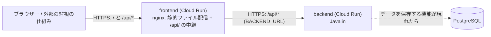

# アプリケーション全体の構成

この文書は、アプリケーション全体の構成を定める。機能ごとの設計は `docs/features/<機能>/architecture.md`、API の契約は [`docs/api/openapi.yaml`](api/openapi.yaml) に書く。アプリケーションのコードは、すべて `app/` の下に置く。

## 1. 技術スタック

既定の技術スタックをそのまま採用する。既定から外れるものは無い。

| 区分 | 採用するもの |
| --- | --- |
| 共通 | Docker、Node.js LTS (npm)、JDK 21 |
| フロントエンド | TypeScript、React、React Router、Tailwind CSS、Radix UI (Primitives)、Vite |
| フロントエンドのテスト・検査 | Vitest、Playwright、dependency-cruiser、Oxc (oxfmt、oxlint) |
| バックエンド | Java 21、Javalin、PostgreSQL、jOOQ、Gradle |
| バックエンドのテスト・検査 | JUnit、Testcontainers、ArchUnit、Spotless |
| デプロイ | フロントエンド、バックエンドとも Cloud Run (別々のサービス) |

JSON の読み取りには、Jackson (`jackson-databind`) をバックエンドの依存に加える (greeting が最初の利用)。Javalin 6 は JSON の処理を同梱せず、Jackson を JSON の既定の処理として自動で使うため、これを選んだ。

PostgreSQL と jOOQ は、データを保存する機能が現れた時点で導入する。データを持たない最初の機能 (health-check) では、依存に加えず、起動時にも接続しない。

## 2. 使い方の選択

| 項目 | 選択 | 理由 |
| --- | --- | --- |
| React Router | SPA として使う (library モード、`createBrowserRouter`)。サーバーサイドレンダリングはしない | バックエンドを Javalin の API に専念させ、画面は静的ファイルとして配信できるため |
| フロントエンドの配信 | `vite build` の成果物を、nginx の入ったコンテナーで配信する。存在しないパスは `index.html` に戻す (SPA のフォールバック)。`/api/` で始まる要求は、環境変数 `BACKEND_URL` (バックエンドの HTTPS の URL) へ中継する。nginx は TLS の SNI を送り、`Host` を `BACKEND_URL` のホストにそろえる | 画面と API を同じ origin にでき、CORS の設定が不要になるため。Cloud Run の URL への接続には HTTPS が必要なため |
| 開発時の API | Vite の開発サーバーの `server.proxy` で、`/api` をバックエンド (`http://localhost:8080`) へ中継する | 本番と同じく、画面から相対パスで API を呼べるため |
| API の形式 | JSON。契約は OpenAPI 3 で 1 ファイルに書く | 契約を 1 か所に集め、テストと実装の拠り所にするため |
| バックエンドの HTTP | Javalin (組み込みの Jetty)。ポートは環境変数 `PORT` (既定 8080) | Cloud Run が `PORT` を渡すため |
| スタイル | Tailwind CSS。ボタンなど操作の部品は Radix UI の Primitives を使う | 既定の技術スタックに従う |
| データへのアクセス | jOOQ を使う (導入は最初にデータを保存する機能から) | 必要になるまで依存を増やさないため |

## 3. `app/` の中の分け方

小さいうちは、フロントエンドとバックエンドの 2 つに分ける。機能が増えたら、各モジュールの中を機能ごとのパッケージ (ディレクトリ) に分ける。

```text
app/
├── frontend/                    # npm プロジェクト (Vite、React)
│   ├── package.json
│   ├── Dockerfile / nginx.conf.template
│   ├── src/
│   │   ├── main.tsx             # 起動。ルーターを描画する
│   │   ├── routes/              # 経路の定義 (router.tsx) と、全画面共通の枠 (RootLayout.tsx)。画面の組み立てだけを書く
│   │   ├── features/<機能>/     # 機能ごとの画面、API の呼び出し、判定。例: features/health/、features/copyright-footer/
│   │   └── shared/              # 機能をまたいで使う部品 (UI の部品、共通の関数)
└── backend/                     # Gradle プロジェクト (Java 21、Javalin)
    ├── build.gradle.kts / settings.gradle.kts
    ├── Dockerfile
    └── src/
        ├── main/java/com/example/app/
        │   ├── Application.java       # 起動と組み立て (Javalin の生成、経路の登録)
        │   └── <機能>/                # 機能ごとのパッケージ。例: health
        └── test/java/com/example/app/
```

- 画面や API を外から確かめる受け入れテスト (Playwright) は、`app/` の外の `acceptance/` に置く。`app/` の中に置くテストは単体テストだけとし、フロントエンドは `src/` の `*.test.ts(x)`、バックエンドは `src/test/` に置く
- 全画面に共通する表示 (フッターなど) は、`routes/RootLayout.tsx` が、すべての経路の親として組み込む。部品そのものは `features/<機能>/` に置き、`RootLayout` は並べるだけにする。画面が増えても、子の経路として追加すれば共通の表示が付く
- バックエンドの基底のパッケージは `com.example.app` とする
- 機能ごとのパッケージの中は、外部との境界 (Javalin の `Handler`) と、機能の処理 (Javalin に依存しない Java のクラス) に分ける
- 機能をまたぐモジュールの分割 (Gradle のマルチプロジェクトなど) は、機能が増えて必要になったときに別の設計で決める
- モジュール間の依存を検査するルールは、`app/` の外の `architecture-rules/` に置く (後の段階で作る)

## 4. モジュール間の依存の向き

後の段階で、ArchUnit (Java) と dependency-cruiser (TypeScript) のルールに書き起こす。以下の「依存」は、import (Java は参照するクラス) を指す。

### 4.1 フロントエンド (TypeScript)

名前は `app/frontend/src/` からの相対パスで表す。

| モジュール | 依存してよいもの | 依存してはいけないもの |
| --- | --- | --- |
| `main.tsx` | `routes`、`shared` | `features` への直接の依存 |
| `routes` | `features/*`、`shared` | |
| `features/<A>` | 同じ `features/<A>` の中、`shared` | `routes`、別の機能 `features/<B>` |
| `shared` | `shared` の中だけ | `routes`、`features` |

- `main.tsx`、`routes`、`features`、`shared` 以外のモジュールの追加は、全体の構成を変える変更として扱う
- 循環する依存を禁止する
- `*.test.ts(x)` は、`src` の任意のモジュールに依存してよい。`src` の本体のコードから、テストファイルへは依存しない
- 外部のパッケージは、`package.json` に宣言されたものだけを使う (未宣言の依存を禁止する)

### 4.2 バックエンド (Java)

| パッケージ | 依存してよいもの | 依存してはいけないもの |
| --- | --- | --- |
| `com.example.app` (`Application`) | `com.example.app.<機能>` のすべて、Javalin | |
| `com.example.app.<機能A>` | 同じ機能のパッケージの中、Java 標準ライブラリー、Javalin (境界のクラスだけ)、Jackson (`com.fasterxml.jackson..`。境界のクラスだけ) | `com.example.app` 直下のクラス (`Application`)、別の機能 `<機能B>` のパッケージ |

- 機能の処理のクラス (境界のクラス以外) は、Javalin (`io.javalin..`) と Jackson (`com.fasterxml.jackson..`) に依存しない
- `com.example.app.greeting..` も、`health` と同じく、データベースに関わるもの (`java.sql..`、`javax.sql..`、`org.jooq..`、`org.postgresql..`) に依存しない (greeting の NFR-4 を機械的に守るため)
- `com.example.app.health..` は、データベースに関わるもの (`java.sql..`、`javax.sql..`、`org.jooq..`、`org.postgresql..`) に依存しない (health-check の NFR-1 を機械的に守るため)
- `com.example.app.textlength..` も、同じく、データベースに関わるもの (`java.sql..`、`javax.sql..`、`org.jooq..`、`org.postgresql..`) に依存しない (text-length の NFR-4 を機械的に守るため)
- 機能の名前にハイフンを含む場合、Java のパッケージ名はハイフンを除いてつなぐ (例: 機能 `text-length` は `textlength`)。フロントエンドのディレクトリは機能の名前のまま (`features/text-length/`) とする
- 循環する依存を禁止する (パッケージの間、機能どうしの間)
- 環境変数の読み取り (`System.getenv`) は、`Application` だけに許す。機能のパッケージは、値を引数で受け取る

## 5. デプロイと実行の構成



- 利用者と外部の監視の仕組みは、フロントエンドのサービスの URL だけを使う。`/api/` で始まる要求はバックエンドへ中継される
- フロントエンドからバックエンドへの中継も HTTPS で行う。Cloud Run の既定の URL (`https://<サービス名>-<ハッシュ>.<リージョン>.run.app`) は HTTP を受けないため、`BACKEND_URL` には、この HTTPS の URL を指定する
- バックエンドの Cloud Run サービスは、認証なしの呼び出しを許可してデプロイする (`--allow-unauthenticated`、IAM の `allUsers` に `roles/run.invoker`)。FR-3 により、外部の監視の仕組みも呼べる必要があるため。この場合、nginx は ID トークンを付けずに中継する。将来、バックエンドを認証必須にする機能が現れたら、その機能の設計で、フロントエンドが ID トークンを付ける仕組みを決める
- 各サービスは Docker イメージとして作り、Cloud Run にデプロイする
- 環境ごとの設定は、環境変数で渡す (フロントエンド: `BACKEND_URL` (HTTPS の URL)、バックエンド: `PORT`)

## 6. 機能の一覧

| 機能 | 設計 | API |
| --- | --- | --- |
| health-check | [architecture.md](features/1-health-check/architecture.md) | `GET /api/health` |
| copyright-footer | [architecture.md](features/25-copyright-footer/architecture.md) | なし (フロントエンドだけの機能) |
| greeting | [architecture.md](features/42-greeting/architecture.md) | `POST /api/greeting` |
| text-length | [architecture.md](features/60-text-length/architecture.md) | `POST /api/text-length` |
