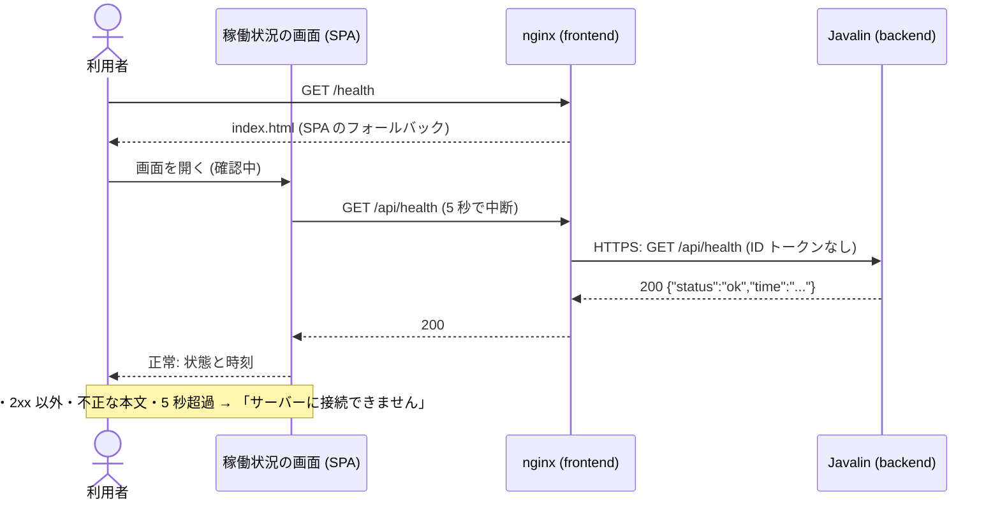

# アーキテクチャ: サーバーの稼働状況の確認

[要件定義書](requirements.md)、[仕様書](specification.md)、[概念モデル](domain-model.md) をもとに、この機能の設計を定める。全体の構成は [`docs/architecture.md`](../../architecture.md)、API の契約は [`docs/api/openapi.yaml`](../../api/openapi.yaml) にある。

## 1. 全体の構成との関係

- この機能は、リポジトリの最初の機能であり、全体の構成 (`docs/architecture.md`) を新しく作る契機になった。既存の構成を変える点は無い
- 関わるモジュールは、フロントエンド (`app/frontend`、`features/health`) とバックエンド (`app/backend`、`com.example.app.health`) の 2 つ
- 既存の API のパスは無いため、既存の機能への影響は無い
- データの保存先 (PostgreSQL) は使わない。全体の構成が定める PostgreSQL と jOOQ は、この機能では導入しない
- 後の段階で作るプロジェクトの土台は、全体の構成の 3 章のディレクトリに従う。この機能では、その最初の中身として `main.tsx`、`routes`、`features/health`、`shared`、`Application`、`health` を作る

## 2. 構成要素とやり取り

| 構成要素 | 置き場所 | 役割 |
| --- | --- | --- |
| 稼働状況の画面 | `app/frontend/src/features/health/` | `/health` の画面。取得の実行、判定、表示 |
| 経路の定義 | `app/frontend/src/routes/` | `/health` を稼働状況の画面に結びつける |
| フロントエンドのサーバー | `app/frontend` の Docker イメージ (nginx) | 静的ファイルの配信、SPA のフォールバック、`/api/` の中継 |
| 稼働状況の API | `app/backend/src/main/java/com/example/app/health/` | `GET`/`HEAD /api/health` に応答する |
| 起動と組み立て | `app/backend/.../Application.java` | Javalin の生成、経路と 405 の登録、500 の処理 |

外部の監視の仕組みは、同じ `/api/health` を直接呼び出す。画面は経由しない。

### 2.1 フロントエンドの内部

`features/health/` には次のファイルを置く。

| ファイル | 内容 |
| --- | --- |
| `HealthPage.tsx` | 画面。状態に応じて「確認中」、状態と時刻、エラーの文言を表示する。「再読み込み」ボタン (Radix UI の Primitives と Tailwind CSS) を置く |
| `useHealthCheck.ts` | 画面が持つ状態 (`checking`、`ok`、`unreachable`) と、`reload` を提供するフック。画面を開いたときに 1 回取得する。取得中の `reload` は無視する。アンマウント時に進行中の取得を中断する |
| `fetchHealth.ts` | `fetch('/api/health')` を呼ぶ。`AbortController` で 5 秒 (`5000` ミリ秒) を過ぎたら中断する。結果を `{ status: 'ok', time }` として返すか、失敗を表す例外を投げる |
| `parseHealthResult.ts` | 2xx 以外、JSON として読めない本文、`status` が `ok` でない、`time` が `^\d{4}-\d{2}-\d{2}T\d{2}:\d{2}:\d{2}Z$` に合わない場合を失敗として扱う、純粋な関数 |

- 画面が持つ状態の遷移は、仕様書の 4.5 に従う。「確認中」の間は「再読み込み」ボタンを押しても何もしない (ボタンは `disabled` にせず、押下を無視する。または `aria-disabled` を付ける。どちらでも、新しい取得を始めない)
- 取得を始めるとき、前回の状態と時刻、エラーの表示を消す
- 時刻は、受け取った文字列をそのまま表示する。変換しない
- 一定時間ごとの自動取得はしない
- 文言は固定: 見出し「稼働状況」、ラベル「状態」「時刻」、ボタン「再読み込み」、確認中の表示「確認中」、エラー「サーバーに接続できません」

### 2.2 バックエンドの内部

`com.example.app.health` には次のクラスを置く。

| クラス | 内容 |
| --- | --- |
| `HealthResult` | `record HealthResult(String status, String time)`。結果を表す。`status` は常に `ok` |
| `HealthService` | `Clock` を受け取り、`HealthResult check()` を返す。現在時刻を秒に切り捨て、`DateTimeFormatter.ofPattern("yyyy-MM-dd'T'HH:mm:ss'Z'")` を UTC で適用する。Javalin にも DB にも依存しない |
| `HealthHandler` | Javalin の `Handler`。`GET` では `HealthService` の結果を JSON (`Content-Type: application/json`) で 200 で返す。`HEAD` では同じ状態コードとヘッダーで本文を付けない |

- `Application` が、`Clock.systemUTC()` を使った `HealthService` を組み立て、`GET` と `HEAD` の `/api/health` を登録する
- `GET`/`HEAD` 以外のメソッドが `/api/health` に来たときは、405、`Allow: GET, HEAD`、空の本文を返す。この処理は `Application` で登録する (Javalin の既定の 404 や 405 の本文に頼らない)
- 予期しない例外は `Application` の例外ハンドラーで 500、空の本文にする。例外の内容はクライアントに返さない
- クエリ文字列と本文は読まない
- JSON の組み立ては、項目が 2 つだけなので、Javalin に同梱の Jackson を使うか、固定の書式の文字列で作る。実装で選んでよいが、本文の項目は `status` と `time` だけにする

## 3. 概念モデルとの対応

| 概念 | 対応するもの |
| --- | --- |
| 利用者 | ブラウザー。`app/frontend` の画面を使う |
| 外部の監視の仕組み | 構成要素の外。`/api/health` を直接呼ぶ |
| サーバー | バックエンドの Javalin のプロセス (Cloud Run のサービス) |
| 稼働状況 | データとしては持たない。要求に応答できること自体 |
| 依存するもの | この機能では無い。`health` パッケージは DB に関わるものへ依存しない (全体の構成 4.2) |
| 稼働状況の API | `HealthHandler`、`HealthService`。状態を持たない |
| 要求、応答 | HTTP の要求と応答。`HEAD`、405、500 は本文なしの応答 |
| 結果 | `HealthResult` (バックエンド)、`parseHealthResult` が返す値 (フロントエンド) |
| 稼働状況の画面 | `HealthPage` と、経路 `/health` |
| 画面が持つ状態 | `useHealthCheck` の状態 (`checking`、`ok`、`unreachable`)。結果の `status` の `ok` とは別に扱う |
| 取得 | `useHealthCheck` の取得の処理と `fetchHealth`。同時に進行するのは 1 つまで。待ち時間の上限は 5 秒 |

状態の遷移は画面だけにあり、タブごとに別の状態を持つ (状態をタブの間で共有しない。ブラウザーの保存先にも書かない)。

## 4. API

契約は [`docs/api/openapi.yaml`](../../api/openapi.yaml) の `/api/health` に書いた。

| メソッド | パス | 応答 |
| --- | --- | --- |
| `GET` | `/api/health` | 200 `{"status":"ok","time":"YYYY-MM-DDTHH:mm:ssZ"}`、`Content-Type: application/json` |
| `HEAD` | `/api/health` | `GET` と同じ状態コードとヘッダー。本文なし |
| 上記以外 | `/api/health` | 405、`Allow: GET, HEAD`、本文なし |
| (内部エラー) | `/api/health` | 500、本文なし |

- 認証は無く、401 と 403 は返さない
- 画面の経路 `/health` は画面の経路であり、API の契約には含めない
- OpenAPI では、定義されていないメソッドの応答を表せない。そのため、`GET` と `HEAD` 以外で OpenAPI に書けるメソッド (`post`、`put`、`patch`、`delete`、`options`、`trace`) のそれぞれに 405 を定義した。`GET` の定義には 405 を置かない
- 一覧にない `CONNECT` などのメソッドは契約に表せない。405 を返す処理は `Application` で登録し、説明文で補う

## 5. データの持ち方

- 保存するデータは無い。データベース、ファイル、ブラウザーの保存先 (`localStorage` など) を使わない
- 結果は、要求ごとに作って返し、保存しない。履歴も持たない
- 結果の構造は次のとおり。

| 項目 | 型 | 内容 |
| --- | --- | --- |
| `status` | 文字列 | 常に `ok` |
| `time` | 文字列 | 応答を作った時刻。UTC の `YYYY-MM-DDTHH:mm:ssZ` (20 文字) |

## 6. 非機能要件への対応

| 要件 | 満たす仕組み |
| --- | --- |
| NFR-1: 依存するものに接続しない | `HealthService` は `Clock` だけに依存する。`health` パッケージが `java.sql..`、`javax.sql..`、`org.jooq..`、`org.postgresql..` に依存しないことを ArchUnit で確かめる。この機能では DB のライブラリーを依存に加えず、バックエンドは起動時にも DB に接続しない。DB を使う機能が現れた後も、`health` パッケージからは使わない。DB が止まっても結果が変わらないことは、受け入れテストで確かめる |
| NFR-2: 1 秒以内に応答する | 処理は現在時刻の整形だけで、入出力も外部への接続も無い。nginx の中継の待ち時間 (`proxy_read_timeout`) は、画面の待ち時間と同じ `5s` とする。Cloud Run のコールドスタートによる遅れは、最小インスタンス数を 1 にして避ける。API のテストで、応答が 1 秒以内に完了することを確かめる |
| NFR-3: 内部の情報を含めない | `HealthResult` の項目は `status` と `time` だけ。500 と 405 は本文を空にする。例外ハンドラーは例外の内容を書かない。`Server` ヘッダーなど、サーバーが自動で付けるヘッダーのバージョンは、nginx で `server_tokens off` にして隠す。受け入れテストで、本文の項目が 2 つだけであることを確かめる |
| FR-3: 認証なしで呼べる | 認証の仕組みを入れない。nginx も認証を求めない。バックエンドの Cloud Run サービスは認証なしの呼び出しを許可し、nginx は ID トークンを付けずに HTTPS で中継する (全体の構成 5 章)。外部の監視の仕組みは、フロントエンドの URL に加えて、バックエンドの HTTPS の URL へも直接呼べる |
| FR-5: 接続できないとき | `fetchHealth` の失敗 (接続失敗、切断、2xx 以外、不正な本文、5 秒超過) を、すべて「接続できない」に集約する |
| 運用 (前提: 小さな機能) | Cloud Run の起動時のヘルスチェック (起動プローブ) には、バックエンドの `/api/health` を使える。ログには要求の行 (メソッド、パス、状態コード) だけを書き、結果の本文は書かない |

## 7. テストの方針

後の段階で、これをもとにテストを書く。

| 対象 | 種類 | 内容 |
| --- | --- | --- |
| `HealthService` | JUnit | 固定した `Clock` で、`time` が 20 文字で、小数秒が無く、`Z` で終わり、秒に切り捨てられること。UTC であること |
| バックエンドの API | JUnit (Javalin のテストツール) | 200 と本文、`HEAD`、405 と `Allow`、クエリ文字列と本文の無視、500 の本文が空、項目が 2 つだけ |
| 構造 | ArchUnit | 全体の構成 4.2 のルール |
| `parseHealthResult`、`useHealthCheck` | Vitest | 正常、2xx 以外、不正な JSON、不正な `status`、不正な `time`、5 秒超過、取得中の再読み込みの無視、再読み込み後の表示の更新 |
| 画面 | Playwright | 実際のバックエンドとフロントエンドを起動し、正常の表示、バックエンドを止めたときの表示、「再読み込み」で表示が更新されること |
| 構造 | dependency-cruiser | 全体の構成 4.1 のルール |

## 8. 判断の理由

| 判断 | 理由 | 採らなかった選択肢 |
| --- | --- | --- |
| React Router を SPA (library モード) で使う | 画面は 1 つで、サーバー側で描画する必要が無い。バックエンドを API だけにできる | フレームワークのモード (SSR)。Node.js のサーバーが増え、運用の負担が大きい |
| フロントエンドを nginx で配信し、`/api/` を HTTPS で中継する | 画面と API が同じ origin になり、仕様書の「同じサーバーの `/api/health`」に合う。CORS が不要になる。フロントエンドとバックエンドを独立してデプロイできる (全体の構成の 1 章で、それぞれ Docker イメージを作って Cloud Run にデプロイすると定めたため)。画面の変更でバックエンドを再デプロイせず、逆も同じ | 別の origin から直接呼ぶ: CORS の設定が必要で、画面の接続設定が環境ごとに変わる。Javalin で静的ファイルも配信する: Cloud Run のサービスが 1 つで、nginx と中継の HTTPS の経路が要らず、運用は単純になる。ただし、画面を変えるたびにバックエンドも再デプロイする必要があり、配信の責務が API のプロセスに入る。全体の構成で 2 つを別々にデプロイすると定めたため、この案は採らない |
| `HealthService` を Javalin から分ける | 時刻の整形を、HTTP なしで JUnit で確かめるため | `Handler` の中に直接書く。テストで HTTP が必須になる |
| `Clock` を渡す | 時刻を固定してテストするため | `Instant.now()` を直接呼ぶ。時刻の検証が不安定になる |
| 時刻を秒に切り捨てる | 仕様書の 2.2 が小数秒を付けないと定めているため。切り上げると未来の時刻になる | 四捨五入、小数秒つき |
| 405 と 500 を `Application` に集める | メソッドの制御と例外の処理は、機能をまたぐ関心事であり、機能のパッケージが Javalin の設定を持たないようにするため | 機能ごとに登録する。機能が増えたときに、処理が重複する |
| DB を導入しない | この機能にデータが無く、NFR-1 を機械的に守りやすい | 先に PostgreSQL と jOOQ を土台に入れる。使わない依存が増える |
| 画面の取得を `fetch` と `AbortController` で書く | 標準の機能で足り、5 秒の中断を直接書ける | データ取得のライブラリー (TanStack Query など)。この機能の規模には過剰 |
| 自動取得 (ポーリング) をしない | 仕様書の 4.3 が、開いたときとボタンのときだけと定めているため | 一定時間ごとの取得 |
