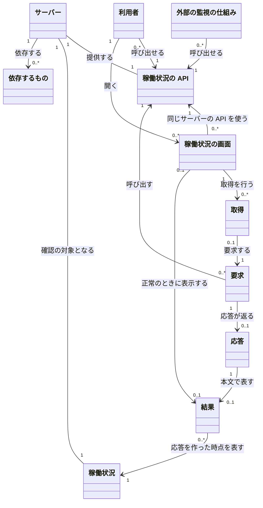

# 概念モデル: サーバーの稼働状況の確認

## 1. 対象と読み方

[仕様書](specification.md) をもとに、サーバーの稼働状況を確かめるための概念、関係、制約を定める。用語は仕様書と、仕様書が参照する [要件定義書](requirements.md) の 3 章に従う。

「結果」は正常な稼働状況を表す情報であり、「応答」は要求に対して返されるものを指す。本文が空の応答や、応答が返らない場合に、異常を表す結果を新たに設けない。また、結果の「状態」と、画面が持つ状態は区別する。

以下の多重度は、この機能で対象とするサーバー、API、画面の関係を表す。サーバーの配備構成や、データの保存方法は表さない。画面はタブごとに別のものとして扱う。

## 2. 概念の一覧

| 名前 | 意味 | 主な属性 |
| --- | --- | --- |
| 利用者 | ブラウザーでアプリケーションを使い、稼働状況を確かめる人。ログインの有無を問わない | この機能で管理する属性は無い |
| 外部の監視の仕組み | 稼働状況の API を直接呼び出し、サーバーが応答できるかを確かめる役割 | この機能で管理する属性は無い |
| サーバー | このアプリケーションの要求を受けて応答する対象 | 稼働状況 |
| 稼働状況 | サーバーが要求に応答できる状態かどうか。依存するものの詳しい状態は含めない | 応答できるかどうか。応答できない場合の結果の値は定めない |
| 依存するもの | データベースなど、サーバーが依存する対象。稼働状況の確認では接続しない | この機能で取得する属性は無い |
| 稼働状況の API | サーバーの稼働状況を、要求ごとに応答する機能 | 経路: `/api/health`。自身では状態を持たない |
| 要求 | 稼働状況の API を呼び出すこと | メソッド、パス。クエリ文字列と本文は、付いていても値を使わない |
| 応答 | 要求に対して返されるもの。要求が届かない場合やサーバーが停止している場合には返らない | 状態コード、ヘッダー、本文の有無。成功した `GET` の本文は結果を表す |
| 結果 | 応答を作った時点で、サーバーが正常に応答できることを表す情報 | 状態 (`status`): 文字列 `ok`。時刻 (`time`): 応答を作った時刻を表す文字列 |
| 稼働状況の画面 | 利用者が開き、同じサーバーの API から取得した結果を表示する画面 | 経路: `/health`。画面が持つ状態: 「確認中」「正常」「接続できない」。表示する状態と時刻、またはエラーの文言。「再読み込み」ボタン |
| 取得 | 画面を開いたとき、または「再読み込み」ボタンを押したときに、API を呼び出して応答を判定する一連の動作 | 開始の契機、待ち時間の上限: 5 秒。判定が完了するまでは取得中 |

結果の状態と時刻は、結果を構成する値として扱う。画面が持つ状態や「再読み込み」ボタンも、画面の属性・操作として扱い、独立した概念にはしない。

## 3. 概念どうしの関係

### 3.1 全体図

図の英字は Mermaid の識別子であり、表示名が概念の名前である。`0..*` は 0 個以上、`0..1` は 0 個または 1 個を表す。

### 3.2 関係の意味と多重度

| 関係 | 多重度と意味 |
| --- | --- |
| 利用者・外部の監視の仕組み → 稼働状況の API | 1 つの API を、0 人以上の利用者と 0 個以上の監視の仕組みが呼び出せる。どちらも認証を必要としない |
| 利用者 → 稼働状況の画面 | 利用者は 0 個以上の画面を開ける。各画面は、1 人の利用者が 1 つのタブで開いたものとして扱う。利用者の識別や認証を要求する関係ではない |
| サーバー → 稼働状況の API・稼働状況 | 対象の 1 つのサーバーについて、稼働状況と、それを返す API をそれぞれ 1 つ扱う |
| サーバー → 依存するもの | 対象の 1 つのサーバーには 0 個以上の依存するものがあり得る。API は依存するものに接続せず、その状態を結果に含めない。この関係は対象サーバーの依存先だけを表す |
| 稼働状況の画面 → 稼働状況の API | 各画面が使うのは同じサーバーの 1 つの API であり、1 つの API を 0 個以上の画面が使える |
| 要求 → 稼働状況の API | 各要求の対象は 1 つの API。API は 0 個以上の要求を独立して扱い、要求数の上限を設けない |
| 要求 → 応答 | 1 つの要求に応答は最大 1 つ。取得中、サーバーの停止、要求が届かない場合など、応答が無い場合もある。各応答は 1 つの要求に対応する |
| 応答 → 結果 | 1 つの応答の本文が表す結果は最大 1 つ。成功した `GET` は 1 つの結果を表し、`HEAD`、405、500 の応答は結果を含まない。各結果は 1 つの応答で表される |
| 結果 → 稼働状況 | 各結果は、対象のサーバーの稼働状況を、応答を作った時点について表す。同じサーバーでも要求ごとに結果を作る。この関係は履歴の保存を意味しない |
| 稼働状況の画面 → 取得 → 要求 | 画面は開いたときと、受け付けた「再読み込み」ボタンの押下ごとに取得を行う。各取得は 1 つの画面に属し、1 つの要求を行う。画面の取得に属さない直接の API 要求もあるため、要求に対応する取得は 0 個または 1 個 |
| 稼働状況の画面 → 結果 | 各画面が同時に表示する結果は最大 1 つ。「正常」のときだけ、その画面の今回の取得に対応する結果を表示する。各結果を表示する画面も最大 1 つであり、直接の API 呼び出しで得た結果など、画面に表示しない結果もある |

画面と取得の `0..*` は、開いてから繰り返し取得できることを表す。同時に進行できる取得は、1 つの画面につき最大 1 つである。過去の取得や結果を保存することは、このモデルに含めない。

## 4. 制約

### 4.1 稼働状況・API・結果

| 番号 | 常に満たす条件 | 仕様書の対応箇所 |
| --- | --- | --- |
| C-1 | 稼働状況はサーバー自身が応答できるかを表す。API は依存するものに接続せず、データの読み書きや状態の変更を行わない。依存するものの障害でも、応答できれば通常の結果を返す | 3.1、3.2 |
| C-2 | 成功した `GET /api/health` は、状態コード 200、`Content-Type: application/json` で、結果を返す。本文の項目は `status` と `time` の 2 つだけで、値はいずれも文字列。状態は大文字と小文字を区別した `ok` だけとし、異常を表す状態の値は設けない | 2.1、3.1、5、6 |
| C-3 | 結果の時刻は応答を作るときの現在時刻であり、要求の開始時刻や画面が受信した時刻ではない。UTC の ISO 8601 形式の `YYYY-MM-DDTHH:mm:ssZ` とし、秒までの 20 文字で、小数秒を付けず、末尾は `Z` とする | 2.2、3.1、5 |
| C-4 | 結果やエラー応答に、バージョン、構成、環境変数、例外の内容など、サーバーの内部の情報を含めない | 3.1、3.2 |
| C-5 | API の応答は要求を受けてから 1 秒以内に完了する。1 秒ちょうどは条件を満たし、1 秒を超えれば API 側の不具合となる | 3.1、5 |
| C-6 | `HEAD` は `GET` と同じ状態コードとヘッダーを返し、本文を付けない。`GET` と `HEAD` 以外のメソッドは 405 と `Allow: GET, HEAD` を返し、本文を空にする。予期しない内部エラーは 500 とし、本文を空にする。サーバーの停止や要求が届かない場合は応答自体が無い | 3.2、6 |
| C-7 | クエリ文字列や本文は、不正な値も含めて無視し、通常どおり応答する。クエリ文字列の長さに機能としての上限を設けない。ただし、サーバーの既定の上限を超えた要求と、`/api/health` 以外のパスは仕様の対象外 | 3.1、3.2、5 |
| C-8 | API は認証や権限によって拒否せず、401 や 403 を返さない。ログインの有無や、利用者・外部の監視の仕組みという違いで結果を変えない | 3.3 |
| C-9 | API は状態を持たない。同時の要求も互いに影響せず、各要求の応答を独立して作る。同時の要求数に上限を設けない | 3.4、5 |

### 4.2 画面・取得

| 番号 | 常に満たす条件 | 仕様書の対応箇所 |
| --- | --- | --- |
| C-10 | 画面はログインなしで開ける。入力欄は無い。開いたときに同じサーバーの `/api/health` を呼び出し、ブラウザーの再読み込みも画面を開く操作として扱う | 2.1、4.1、4.3、6 |
| C-11 | 画面が持つ状態は「確認中」「正常」「接続できない」のいずれか 1 つだけ。結果の状態 `ok` と、画面の状態「正常」は区別する | 4.1、4.5 |
| C-12 | 取得を始めると、前回の状態と時刻、またはエラーの表示を消して「確認中」にする。「確認中」の間は新しい取得を始めず、「再読み込み」ボタンの押下を無視する。取得完了後の押下回数に上限は設けない | 4.2、4.4、4.5、5 |
| C-13 | 画面は、5 秒以内に応答が完了し、状態コードが 2xx で、本文を JSON として読め、`status` が `ok`、`time` が C-3 の形式であるときに正常として扱う。API の 1 秒という応答条件を超えても、5 秒以内の正しい応答なら画面は正常として扱う | 4.1、4.4、4.5、5 |
| C-14 | 接続失敗、通信途中の切断、2xx 以外の状態コード、JSON として読めない本文、不正な `status` または `time` は、いずれも「接続できない」とする。5 秒を経過しても応答が完了しない場合は取得を中断し、同じ状態にする | 4.1、4.4、4.5、5 |
| C-15 | 「正常」のときは「状態」として受け取った `status` を、「時刻」として受け取った `time` を表示する。時刻は変換せず、受け取った UTC の表記のまま表示する。「確認中」の表示は消す | 4.1、4.2 |
| C-16 | 「接続できない」のときの結果表示は「サーバーに接続できません」だけとし、状態と時刻を表示しない。前回が正常でも、その結果を残さない | 4.1、4.2、4.4 |
| C-17 | 取得の契機は、画面を開く操作と、取得中でないときの「再読み込み」ボタンの押下だけ。一定時間ごとの自動取得は行わない。別のタブの画面は、取得と表示を独立して行う | 4.2、4.3、4.4、6 |

### 4.3 画面が持つ状態と遷移

| 遷移元 | 契機・条件 | 遷移先 | 結果の扱い |
| --- | --- | --- | --- |
| 開く前 | 画面を開く。ブラウザーの再読み込みを含む | 確認中 | 結果を表示せず、取得を始める |
| 確認中 | C-13 の正常条件を満たす | 正常 | 今回の状態と時刻を表示する |
| 確認中 | C-14 の失敗条件のいずれかに該当する | 接続できない | エラーの文言を表示する |
| 確認中 | 「再読み込み」ボタンを押す | 確認中 | 押下を無視し、進行中の取得を続ける |
| 正常 | 「再読み込み」ボタンを押す | 確認中 | 状態と時刻を消し、新しい取得を始める |
| 接続できない | 「再読み込み」ボタンを押す | 確認中 | エラーの表示を消し、新しい取得を始める |

状態の遷移は画面だけにある。取得の失敗や画面の「接続できない」は、サーバーが停止しているという断定ではない。通信や応答内容に問題がある場合も、同じ表示になる。

## 5. 仕様との対応

| 仕様書の箇所 | 関わる概念 | この文書での対応 |
| --- | --- | --- |
| 1. 要件との対応 | 全概念 | 各仕様項目を通じて FR-1 ～ FR-6、NFR-1 ～ NFR-3 と前提を反映する |
| 2.1 経路 | 稼働状況の API、要求、稼働状況の画面、取得 | 概念の属性、画面と API の関係、C-2、C-10 |
| 2.2 時刻の形式 | 結果、応答、稼働状況の画面 | C-3、C-13 ～ C-15 |
| 3.1 稼働状況を取得する | サーバー、稼働状況、稼働状況の API、要求、応答、結果、依存するもの | 要求・応答・結果の関係、C-1 ～ C-5、C-7 |
| 3.2 異常系 | サーバー、依存するもの、要求、応答、結果 | 結果を含まない応答と応答が無い場合の区別、C-1、C-4、C-6、C-7 |
| 3.3 権限 | 利用者、外部の監視の仕組み、稼働状況の API | 呼び出す役割の関係、C-8 |
| 3.4 同時の要求 | 稼働状況の API、要求、応答、結果 | 要求の多重度と独立性、C-9 |
| 4.1 画面を開く | 利用者、稼働状況の画面、取得、要求、応答、結果 | 画面・取得・結果の関係、C-10 ～ C-16、4.3 節の遷移表 |
| 4.2 「再読み込み」ボタンを押す | 稼働状況の画面、取得、結果 | 同時取得数と表示結果数の上限、C-12、C-15 ～ C-17、4.3 節の遷移表 |
| 4.3 ブラウザーの再読み込み | 稼働状況の画面、取得 | C-10、C-17、4.3 節の遷移表 |
| 4.4 異常系 | 稼働状況の画面、取得、応答、結果、依存するもの | C-12 ～ C-17。API の応答時間と画面の待ち時間、タブ間の独立性を区別する |
| 4.5 状態の遷移 | 稼働状況の画面、取得、結果 | C-11 ～ C-14、4.3 節の遷移表 |
| 5. 境界値 | 要求、応答、結果、稼働状況の画面、取得 | C-2、C-3、C-5、C-7、C-9、C-12 ～ C-14 |
| 6. 仕様で定めた判断 | 稼働状況の API、要求、応答、結果、稼働状況の画面、取得 | 結果と応答の区別、経路、項目、秒の精度、異常時の扱い、5 秒の待ち時間、応答の判定、メソッド、取得の契機、認証不要、要求数の制約を反映する |
| 7. 後の段階への引き継ぎ | 稼働状況の API、稼働状況の画面、結果 | 仕様で決まった経路・応答項目・表示文言を維持する。技術、見た目、API 契約の記述方法は、このモデルでは追加しない |
