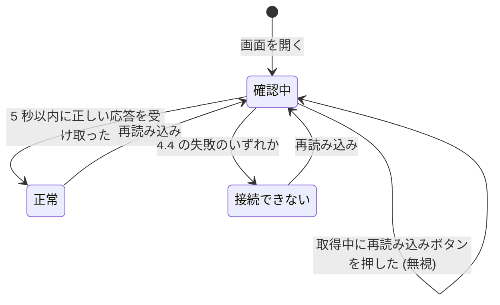

# 仕様書: サーバーの稼働状況の確認

この文書は、要件定義書 (`requirements.md`) をもとに、稼働状況の API と稼働状況の画面が外から見てどう振る舞うかを定める。画面の見た目、技術の選択、データの持ち方は後の段階で決めるため、ここには書かない。用語は要件定義書の 3 章に従う。

## 1. 要件との対応

| 要件 | 要約 | 仕様の該当箇所 |
| --- | --- | --- |
| FR-1 | サーバーが応答できるとき、正常に動いていることを表す結果を返す | 3.1 |
| FR-2 | 結果に、状態 `ok` と、UTC の ISO 8601 形式の応答時刻を含める | 2.2、3.1 |
| FR-3 | ログインしていない利用者や、外部の監視の仕組みからも呼び出せる | 3.3 |
| FR-4 | 画面を開くと API を呼び出し、結果の状態と時刻を表示する | 4.1、4.3 |
| FR-5 | API に接続できないとき、または API がエラーを返したときは「サーバーに接続できません」と表示する | 4.1、4.4 |
| FR-6 | 「再読み込み」ボタンを押すと、結果を取得し直して表示を更新する | 4.2 |
| NFR-1 | データベースなどの依存するものに接続せずに応答する | 3.1、3.2 |
| NFR-2 | 要求を受けてから 1 秒以内に応答する | 3.1、5 |
| NFR-3 | 結果に、サーバーの内部の情報を含めない | 3.1、3.2 |
| 前提 | 利用者は、ブラウザーでアプリケーションを使う | 4.1 |

## 2. 共通の決まり

### 2.1 経路

- 稼働状況の API の経路は `GET /api/health` とする
- 稼働状況の画面の経路は `/health` とする
- 画面は、同じサーバーの `/api/health` を呼び出す

### 2.2 時刻の形式

- 時刻は、UTC の ISO 8601 形式で、`YYYY-MM-DDTHH:mm:ssZ` の形にする (例: `2026-10-16T07:33:00Z`)
- 秒までを表し、小数秒は付けない。末尾は `Z` だけにする
- 長さは常に 20 文字とする

## 3. 稼働状況の API

### 3.1 稼働状況を取得する

- 入力: `GET /api/health`。認証は不要で、本文は無い。クエリ文字列や本文が付いていても、値は使わずに無視する
- 事前の条件: サーバーが要求を受けて、応答を返せること。依存するものの状態は、結果に関係しない
- 処理: 状態は変えない。データは読まず、書かない。応答を作るときの現在の時刻を使う
- 出力 (成功): 状態コード 200、`Content-Type` は `application/json`、本文は次の JSON とする

```json
{"status": "ok", "time": "2026-10-16T07:33:00Z"}
```

| 項目 | 型 | 内容 |
| --- | --- | --- |
| `status` | 文字列 | 常に `ok` |
| `time` | 文字列 | 応答を作った時刻。2.2 の形式 |

- 項目は `status` と `time` の 2 つだけにする。バージョン、構成、環境変数など、ほかの項目は含めない (NFR-3)
- 応答は、要求を受けてから 1 秒以内に完了する (NFR-2)

### 3.2 異常系

| 事象 | 振る舞い |
| --- | --- |
| `GET` と `HEAD` 以外のメソッド (`POST`、`PUT`、`DELETE` など) | 状態コード 405 を返す。`Allow: GET, HEAD` のヘッダーを付け、本文は空にする |
| `HEAD` | `GET` と同じ状態コードとヘッダーを返す。本文は付けない |
| 入力の誤り (クエリ文字列や本文が不正) | 入力は使わないため、無視して通常どおり 200 を返す |
| 依存するものの障害 (データベースが止まっているなど) | API は依存するものに接続しないため、結果は変わらず 200 を返す (NFR-1) |
| 予期しない内部エラー | 状態コード 500 を返す。本文は空にし、例外の内容や内部の情報を含めない (NFR-3) |
| サーバーが停止している、または要求が届かない | 応答は返らない。利用者や監視の側では、接続の失敗になる |
| `/api/health` 以外のパス | この仕様の対象外とする |

### 3.3 権限

- 認証は無く、権限によって拒否する操作は無い
- ログインしているかどうか、ブラウザーか外部の監視の仕組みかに関係なく、同じ結果を返す (FR-3)
- 401 や 403 は返さない

### 3.4 同時の要求

- 稼働状況の API は状態を持たないため、要求どうしは影響しない
- 同時に複数の要求が来ても、要求ごとに独立して 3.1 の応答を返す
- 要求の数に上限は設けない

## 4. 稼働状況の画面

### 4.1 画面を開く

- 入力: ブラウザーで `/health` を開く。入力欄は無い
- 事前の条件: 利用者が、ブラウザーでアプリケーションを開けること。ログインは不要
- 処理:
  1. 画面を「確認中」の状態にする
  2. 同じサーバーの `/api/health` を呼び出す (3.1)
  3. 5 秒以内に応答が完了すれば、その結果で判定する。5 秒を経過しても完了しなければ、失敗として扱う
- 出力 (成功): 次の 2 つを表示し、「確認中」の表示は消す
  - 「状態」として、応答の `status` の値 (`ok`)
  - 「時刻」として、応答の `time` の値。受け取った値のまま表示し、タイムゾーンへの変換はしない (UTC の表記のまま)
- 出力 (失敗): 「サーバーに接続できません」だけを表示する。状態と時刻は表示しない (FR-5)
- 状態の変化: 「確認中」から「正常」または「接続できない」へ移る (4.5)

### 4.2 「再読み込み」ボタンを押す

- 入力: 「再読み込み」ボタンを押す
- 事前の条件: 画面が開いていること。取得中 (「確認中」の状態) でないこと
- 取得中にボタンを押した場合は、何もしない。取得中の結果は、そのまま表示する (4.4 の「取得中の押下」を参照)
- 処理:
  1. 取得を始めた時点で、前回の結果 (状態と時刻、またはエラーの表示) を消し、「確認中」の状態にする
  2. 4.1 の処理の 2 と 3 と同じように、API を呼び出して判定する
- 出力: 4.1 の成功と失敗と同じ。前回が正常でも、今回が失敗なら「サーバーに接続できません」だけを表示し、前回の `ok` と時刻は残さない (FR-6)

### 4.3 ブラウザーの再読み込み

- ブラウザーの再読み込みは、4.1 の画面を開く操作と同じに扱う
- 画面は、開いたときと、「再読み込み」ボタンを押したときだけ API を呼び出す。一定時間ごとに自動で取得し直すことはしない

### 4.4 異常系

| 事象 | 画面の振る舞い |
| --- | --- |
| API に接続できない (サーバーが停止しているなど) | 「サーバーに接続できません」を表示する (FR-5) |
| 通信の途中で切断された | 「サーバーに接続できません」を表示する |
| 5 秒を経過しても応答が完了しない | 取得を中断し、「サーバーに接続できません」を表示する |
| API が 2xx 以外の状態コードを返す (4xx、5xx など) | 「サーバーに接続できません」を表示する (FR-5) |
| 2xx だが、本文が JSON として読めない、`status` が `ok` でない、または `time` が 2.2 の形式でない | 想定と違う応答としてエラーに扱い、「サーバーに接続できません」を表示する |
| 依存するものが障害でも、API が 200 を返した | 正常として、状態と時刻を表示する (API は依存するものの状態を返さないため) |
| 1 秒を超えたが 5 秒以内に応答が完了した | 正常として表示する。1 秒を超えた応答は、NFR-2 に対する API 側の不具合として扱う |
| 取得中に「再読み込み」ボタンを押した | 何もしない。新しい取得は始めず、進行中の取得の結果を表示する |
| 同じ画面を別のタブで開いた | 各タブは独立して動き、互いの結果に影響しない |

### 4.5 状態の遷移

画面が持つ状態は、「確認中」「正常」「接続できない」の 3 つとする。



| 遷移元 | 遷移先 | 条件 |
| --- | --- | --- |
| (開始) | 確認中 | 画面を開く (ブラウザーの再読み込みを含む) |
| 確認中 | 正常 | 5 秒以内に、3.1 の正しい応答 (`status` が `ok`、`time` が 2.2 の形式) を受け取った |
| 確認中 | 接続できない | 4.4 の失敗のいずれか (接続できない、5 秒経過、2xx 以外、想定と違う応答) |
| 正常 | 確認中 | 「再読み込み」ボタンを押した |
| 接続できない | 確認中 | 「再読み込み」ボタンを押した |

- 「確認中」のときの「再読み込み」ボタンは、状態を変えない
- 稼働状況の API は状態を持たず、状態の遷移は画面だけにある

## 5. 境界値

| 項目 | 下限と上限 | 振る舞い |
| --- | --- | --- |
| API の応答時間 | 要求を受けてから 1 秒以内 (1 秒ちょうどを含む) | 1 秒を超えた応答は、NFR-2 に違反する |
| 画面の待ち時間 | 5 秒 | 5 秒を経過しても応答が完了しなければ、取得を中断して「サーバーに接続できません」を表示する |
| 時刻の形式 | 常に 20 文字 (`YYYY-MM-DDTHH:mm:ssZ`)。秒までで、小数秒は無く、末尾は `Z` | 形式が違う応答は、画面では想定と違う応答として失敗に扱う |
| `status` の値 | `ok` だけ。大文字と小文字を区別する | `ok` 以外の値は、画面では想定と違う応答として失敗に扱う |
| 同時の要求の数 | 上限は設けない | 要求ごとに独立して応答する |
| 「再読み込み」の押下 | 取得中は受け付けない。取得が完了すれば、何回でも押せる | 取得中の押下は無視する |
| クエリ文字列の長さ | 上限は設けない | 値は使わずに無視する。ただし、サーバーの既定の上限を超えた要求は、この仕様の対象外とする |

## 6. 仕様で定めた判断

要件定義書に無かったため、この仕様で定めた点を次に挙げる。後の段階は、これらを前提にする。

- 経路は、API が `GET /api/health`、画面が `/health` とする (2.1)
- 応答の項目名は `status` と `time` とする (3.1)。項目は FR-2 の 2 つだけにする (NFR-3)
- 時刻は秒までの精度とする (2.2)
- 異常なときの結果は定めない。要件は正常時の結果だけを定めているため、サーバーが応答できないときは結果を返さず、応答が無いことで表す。画面では、これを「接続できない」として扱う (3.2、4.4)
- 画面の待ち時間は 5 秒とする。要件に上限が無いため、NFR-2 の 1 秒に、通信の遅れの余裕を加えた値とする (5)
- 2xx の応答でも、想定と違う内容は、FR-5 の「エラー」に含めて失敗として扱う (4.4)
- `GET` と `HEAD` だけを受け付け、ほかのメソッドは 405 を返す。`HEAD` は監視の仕組みで使われることがあるため、`GET` と同じ応答にする (3.2)
- 画面は、開いたときと「再読み込み」を押したときだけ取得する。取得の頻度は要件に無いため、自動の取得は行わない (4.3)
- 画面は、ログインしていなくても開ける。要件定義書 3 章の「利用者」の定義に従う (4.1)
- 要求の数に上限は設けない (3.4、5)

## 7. 後の段階への引き継ぎ

- アーキテクチャ設計では、2.1 の経路と、3.1 の応答の項目を、API の契約 (`docs/api/openapi.yaml`) に書く。この仕様にない項目や経路を足さない
- 画面の見た目、技術、画面の作り方は、アーキテクチャ設計で決める。画面に表示する文言 (「状態」「時刻」「確認中」「再読み込み」「サーバーに接続できません」) は、この仕様のとおりにする
- 受け入れテストは、この仕様の 3 章、4 章、5 章の各項目を確かめる
