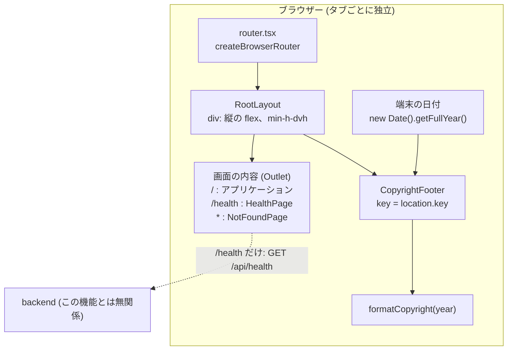
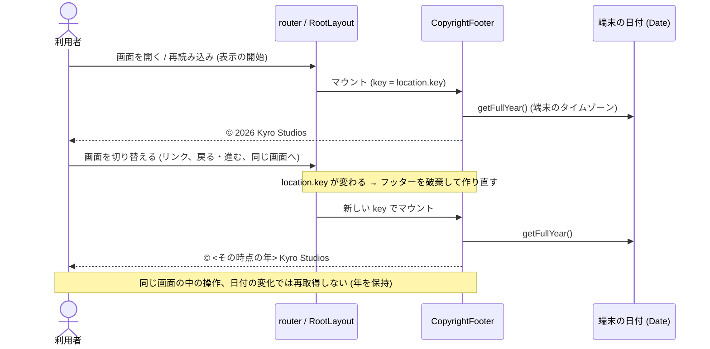

# アーキテクチャ: 著作権の表記のフッター

[要件定義書](requirements.md)、[仕様書](specification.md)、[概念モデル](domain-model.md) をもとに、この機能の設計を定める。全体の構成は [`docs/architecture.md`](../../architecture.md)、API の契約は [`docs/api/openapi.yaml`](../../api/openapi.yaml) にある

## 1. 全体の構成との関係

- この機能は、フロントエンド (`app/frontend`) だけの機能である。バックエンド、データの保存先 (PostgreSQL)、nginx の設定は変えない (要件定義書 2.2、NFR-1)
- 関わるモジュールは、全体の構成 4.1 の `routes` と `features/*` である。`main.tsx` と `shared` は変えない
- 全体の構成 (`docs/architecture.md`) の変更は次のとおり。依存の向きのルール (4.1) は変えず、新しいモジュールの種類も増やさない

| 変更 | 内容 | 理由 |
| --- | --- | --- |
| `routes/RootLayout.tsx` の追加 | 全画面共通の枠を、経路の親として置く | すべての画面に、フッターを 1 つだけ付けるため (3.1) |
| `features/copyright-footer/` の追加 | フッターの部品と年の整形 | フッターの文言と年の決め方を 1 か所に集めるため |
| `features/not-found/` の追加 | 存在しないパスのエラーの画面 | 仕様書 2.1 が、エラーの画面にもフッターを表示すると定めたため。今は React Router の既定のエラー表示で、枠の外に出てしまう |
| 全体の構成から `e2e/` の記載を削除 | 受け入れテストは `app/` の外の `acceptance/` に置く | 受け入れテストの置き場の規約に合わせるため。`app/frontend/e2e/` は実在しないので、コードの変更は無い |

- 既存のパス `/` と `/health` の表示は、フッターが下に付く以外は変わらない。`/health` の `HealthPage` は変えない。ただし `HealthPage` と `/` の画面の外側に、枠の `div` が 1 つ増える
- 既存の API のパスは変えない。既存の機能 (health-check) の API への影響は無い

## 2. 構成要素とやり取り

| 構成要素 | 置き場所 | 役割 |
| --- | --- | --- |
| 経路の定義 | `app/frontend/src/routes/router.tsx` | `RootLayout` を親にし、`/`、`/health`、`*` (上記以外) を子として定義する |
| 全画面共通の枠 | `app/frontend/src/routes/RootLayout.tsx` | 画面の内容 (`<Outlet />`) とフッターを縦に並べる。位置の規則 (仕様書 3.5) を満たす。表示の開始ごとにフッターを作り直す |
| フッター | `app/frontend/src/features/copyright-footer/CopyrightFooter.tsx` | `<footer>` を 1 つ描画する。マウントされた時点の年を保持する |
| 年の整形 | `app/frontend/src/features/copyright-footer/formatCopyright.ts` | 年の数値から、`© <年> Kyro Studios` の文字列を作る純粋な関数 |
| エラーの画面 | `app/frontend/src/features/not-found/NotFoundPage.tsx` | 存在しないパスで表示する。固定の文言だけを持つ |
| 端末の日付 | ブラウザーの `Date` | 年の根拠。サーバーの時刻は使わない |

ブラウザーの外へのやり取りは無い。フッターは、ネットワークに触れない。





### 2.1 フロントエンドの内部

```tsx
// routes/router.tsx (形)
createBrowserRouter([
  {
    element: <RootLayout />,
    children: [
      { path: "/", element: <p className="p-4">アプリケーション</p> },
      { path: "/health", element: <HealthPage /> },
      { path: "*", element: <NotFoundPage /> },
    ],
  },
]);

// routes/RootLayout.tsx (形)
function RootLayout() {
  const location = useLocation();
  return (
    <div className="flex min-h-dvh flex-col">
      <div className="flex-1"><Outlet /></div>
      <CopyrightFooter key={location.key} />
    </div>
  );
}

// features/copyright-footer/CopyrightFooter.tsx (形)
function CopyrightFooter() {
  const [year] = useState(() => new Date().getFullYear());
  return <footer className="p-4 text-center text-sm">{formatCopyright(year)}</footer>;
}
```

- `formatCopyright(year: number): string` は、`© ${String(year).padStart(4, "0")} Kyro Studios` を返す。0 から 999 は先頭を 0 で埋め、10000 以上は切り詰めない。負の年は仕様書で表示の方法を定めていないため、特別な扱いはしない (テストもしない)
- フッターの高さの規則 (仕様書 3.5) は、CSS だけで満たす。JavaScript で高さを測らない
  - `div` (枠) に `min-h-dvh` と縦の `flex` を指定し、内容を包む `div` に `flex-1` を指定する。C + F が V 以下のときは、内容の領域が余白を埋め、フッターの下端が表示領域の下端に合う。C + F が V を超えるときは、枠が内容に合わせて伸び、フッターは内容の直後に来る。ちょうど V のときも、両方の条件を満たす
  - フッターには `position: fixed` や `sticky` を使わない
  - 文字列は `<footer>` の中のテキストで、折り返しを許す (`whitespace-nowrap`、`overflow-hidden`、`truncate` を指定しない)。折り返しによる F の変化も、CSS が自然に反映する
- `<footer>` を `<main>` の外に置く。`RootLayout` が描画する `<footer>` は、`<main>`、`<article>`、`<section>` などの中に入らない。ブラウザーはこれを `contentinfo` のランドマークとして扱う。`role="contentinfo"` を重ねて書かない。`aria-hidden`、`tabindex` も付けない
- `/` の画面の `<p>` は、本文の領域 (`<main>`) になっていない。後の段階で、`<main className="p-4">アプリケーション</main>` に直す (フッターを本文の領域の外に置く条件を、画面の側で確かめられるようにするため)。見た目は変えない
- `NotFoundPage` は `<main>` の中に、固定の文言を表示する。文言は「ページが見つかりません」とする。仕様書に文言の指定が無いため、この設計で決める。リンクは置かない
- フッターに `onClick` やリンクを置かない (仕様書 3.4)

## 3. 概念モデルとの対応

| 概念 | 対応するもの |
| --- | --- |
| 利用者、タブ、端末、表示領域、支援技術 | ブラウザーの側のもの。コードには現れない。タブごとに独立した JavaScript の実行環境があるため、年と表示はタブごとに独立する (C-10) |
| 画面 | `router.tsx` の子の経路 (`/`、`/health`、`*`) が描画する内容と、それを包む `RootLayout`。種類は経路で区別する |
| 表示の開始 | 次のどちらか。(1) ページの読み込み (URL を開く、再読み込み) で、`RootLayout` とフッターがマウントされること。(2) アプリ内の切り替えで、`location.key` が変わり、フッターが `key` により作り直されること |
| 年 | `CopyrightFooter` の `useState` の初期化関数で決めた値。以後は更新しない (C-8、C-11) |
| フッター | `CopyrightFooter` (`<footer>`)。表示中かどうかはマウントの有無。フッターの領域としての役割 (`contentinfo`) は `<footer>` 要素が持つ |
| 著作権の表記 | `formatCopyright(year)` の戻り値。`<footer>` の中のテキスト |
| 著作権者 | `formatCopyright.ts` の中の定数 `Kyro Studios`。設定や環境変数にしない |
| 本文の領域 | 各画面の `<main>`。`RootLayout` の `<Outlet />` の側にあり、`<footer>` はその外 (C-4) |
| 画面の内容の高さ C、フッターの高さ F、表示領域の高さ V | CSS (flex の `min-h-dvh` と `flex-1`) が配置で満たす。コードで値を持たない (C-14、C-15、C-16) |
| 制約 C-1 (1 画面に 1 つ) | フッターを描画するのは `RootLayout` だけ。各画面の部品はフッターを描画しない |
| 制約 C-12、C-13 | フッターは API を呼ばない。アプリの画面が読み込めないときは、`RootLayout` も無いのでフッターも出ない |
| サーバー、API | この機能の構成要素ではない (概念モデル 2 章) |

## 4. API

- この機能は API を使わない。`docs/api/openapi.yaml` に、パスもスキーマも追加しない (仕様書 8 章、NFR-1)
- `docs/api/openapi.yaml` の説明文に、「API を使わないフロントエンドだけの機能は何も書き足さない」旨を書き足した。契約の中身は変えていない
- 画面の経路 `/`、`/health`、`*` は画面の経路であり、API の契約に含めない
- nginx の SPA のフォールバックにより、存在しないパスも `index.html` を返す (状態コードは 200)。そのため、エラーの画面は React Router の `*` の経路で描画される。状態コード 404 は返さない (全体の構成 2 章の選択のまま)

## 5. データの持ち方

- 保存するデータは無い。データベース、ファイル、ブラウザーの保存先 (`localStorage`、`sessionStorage`、Cookie) を使わない
- 持つ値は次のとおり。いずれもメモリー上の値で、`CopyrightFooter` のマウント中だけ存在する

| 値 | 型 | 内容 |
| --- | --- | --- |
| `year` | 数値 (整数) | マウントの時点の `new Date().getFullYear()`。端末のタイムゾーンの年 |
| 表記の文字列 | 文字列 | `formatCopyright(year)` の戻り値。保持せず、描画のたびに作る |

- 年は表示の終了 (アンマウント) で破棄される。タブの間で共有しない

## 6. 非機能要件への対応

| 要件 | 満たす仕組み |
| --- | --- |
| NFR-1: API を呼び出さない | `features/copyright-footer` は `fetch` や API の呼び出しの関数を使わず、`shared` の通信の部品にも依存しない。年は `Date` だけで決める。フッターのモジュールが `features/health` に依存することも、全体の構成 4.1 が禁止している。受け入れテストで、フッター表示のときに `/api/` への要求が 0 件であることと、バックエンドを止めても表示されることを確かめる |
| NFR-2: 支援技術から認識できる | `<main>` の外に置いた `<footer>` が、ページ全体で 1 つの `contentinfo` になる。表記はテキストで、`aria-hidden` を付けない。受け入れテストで、`getByRole("contentinfo")` が 1 件で、その中に表記があることを確かめる |
| FR-1: すべての画面に表示 | 全経路を `RootLayout` の子にする。経路を足すときも、子に足す。受け入れテストで、`/`、`/health`、存在しないパスの 3 種類を確かめる |
| FR-3: 年の決め方 | 端末の日付 (`getFullYear`、端末のタイムゾーン) を、フッターのマウント時に 1 回だけ読む。`location.key` を `key` にして、切り替えのたびにフッターを作り直す |
| FR-4: 位置 | CSS の flex (`min-h-dvh`、`flex-1`) だけで満たす。JavaScript での測定やイベントの監視はしない |
| 性能 (前提: 小さな機能) | 年の取得は、マウントごとに `Date` を 1 回読むだけ。タイマーも通信も無い。再描画で年を読み直さない (`useState` の初期化関数) |
| セキュリティ | 表示する文字列は固定の定数と数値だけ。URL のクエリ文字列とハッシュ、`localStorage` などの外部の入力を読まない (C-10)。`dangerouslySetInnerHTML` は使わない |
| 運用 | 追加の環境変数、設定、ログ、デプロイの変更は無い。フロントエンドの既存のコンテナーのデプロイ (Cloud Run) に含まれる |

## 7. テストの方針

後の段階で、これをもとにテストを書く。受け入れテストは `app/` の外の `acceptance/` に Playwright で置く。

| 対象 | 種類 | 内容 |
| --- | --- | --- |
| `formatCopyright` | Vitest | `5` → `© 0005 Kyro Studios`、`999` → `0999`、`1000`、`2026`、`9999`、`10000` (切り詰めない)。半角スペースが 1 つずつ |
| `CopyrightFooter` | Vitest (Testing Library) | `vi.setSystemTime` で年を固定して表記が出ること。`<footer>` が 1 つで `contentinfo` として取れること。リンクとボタンが無いこと。再描画しても年が変わらないこと (時刻を進めて再描画) |
| `RootLayout`、`router` | Vitest | 3 種類の経路で `contentinfo` が 1 つ。画面の切り替えで年を読み直すこと (時刻を進めて切り替え)。同じ画面への遷移でも読み直すこと。`/health` の「再読み込み」ボタンで年が変わらないこと。`NotFoundPage` が `*` で出ること |
| 画面 (位置と年と API) | Playwright (`acceptance/`) | 仕様書 8 章の 4 項目。`page.clock` で端末の日付を変えて年を確かめる。タイムゾーンは `timezoneId` で変える (例: `Etc/GMT+12` で UTC の `2027-01-01T11:59:59Z` が `2026`)。表示領域の高さ V を `setViewportSize` で変え、C + F が V - 1、V、V + 1 の位置を `boundingBox` で確かめる。`page.route` で `/api/` への要求を数える |
| 構造 | dependency-cruiser | 全体の構成 4.1 のルール。`features/copyright-footer` が `routes`、他の `features/*` に依存しないこと |

## 8. 判断の理由

| 判断 | 理由 | 採らなかった選択肢 |
| --- | --- | --- |
| 共通の枠 `RootLayout` を、React Router の親の経路 (layout route) にする | 画面が増えても、子の経路に足すだけでフッターが付く。フッターを描画する場所が 1 か所になり、C-1 (1 画面に 1 つ) を構造で守れる。`NotFoundPage` も同じ枠の中に入れられる | 各画面の部品がフッターを描画する。画面が増えるたびに付け忘れ、2 重表示が起こる。`main.tsx` の `RouterProvider` の外に置く。ルーターの情報 (`location.key`) が使えない |
| 年の再決定に `location.key` を `key` として使う | 画面を切り替えるたびに (同じ画面への遷移し直しも、戻る・進むも) `key` が変わる。再読み込みはページごと作り直されるため、マウントで済む。表示中の再描画や画面内の操作では `key` が変わらず、年を保てる | `pathname` を `key` にする。同じ画面へ遷移し直したときに年を決め直せない (C-7)。`useEffect` で毎回 `Date` を読み、状態を更新する。余計な再描画が起こり、年が表示中に変わりうる。タイマーで日付の変化を追う。仕様書 2.3 は、表示中に年を変えないと定めている |
| 年の取得に `new Date().getFullYear()` を使う | 端末のタイムゾーンの日付の年が、そのまま得られる。仕様書 2.3 の「UTC ではなく端末の設定のタイムゾーン」に合う | `getUTCFullYear` (UTC になり誤り)。サーバーの時刻 (NFR-1 に反する)。`Intl.DateTimeFormat` (この用途には過剰) |
| 位置を CSS の flex で決める | 高さの測定が要らず、折り返しやブラウザーの大きさの変化に自然に追従する (C-16)。境界 (C + F が V と同じ) の両条件も満たす | `position: fixed` / `sticky` (長い画面で内容に重なる、または内容の後にならない)。JavaScript で高さを測って配置する (リサイズの監視が要り、壊れやすい) |
| `min-h-dvh` を使う | スマートフォンのブラウザーで、アドレスバーが出入りしても表示領域の高さに合う。デスクトップでは `100vh` と同じ | `min-h-screen` (`100vh`)。アドレスバーが出ているとき、フッターが下に隠れることがある |
| `<footer>` 要素を使い、役割を重ねない | `<main>` などの外の `<footer>` は、標準で `contentinfo` になる。仕様書 2.4 を最小のコードで満たす | `<div role="contentinfo">`。標準の要素で足りるのに冗長。`<main>` の中に置く。`contentinfo` にならない (C-4 に反する) |
| フッターを `features/copyright-footer/` に置き、`RootLayout` を `routes/` に置く | 全体の構成 4.1 の向き (`routes` → `features`) のまま実現できる。文言と年の整形が機能の中に収まり、`routes` は組み立てだけになる | フッターを `shared/` に置く。`shared` は機能をまたぐ汎用の部品用で、固有の文言 (`Kyro Studios`) を持たせない方がよい。`RootLayout` を `features/` に置く。`features` から `routes` への依存が必要になり、禁止されている |
| エラーの画面を `features/not-found/` に新設し、`*` の経路で受ける | React Router の既定のエラー表示は、枠の外に描画され、フッターが付かない。仕様書 2.1 に反する | 親の経路に `errorElement` を付ける。描画の例外も拾うが、「存在しないパス」の画面を自分で決められず、今回の範囲を超える |
| 表記を設定ファイルや環境変数にしない | 仕様書 8 章が、文字列を変える設定を作らないと定めている | 環境変数 (`VITE_...`) で著作権者を渡す。変える要件が無く、設定が増える |
| API とバックエンドを変えない | 要件定義書 2.2 と NFR-1 のとおり | 年を `/api/` から取る。サーバーに接続できないときに表示できない |
