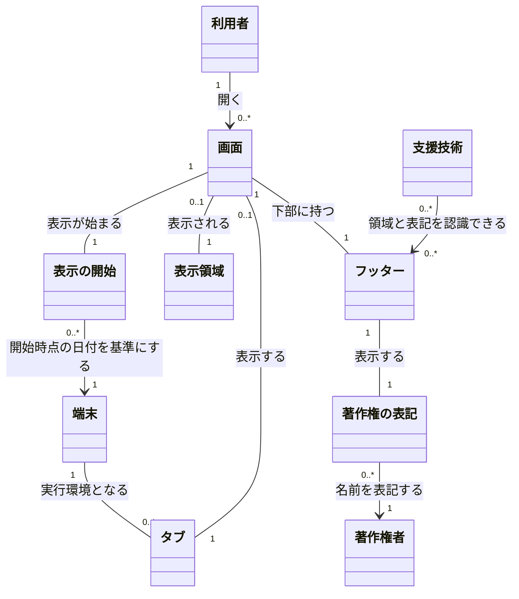

# 概念モデル: 著作権の表記のフッター

## 1. 対象と読み方

[仕様書](specification.md) をもとに、すべての画面に共通のフッターを表示するための概念、関係、制約を定める。用語は仕様書と、仕様書が参照する [要件定義書](requirements.md) の 3 章に従う。

このモデルの「画面」は、画面の種類ではなく、あるタブで表示の開始から終了まで表示される画面を指す。同じパスでも、別のタブで開いた画面や、再読み込み・遷移し直しによって表示が始まった画面は区別する。画面の種類は画面の属性として表す。

関係の多重度は、表示されている画面を対象とする。表示が終わった画面や過去の年を保存することは意味しない。画面が読み込めない場合は、表示される画面もフッターも無い。

## 2. 概念の一覧

| 名前 | 意味 | 主な属性 |
| --- | --- | --- |
| 利用者 | ブラウザーでアプリケーションを使い、著作権の表記を確かめる人。ログインの有無を問わない | この機能で管理する固有の属性は無い |
| 端末 | フッターを表示するブラウザーの実行環境。年を決める際の日付の基準となる | 端末の設定のタイムゾーン、そのタイムゾーンにおける日付 |
| タブ | ブラウザーで画面を開く単位。別のタブの表示とは独立して扱う | この機能で管理する固有の属性は無い |
| 画面 | アプリケーションで表示され、フッターを持つ画面 | 種類: `/` のアプリケーションの画面、`/health` の稼働状況の画面、存在しないパスのエラーの画面。フッターを除いた画面の内容、その高さ (C)、本文の領域 (メインの内容) |
| 表示の開始 | 画面を開く、ブラウザーで再読み込みする、アプリ内で画面を切り替えることによって、新たに表示が始まる出来事 | 契機、開始の時点。その時点の端末の日付を年の根拠とする |
| 表示領域 | ブラウザーで画面を表示する領域。フッターの位置を判断する基準 | 幅、高さ (V) |
| フッター | 画面の下部に置く、すべての画面に共通の領域 | 表示中かどうか、表示の開始で決めた年、表示の高さ (F)、フッターの領域としての役割 (`contentinfo`) |
| 著作権の表記 | 著作権の記号、年、著作権者の名前を並べた文字列 | 記号: `©`。年: フッターの表示の開始で決めた年。文字列: `© <年> Kyro Studios` |
| 著作権者 | 著作権の表記に名前を載せる対象 | 名前: `Kyro Studios` |
| 支援技術 | フッターを画面のフッターの領域として認識し、表記を読み上げるための手段。スクリーンリーダーなど | この機能で管理する固有の属性は無い |

年はフッターの表示の開始で決まる値であり、著作権の表記にはその同じ値を用いる。日付は端末の属性として扱う。本文の領域と画面の内容は画面の構成として扱い、フッターを本文の領域の外に置く条件は制約として記述する。サーバーや API はフッターの表示に関与せず、このモデルの独立した概念にはしない。

## 3. 概念どうしの関係

### 3.1 全体図

図の英字は Mermaid の識別子であり、表示名が概念の名前である。`0..*` は 0 個以上、`0..1` は 0 個または 1 個、`1` は必ず 1 個を表す。

### 3.2 関係の意味と多重度

| 関係 | 多重度と意味 |
| --- | --- |
| 利用者 → 画面 | 利用者は 0 個以上の画面を開ける。各画面は 1 人の利用者が開いたものとして扱う。利用者の識別や認証を要求する関係ではない |
| 端末 → タブ | 1 つの端末で 0 個以上のタブを扱う。各タブの実行環境は 1 つの端末とする。端末やタブの管理機能を設ける意味ではない |
| タブ → 画面 | 各タブで同時に表示されるアプリケーションの画面は最大 1 つ。各画面は 1 つのタブに属する。画面を読み込めない場合や表示を終えた場合、そのタブに表示中の画面は無い |
| 画面 → 表示の開始 | 各画面の表示には、1 回の表示の開始が対応する。各表示の開始で、1 つの画面の表示が始まる。再読み込みや画面の切り替えでは、それまでの表示を終え、新たな表示の開始として扱う |
| 表示の開始 → 端末 | 各表示の開始は、その画面を表示する 1 つの端末の日付を年の基準とする。1 つの端末で 0 回以上の表示の開始が起こり得る。過去の出来事を保存する関係ではない |
| 画面 → 表示領域 | 各画面は、その画面を開いたタブの 1 つの表示領域に表示される。この機能の画面が表示されていない表示領域もあるため、表示領域に対応する表示中の画面は最大 1 つ |
| 画面 → フッター | 表示されている各画面には、必ず 1 つのフッターがある。各フッターは 1 つの画面に属する。すべての画面で同じ決まりを用いるが、表示中の年や状態は各画面について扱う |
| フッター → 著作権の表記 | 各フッターは、1 つの著作権の表記だけを表示する。各表記は 1 つのフッターに表示される。複数のフッターで文字列が同じでも、それぞれの表示として扱う |
| 著作権の表記 → 著作権者 | 各表記は、1 つの著作権者である Kyro Studios の名前を示す。同じ著作権者が 0 個以上の表記に現れる |
| 支援技術 → フッター | 1 つの支援技術は 0 個以上のフッターを認識でき、1 つのフッターは 0 個以上の支援技術から認識の対象となり得る。実際に支援技術を使っていない場合も、認識できることは必須とする |

## 4. 制約

### 4.1 表示する画面と表記

| 番号 | 常に満たす条件 | 仕様書の対応箇所 |
| --- | --- | --- |
| C-1 | 表示されるすべての画面にフッターが 1 つだけある。`/`、`/health`、存在しないパスのエラーの画面に適用し、今後画面が増えても同じ決まりを適用する。再描画で個数は増えない | 2.1、2.4、3.1、3.2、4、5 |
| C-2 | 著作権の表記は `© <年> Kyro Studios` の 1 つだけとする。`©` と年の間、年と `Kyro Studios` の間に半角スペースを 1 つずつ入れる。ほかの文言を付けず、言語、設定、ログインの有無によって変えない | 2.2、3.1、4、7、8 |
| C-3 | 著作権の表記はテキストであり、画像にせず、支援技術から隠さない。幅が狭い場合は折り返して全体を表示し、文字を切ったり隠したりしない | 2.2、2.4、5 |
| C-4 | ページ全体でフッターの領域は 1 つだけとし、支援技術から `contentinfo` のランドマークとして認識できる。フッターは本文の領域の外に置く | 2.4、7、8 |
| C-5 | フッターにはリンクや操作できる部品を置かない。クリックしても状態や表示は変わらず、キーボードのフォーカスはフッターで止まらない。画面ごとの表示の切り替えや、多言語での切り替えを設けない | 2.5、3.4、7、8 |

### 4.2 年と表示の開始

| 番号 | 常に満たす条件 | 仕様書の対応箇所 |
| --- | --- | --- |
| C-6 | 年は、表示の開始の時点における端末の日付の西暦の年とする。UTC の日付ではなく、端末の設定のタイムゾーンの日付を用いる。同じ瞬間でも、端末の日付の年が異なれば表記の年は異なる | 2.3、3.1、3.2、5、7 |
| C-7 | 画面を開く、ブラウザーで再読み込みする、アプリ内のリンクやブラウザーの戻る・進むで画面を切り替えるたびに、年を決め直す。同じ画面へ遷移し直す場合も含める | 2.3、3.1、3.2、6、7 |
| C-8 | 表示の開始からその表示の終了までは年を変えない。年をまたぐ日付の変化や、同じ画面内の操作でも変えない。`/health` の「再読み込み」ボタンは画面内の操作であり、ブラウザーの再読み込みと区別する | 2.3、3.3、4、5、6、7 |
| C-9 | 年が 0 以上 999 以下なら先頭を 0 で埋めて 4 桁にし、1000 以上 9999 以下なら 4 桁で表す。10000 以上は仕様書 7 章の判断に従い、切り詰めず桁数のまま表す。例: `0000`、`0005`、`0999`、`1000`、`9999`、`10000`。負の年は仕様書で扱わず、表示方法を定めない | 2.2、4、5、7 |
| C-10 | クエリ文字列とハッシュは、値の正誤や長さにかかわらず無視し、表記を決める入力にしない。同じ画面を別のタブで開いた場合は、それぞれの表示の開始で年を決め、年と表示を互いに独立して扱う | 3.1、4、5 |

### 4.3 状態と外部の影響

| 番号 | 常に満たす条件 | 仕様書の対応箇所 |
| --- | --- | --- |
| C-11 | フッターの状態は表示中かどうかと、表示の開始で決めた年だけとする。表示の終了時に年を破棄し、次の表示の開始で決め直す。フッター自身には取得中やエラーの状態を設けない | 3.1、3.2、6 |
| C-12 | 年の決定とフッターの表示のために API を呼び出したり通信したりせず、サーバーの状態やデータを変えない。稼働状況の画面の「確認中」「正常」「接続できない」とは独立し、API の接続失敗、500、無応答、表示後のネットワーク切断でもフッターを残す | 2.3、3.1、3.3、4、6、8 |
| C-13 | アプリケーションの画面を読み込めず表示されない場合は、フッターも表示しない。フッターだけを別に表示する仕組みは設けない | 4、5、7 |

### 4.4 フッターの位置

C はフッターを除いた画面の内容の高さ、F はフッターの表示の高さ、V はブラウザーの表示領域の高さとする。本文の領域だけの高さを C とするのではなく、フッターを除いた画面の内容を対象にする。

| 番号 | 常に満たす条件 | 仕様書の対応箇所 |
| --- | --- | --- |
| C-14 | C + F が V 以下なら、フッターの下端を表示領域の下端に合わせ、スクロールせずに見えるようにする。内容との間に空きがあってよい。C + F が V と等しい場合は、内容の直後であり、かつ表示領域の下端にある | 3.5、5、7 |
| C-15 | C + F が V を超える場合は、フッターを内容の直後に置く。表示領域の下端には固定せず、画面の下端までスクロールすると見えるようにする | 3.5、5、7 |
| C-16 | 高さの判定には F を必ず含め、文字列が折り返された場合も実際の表示の高さで判断する。ブラウザーの大きさや画面の内容が変わったときも C-14 と C-15 に従う。この配置の変化で年を決め直さない | 2.3、3.3、3.5、5 |

## 5. 仕様との対応

| 仕様書の箇所 | 関わる概念 | この文書での対応 |
| --- | --- | --- |
| 1. 要件との対応 | 全概念 | 以下の各仕様項目を通じて FR-1 ～ FR-4、NFR-1、NFR-2 と前提を反映する |
| 2.1 表示する画面 | 利用者、画面、フッター | 画面の種類、画面とフッターの関係、C-1 |
| 2.2 表示する文字列 | フッター、著作権の表記、著作権者 | 表記と著作権者の関係、C-2、C-3、C-9 |
| 2.3 年の決め方 | 端末、画面、表示の開始、フッター、著作権の表記 | 表示の開始と端末の関係、C-6 ～ C-8、C-12 |
| 2.4 支援技術からの見え方 | 画面、フッター、著作権の表記、支援技術 | フッターの数、領域の役割、本文の領域との区別、C-1、C-3、C-4 |
| 2.5 この仕様の対象外 | 画面、フッター、著作権の表記 | C-2、C-5、C-12。リンク、多言語切り替え、画面別の表示切り替え、サーバー側の変更を追加しない |
| 3.1 画面を開く (ブラウザーで URL を開く、再読み込みする) | 利用者、端末、画面、表示の開始、フッター、著作権の表記 | 画面・表示の開始・フッターの関係、C-1、C-2、C-6、C-7、C-10 ～ C-12 |
| 3.2 画面を切り替える | タブ、画面、表示の開始、フッター | 表示を終えて新たに開始する関係、C-1、C-6、C-7、C-11 |
| 3.3 同じ画面の中で操作する | 画面、フッター、著作権の表記 | 年と表記を維持し、画面の内容が変われば位置の規則を適用する。C-8、C-12、C-16 |
| 3.4 フッターを操作する | 利用者、フッター | 操作できる部品を置かず、フォーカスを受けないこと。C-5 |
| 3.5 画面の内容の長さと、フッターの位置 | 画面、表示領域、フッター | C、F、V の意味と、等しい場合も含む配置の条件。C-14 ～ C-16 |
| 4. 異常系 | 端末、タブ、画面、表示の開始、フッター、著作権の表記 | エラーの画面、入力の無視、認証不要、重複防止、タブごとの独立性、通信失敗、画面未表示、日付の変化、想定外の年。C-1、C-2、C-8 ～ C-13 |
| 5. 境界値 | 端末、タブ、画面、表示の開始、表示領域、フッター、著作権の表記 | 年の桁数、端末の年の切り替わりとタイムゾーン、C + F と V の境界、折り返し、個数、入力の長さ。C-1、C-3、C-6 ～ C-10、C-13 ～ C-16 |
| 6. 状態の遷移 | 画面、表示の開始、フッター | 表示の開始で年を決め、終了で破棄し、画面内の操作では維持する。C-7、C-8、C-11、C-12 |
| 7. 仕様で定めた判断 | 画面、表示の開始、表示領域、フッター、著作権の表記、支援技術 | エラーの画面、表示の開始の範囲、年の維持と桁数、配置、空白、操作不可、画面未表示、領域の役割。C-1、C-2、C-4 ～ C-9、C-13 ～ C-15 |
| 8. 後の段階への引き継ぎ | 画面、表示領域、フッター、著作権の表記、支援技術 | 全画面共通の制約、配置、領域の役割、通信不要、表記を維持する。構成方法や見た目、API 契約の変更は、このモデルでは追加しない |
