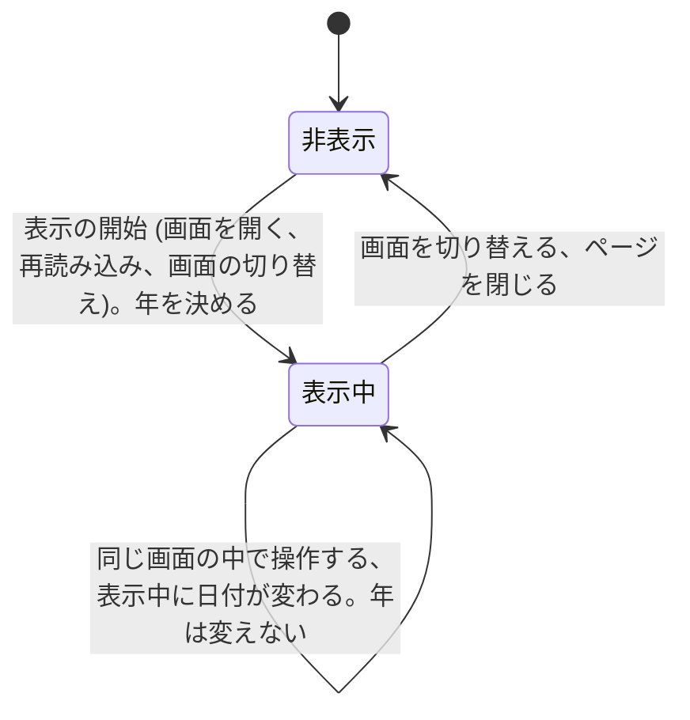

# 仕様書: 著作権の表記のフッター

この文書は、要件定義書 (`requirements.md`) をもとに、フッターが外から見てどう振る舞うかを定める。画面の見た目、技術の選択、データの持ち方は後の段階で決めるため、ここには書かない。用語は要件定義書の 3 章に従う。

## 1. 要件との対応

| 要件 | 要約 | 仕様の該当箇所 |
| --- | --- | --- |
| FR-1 | すべての画面の下部に、フッターを表示する | 2.1、3.1、3.2、4 |
| FR-2 | フッターに `© <年> Kyro Studios` を表示する | 2.2、3.1 |
| FR-3 | 年は、画面を開いたときの端末の日付の年 (西暦 4 桁) にする | 2.3、3.1、3.2、5 |
| FR-4 | 内容が画面の高さに満たないときは画面の下端に、長いときは内容の後にフッターを置く | 3.5、5 |
| NFR-1 | フッターの表示のために、サーバーの API を呼び出さない | 2.3、3.1、4 |
| NFR-2 | 支援技術から、画面のフッターの領域として認識できる | 2.4 |
| 前提 | 利用者は、ブラウザーでアプリケーションを使う | 2.1、3.1 |

## 2. 共通の決まり

### 2.1 表示する画面

- フッターは、アプリケーションのすべての画面に表示する
- 現時点の画面は次の 3 つとする
  - `/`: アプリケーションの画面
  - `/health`: 稼働状況の画面 (`docs/features/1-health-check/specification.md` の 4 章)
  - 存在しないパスを開いたときに表示する、エラーの画面 (7 章の判断)
- 画面が増えても、すべての画面に同じフッターを表示する

### 2.2 表示する文字列

- フッターに表示する文字列は、次の形式の 1 つだけとする: `© <年> Kyro Studios`
- `©` と年の間、年と `Kyro Studios` の間は、半角スペースを 1 つずつ入れる。例: `© 2026 Kyro Studios`
- 年は 2.3 の決め方で決まる、西暦 4 桁の値とする (5 章の境界値を参照)
- 文字列は、利用者の言語や設定によって変えない
- ほかの文言 (利用規約の表記、「All rights reserved」など) は付けない
- 文字列は、画像ではなく、テキストとして表示する

### 2.3 年の決め方

- 年は、端末 (フッターを表示するブラウザーの実行環境) の日付の年とする。UTC ではなく、端末の設定のタイムゾーンにおける日付で決める
- 次のいずれかが起きて画面の表示が新しく始まったことを、この仕様では「表示の開始」と呼ぶ
  - 画面を開く
  - ブラウザーで再読み込みする
  - アプリ内で、別の画面に切り替わる
- 年は、表示の開始のときに決める
- 表示の開始から次の表示の開始までは、年を変えない。表示の間に日付が変わっても、年は変えない
- 年の決め方は、API の呼び出しに関係しない。フッターのために API を呼び出さない (NFR-1)

### 2.4 支援技術からの見え方

- フッターは、画面の下部にある「フッターの領域」として、支援技術から認識できる。ウェブの標準の役割では contentinfo のランドマークにあたる
- フッターの領域は、ページ全体で 1 つだけとする
- フッターは、本文の領域 (メインの内容) の中には入れない
- 著作権の表記は、読み上げられるテキストとして含める。画像にしない、支援技術から隠さない

### 2.5 この仕様の対象外

要件定義書 2.2 のとおり、次は扱わない。

- 利用規約、プライバシーポリシーなど、ほかのページへのリンク。フッターには、リンクや押せる部品を置かない
- 多言語での表示の切り替え
- 画面ごとに、フッターを表示するかどうかを切り替えること
- サーバーの側の変更

## 3. 操作ごとの振る舞い

### 3.1 画面を開く (ブラウザーで URL を開く、再読み込みする)

- 入力: ブラウザーで、2.1 の画面の URL を開く、または再読み込みする。クエリ文字列やハッシュ (`#` 以降) が付いていても、値は使わずに無視する
- 事前の条件: アプリケーションの画面が読み込まれて、表示されていること。ログインは不要。サーバーに接続できるかどうかは問わない
- 処理:
  1. 表示の開始として、端末の日付から年を決める (2.3)
  2. フッターを、画面の下部に 1 つ表示する (位置は 3.5 のとおり)
  3. API を呼び出さない (NFR-1)
- 出力: 2.2 の文字列 (例: `© 2026 Kyro Studios`) を、フッターの領域に表示する
- 状態の変化: 画面の表示が始まり、年が決まる (6 章)。サーバーの状態やデータは変わらない

### 3.2 画面を切り替える

- 入力: アプリ内のリンク、またはブラウザーの戻る・進むで、2.1 の別の画面に切り替える。同じ画面へ遷移し直す場合も含む
- 事前の条件: 切り替え前の画面が表示されていること
- 処理:
  1. 切り替え前の画面の表示を終える
  2. 切り替え先の画面の表示の開始として、年を決め直す (2.3)
  3. 切り替え先の画面の下部に、フッターを 1 つ表示する
- 出力: 切り替え先の画面に、2.2 の文字列を表示する
- 状態の変化: 年は、切り替えた時点の端末の日付の年になる (6 章)

### 3.3 同じ画面の中で操作する

- 入力: 画面の中の操作 (例: `/health` の「再読み込み」ボタン)
- 事前の条件: 画面が表示されていること
- 処理: 画面の中の内容や状態が変わっても、フッターは変えない。年も変えない
- 出力: フッターの表示は、操作の前と同じ
- 状態の変化: フッターについては、なし。例えば、`/health` で「サーバーに接続できません」が表示されても、フッターは残る

### 3.4 フッターを操作する

- 入力: フッターをクリックする、またはキーボードでフッターに移る
- 事前の条件: フッターが表示されていること
- 処理: フッターには操作できる部品が無いため、何もしない。キーボードのフォーカスは、フッターで止まらない
- 出力: 表示の変化は無い
- 状態の変化: なし

### 3.5 画面の内容の長さと、フッターの位置

- 入力: 画面の内容の高さと、ブラウザーの表示領域の高さ。ブラウザーの大きさを変えたときや、内容が変わったときも、この規則に従う
- 処理と出力:
  - 内容が画面の高さに満たないとき: フッターは画面の下端に置く。内容とフッターの間に空きができてよい
  - 内容が画面の高さを超えるとき: フッターは内容の直後に置く。画面の下端には固定しない。利用者が画面の下端までスクロールすると、フッターが見える
  - 内容の高さが画面の高さとちょうど同じとき: フッターは内容の直後にあり、かつ画面の下端にある
- 状態の変化: なし

## 4. 異常系

| 事象 | 振る舞い |
| --- | --- |
| 入力の誤り: クエリ文字列やハッシュが不正 | 値は使わないため、無視して 3.1 と同じように表示する |
| 入力の誤り: 存在しないパスを開いた | 2.1 のエラーの画面にも、フッターを表示する。年は 2.3 のとおりに決める |
| 権限の不足 | 権限による制御は無いため、起きない。ログインの有無に関係なく、同じフッターを表示する |
| 競合: 1 画面に 2 つ以上のフッター | 起こさない。1 画面に 1 つだけ表示する (2.4)。画面の内容が再描画されても、フッターは増えない |
| 競合: 同じ画面を別のタブで開く | 各タブは独立して、それぞれに 1 つのフッターを表示する。年もタブごとに決める |
| 外部の失敗: API に接続できない、API が 500 を返す、応答が無い (稼働状況の画面) | フッターは影響を受けず、表示したままにする (NFR-1)。画面の「サーバーに接続できません」は、稼働状況の機能の仕様に従う |
| 外部の失敗: 表示済みの画面で、ネットワークが切れた | 表示済みのフッターは残す。フッターの表示のために通信はしない |
| 外部の失敗: アプリの画面 (静的ファイル) を読み込めない | 画面が表示されないため、フッターも表示されない。フッターだけを別に表示する仕組みは作らない |
| 表示したまま、日付が変わった (12 月 31 日から 1 月 1 日など) | 年は変えない。新しい年にするには、再読み込みするか、画面を切り替える (2.3、3.1、3.2) |
| 端末の日付が想定外 (西暦 1000 年より前、または 10000 年以降) | 5 章の境界値のとおりに表示する。エラーとして扱わない |

## 5. 境界値

| 項目 | 境界 | 振る舞い |
| --- | --- | --- |
| 年の桁数 | 1000 以上 9999 以下 | 4 桁で表す (例: `1000`、`2026`、`9999`) |
| 年が 1000 より前 | 0 以上 999 以下 | 4 桁になるように、先頭を 0 で埋める (例: `999` は `0999`、`5` は `0005`) |
| 年が 10000 以上 | 10000 以上 | 4 桁に切り詰めず、桁数のまま表す (例: `10000`) |
| 年が切り替わる時刻 | 端末の時刻で 12 月 31 日 23:59:59 と 1 月 1 日 00:00:00 | 表示の開始の時点の年で決まる。12 月 31 日の 23:59:59 に開いた画面は前の年、1 月 1 日の 00:00:00 に開いた画面は新しい年になる |
| タイムゾーンの境界 (例: UTC-12 の端末) | UTC の `2027-01-01T11:59:59Z` と `2027-01-01T12:00:00Z` | 前者は端末の `2026-12-31 23:59:59` なので年は `2026`、後者は端末の `2027-01-01 00:00:00` なので年は `2027` |
| 画面の内容の高さ | 画面の高さより 1 px 短い、ちょうど同じ、1 px 長い | 1 px 短いときは画面の下端に置く。ちょうど同じときは、内容の直後で画面の下端にある。1 px 長いときは内容の直後に置く (3.5) |
| 画面の幅 | 幅が狭い画面 | 文字列は折り返して、全体を表示する。文字を切らず、隠さない |
| 1 画面に表示するフッターの数 | 0 または 1 | 1 つだけ表示する。0 になるのは、アプリの画面が表示されないときだけ (4 章) |
| クエリ文字列・ハッシュの長さ | 上限なし | 値は使わず無視する。長さによって表示が変わることはない |

## 6. 状態の遷移

フッターは、取得中やエラーなどの状態を持たない。持つのは、表示中かどうかと、表示の開始で決めた年だけとする。

| 遷移元 | 遷移先 | 条件 | 年 |
| --- | --- | --- | --- |
| 非表示 | 表示中 | 表示の開始 (画面を開く、再読み込みする、切り替え先の画面が表示される) | 端末の日付から決める |
| 表示中 | 非表示 | 画面を切り替える、ページを閉じる | 破棄する |
| 表示中 | 表示中 | 同じ画面の中で操作する、表示中に日付が変わる | 変えない |

- 画面を切り替えるときは、「表示中」から「非表示」に移り、続けて切り替え先で「非表示」から「表示中」に移る。このため、切り替えのたびに年は決め直される
- フッターの状態は、稼働状況の画面の状態 (「確認中」「正常」「接続できない」) とは独立している

## 7. 仕様で定めた判断

要件定義書に無かったため、この仕様で定めた点を次に挙げる。後の段階は、これらを前提にする。

- 「すべての画面」に、存在しないパスを開いたときのエラーの画面を含める (2.1)。要件の文言を文字どおりに読んだ
- 「画面を開いたとき」は、表示の開始 (画面を開く、再読み込み、画面の切り替え) のこととする。アプリ内の遷移も、画面を開いたこととみなす (2.3)
- 表示中に日付が変わっても、年は変えない。年は表示の開始のときにだけ決める (2.3、6)
- 年が 4 桁に収まらない場合は、5 章のとおりに扱う。負の年は、端末の日付としては扱わず、表示の方法は定めない
- 長い画面では、フッターを画面の下端に固定しない。要件の「内容の後に表示する」を文字どおりに読んだ (3.5)
- 年、`©`、`Kyro Studios` の間は、半角スペース 1 つにする。要件の例 `© 2026 Kyro Studios` に従う (2.2)
- フッターには、リンクや操作できる部品を置かない。要件の対象外 (リンク) に従い、フォーカスも受けない (3.4)
- アプリの画面が表示されないときは、フッターも表示しない。フッターだけを表示する仕組みは作らない (4)
- 支援技術からの認識は、ページ全体で 1 つの「フッターの領域」とする (2.4)。役割の名前は、ウェブの標準の contentinfo に従う

## 8. 後の段階への引き継ぎ

- アーキテクチャ設計では、フッターをすべての画面に共通の枠に置く方法と、存在しないパスのエラーの画面にも表示する方法を決める。3.5 の位置の規則と、2.4 の支援技術からの認識を満たす構成にする
- API の契約 (`docs/api/openapi.yaml`) は変更しない。フッターは API を使わない (NFR-1)
- 表示する文字列は 2.2 のとおりにする。文字列を変える設定や、言語の切り替えは作らない
- 受け入れテストは、この仕様の 2 章、3 章、4 章、5 章の各項目を確かめる。特に次を確かめる
  - `/`、`/health`、存在しないパスの 3 種類の画面に、フッターが 1 つだけあること
  - 端末の日付を変えて、3.1 と 3.2 のとおりに年が決まること。表示中に日付が変わっても、年が変わらないこと
  - フッターの表示のときに、サーバーの API を呼び出さないこと
  - 3.5 の位置の規則を、内容の短い画面と長い画面のそれぞれで確かめること
