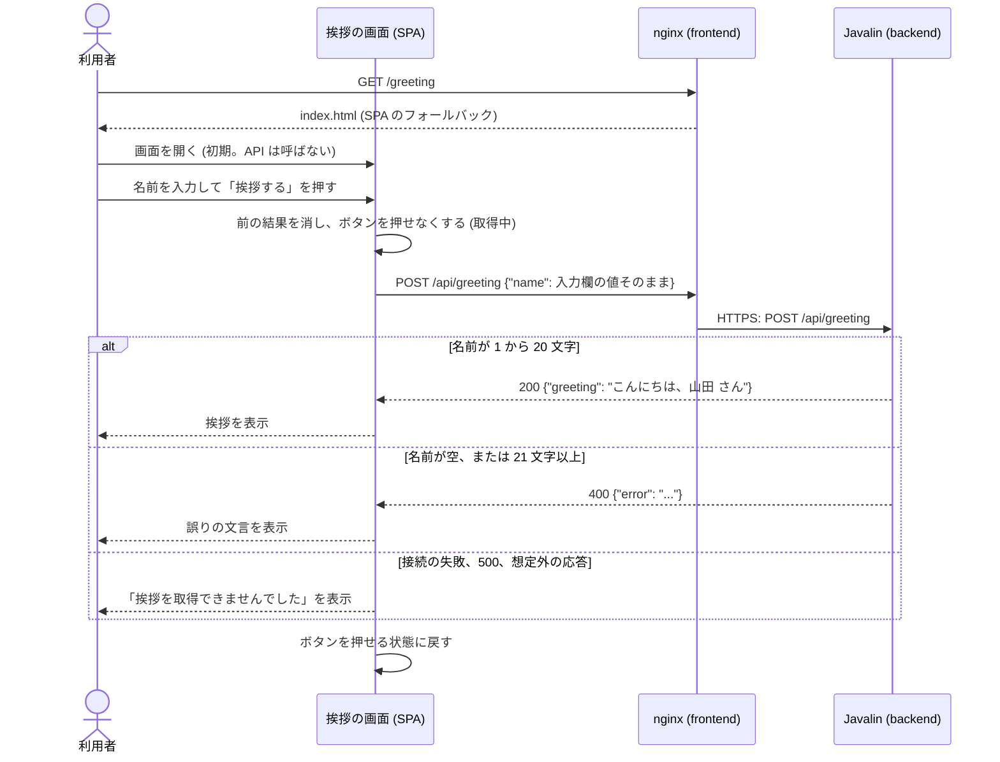

# アーキテクチャ: 名前を入力すると挨拶を表示する

[要件定義書](requirements.md)、[仕様書](specification.md)、[概念モデル](domain-model.md) をもとに、この機能の設計を定める。全体の構成は [`docs/architecture.md`](../../architecture.md)、API の契約は [`docs/api/openapi.yaml`](../../api/openapi.yaml) にある。

## 1. 全体の構成との関係

- 関わるモジュールは、フロントエンド (`app/frontend`、`features/greeting`、`routes`) とバックエンド (`app/backend`、`com.example.app.greeting`、`Application`) の 2 つ。health-check と同じ形の、API と画面の組の機能である
- 全体の構成 (`docs/architecture.md`) の変更点は、次の 3 つだけ。モジュールの追加や、依存の向きの変更は無い
  1. 技術スタックに Jackson (`jackson-databind`) を、バックエンドの依存として加える。理由は 8 章
  2. 4.2 の依存のルールに、機能のパッケージの境界のクラスから Jackson への依存を許す行を足す。機能の処理のクラスは Jackson に依存しない
  3. 4.2 に、`com.example.app.greeting..` が DB に関わるものへ依存しないルールを足す (NFR-4 を機械的に守る)。6 章の機能の一覧にも行を足す
- 既存の API のパスは変えない。`/api/health` と、フッター (`routes/RootLayout.tsx`) への影響は無い。`routes/router.tsx` に `/greeting` の子の経路を足すだけで、共通のフッターは既存の仕組みで付く
- データの保存先 (PostgreSQL) と jOOQ は使わず、導入もしない (NFR-4)
- nginx の設定 (`/api/` の中継) は変えない。`/api/greeting` は既存の中継にそのまま乗る

## 2. 構成要素とやり取り

| 構成要素 | 置き場所 | 役割 |
| --- | --- | --- |
| 挨拶の画面 | `app/frontend/src/features/greeting/` | `/greeting` の画面。入力欄、ボタン、取得の実行、結果の判定と表示 |
| 経路の定義 | `app/frontend/src/routes/router.tsx` | `/greeting` を挨拶の画面に結びつける。`RootLayout` の子とする |
| フロントエンドのサーバー | `app/frontend` の Docker イメージ (nginx) | 静的ファイルの配信、SPA のフォールバック (`/greeting` の直接アクセス)、`/api/` の中継。変更なし |
| 挨拶の API | `app/backend/src/main/java/com/example/app/greeting/` | `POST /api/greeting` に応答する。名前の確かめと挨拶の文の作成 |
| 起動と組み立て | `app/backend/.../Application.java` | `GreetingHandler` の組み立てと、`POST /api/greeting` の登録 |

データの保存先は無い。名前も挨拶も、API の処理の間だけメモリー上にあり、画面は React の状態にだけ持つ。

### 2.1 フロントエンドの内部

`features/greeting/` には次のファイルを置く。

| ファイル | 内容 |
| --- | --- |
| `GreetingPage.tsx` | 画面。入力欄、ボタン、結果の表示を組み立てる。状態は `useGreeting` から受け取る |
| `useGreeting.ts` | 画面が持つ状態と、入力欄の値、「挨拶する」の処理を提供するフック。状態は `idle`、`loading`、`greeting`、`error`、`failed` の 5 つ (仕様書 7 章の初期、取得中、挨拶表示、誤り表示、取得失敗表示に対応)。`loading` の間は取得を始めない |
| `requestGreeting.ts` | `fetch('/api/greeting', { method: 'POST', headers: { 'Content-Type': 'application/json' }, body: JSON.stringify({ name }) })` を呼ぶ。結果を `{ kind: 'greeting', text }`、`{ kind: 'error', text }`、`{ kind: 'failed' }` のいずれかで返す。例外は投げない。待ち時間の上限 (タイムアウトや `AbortController`) は設けない |
| `parseGreetingResponse.ts` | 状態コードと本文の文字列から結果を決める、純粋な関数。判定は仕様書 5.2 の 4 のとおり: 200 で本文が JSON のオブジェクトで `greeting` が文字列なら `greeting`。400 で `error` が文字列なら `error`。それ以外はすべて `failed` |

- 入力欄の値は React の状態として持ち、どの結果でも消さない。前後の空白の除去、空や長さの確かめは、画面ではしない。入力欄に `maxLength` も付けない (仕様書 5.2、6 章)
- 「挨拶する」ボタンは `<button type="button">` とし、Enter での送信は起きないよう `<form>` で囲まない。Radix UI の Primitives に、この機能に必要なボタンの部品は無いため、`shared` のボタンの部品があればそれを使い、無ければ標準の `<button>` を Tailwind CSS で整える (新しい Primitives は足さない)。ラベルは `<label>` と `htmlFor`/`id` で入力欄に結びつける
- 取得中にボタンを押せなくする方法: `disabled` 属性を付ける。`loading` に入る前に、フックの中でも `loading` なら無視する (二重の安全)
- 結果の表示は、React の通常のテキストの描画だけで行い、`dangerouslySetInnerHTML` は使わない (HTML として解釈させない)
- 押した時点で、前の結果を消してから取得を始める。画面を離れた後の応答で状態を更新しない (アンマウント後は無視する)
- 状態は `useState` だけで持つ。`localStorage`、`sessionStorage`、URL のクエリ、Cookie には書かない。別のタブとも共有しない (NFR-1、仕様書 5.3)
- 固定の文言と要素 (仕様書 5.1、NFR-2):

| 要素 | 内容 |
| --- | --- |
| 見出し | 「挨拶」 (`<h1>`) |
| 入力欄 | `<label>` の文言は「名前」、`<input type="text">`。アクセシブルな名前が「名前」になること |
| ボタン | 「挨拶する」 |
| 挨拶の表示 | `role="status"` の要素 (`
`)。挨拶のテキスト |
| 誤りの表示 | `role="alert"` の要素 (`
`)。誤りの文言 (API が返した文字列をそのまま) |
| 取得失敗の表示 | `role="alert"` の要素 (`
`)。「挨拶を取得できませんでした」 |

- `role="status"` と `role="alert"` の要素は、結果が無いときは描画しない。表示するのは 1 つだけ (挨拶と誤りを同時に出さない)。読み上げの確認そのものは受け入れテストの範囲外 (仕様書 2.2) だが、要素の作り方はこのとおりにする

### 2.2 バックエンドの内部

`com.example.app.greeting` には次のクラスを置く。

| クラス | 内容 |
| --- | --- |
| `GreetingResult` | `sealed interface`。`record Greeted(String greeting)` と `record Rejected(String error)` の 2 つだけを許す。Jackson にも Javalin にも依存しない |
| `GreetingService` | `GreetingResult greet(String rawName)` を持つ。処理は 1 前後の空白を除く (下記の 5 つのコードポイント)、2 空なら `Rejected("名前を入力してください")`、3 `codePointCount` が 21 以上なら `Rejected("名前は 20 文字以内で入力してください")`、4 それ以外は `Greeted("こんにちは、" + 名前 + " さん")`。状態を持たず、Javalin にも Jackson にも DB にも依存しない |
| `GreetingHandler` | Javalin の `Handler`。境界。本文を読み、`GreetingService` を呼び、結果を JSON で返す |

- 前後から除く文字は U+0020、U+3000、U+0009、U+000A、U+000D の 5 つのコードポイント (仕様書 3.1 の 4 種類。改行は LF と CR) に限る。`String.strip()`、`trim()` は使わない。先頭から、末尾からそれぞれ、この集合に含まれる間だけ進める (間の空白は残す)
- `GreetingHandler` の本文の読み取り (Jackson の `ObjectMapper.readTree` を使う): 本文を UTF-8 の文字列として読み、JSON として読めない、空、オブジェクトでない、`name` が無い、`name` が文字列のノードでない場合は、`rawName` を空文字列にして `GreetingService` を呼ぶ。読み取りの例外は、ここで受けて空の名前にする (500 にしない)。`Content-Type` は見ない。クエリ文字列は読まない。`name` 以外の項目は読まない
- 応答: `Greeted` なら 200、`Rejected` なら 400。どちらも `Content-Type: application/json` で、本文は `{"greeting": ...}` または `{"error": ...}` の 1 項目だけ。JSON の組み立ては `ObjectMapper` で行う (名前に `"` や `\` や制御文字が含まれても壊れないようにするため)
- `Application` が `GreetingHandler` を組み立て、`.post("/api/greeting", greeting)` を登録する。500 は、既存の `Exception` ハンドラー (`respondInternalError`) が、本文を空にして返す。`POST` 以外のメソッドや他の経路のための処理は足さない (仕様書 4.2 でフレームワークの既定に任せると決めたため)
- ログには、既存と同じく要求の行 (メソッド、パス、状態コード) だけを書く。名前も挨拶もログに書かない (NFR-1)

## 3. 概念モデルとの対応

| 概念 | 対応するもの |
| --- | --- |
| 利用者 | ブラウザー。`app/frontend` の画面を使う。固有のデータは持たない |
| 挨拶の画面 | `GreetingPage` と、経路 `/greeting` (`routes/router.tsx`) |
| 画面の状態 (初期、取得中、挨拶表示、誤り表示、取得失敗表示) | `useGreeting` の状態 `idle`、`loading`、`greeting`、`error`、`failed`。`useState` で画面だけが持ち、タブごとに独立する |
| 入力欄の文字列 | `useGreeting` の状態の `name` (入力欄の値)。保存先に書かない |
| 取得 | `useGreeting` の「挨拶する」の処理と `requestGreeting`。同時に進行するのは 1 つまで (`loading` の間は始めない)。待ち時間の上限は無い |
| 挨拶の API | `GreetingHandler`、`GreetingService`。状態を持たない |
| 要求 | `POST /api/greeting` の HTTP の要求。本文 `name` は、`GreetingHandler` が読み取る |
| 名前 | `GreetingService` の中の、前後の空白を除いた文字列。文字数は `codePointCount`。保存しない |
| 応答 | HTTP の応答。200 は `Greeted`、400 は `Rejected`、500 は本文が空 |
| 挨拶の文 | `Greeted.greeting` (バックエンド)。画面は `parseGreetingResponse` が返す `greeting` の `text` |
| 誤りの文言 | `Rejected.error` (バックエンド)。画面は API が返した文字列をそのまま表示する。文言の定義はバックエンドだけに置く |
| 取得失敗の文言 | フロントエンドの定数 (`GreetingPage` の固定文言)。API は返さない |
| 支援技術 | `<label>`、`role="status"`、`role="alert"` の要素 (2.1) |
| フッター | 既存の `routes/RootLayout.tsx` の `CopyrightFooter`。この機能は変更しない |
| サーバー | バックエンドの Javalin のプロセス (Cloud Run のサービス)。役割としてのみ扱う |

## 4. API

契約は [`docs/api/openapi.yaml`](../../api/openapi.yaml) の `/api/greeting` に書いた。

| メソッド | パス | リクエスト | 応答 |
| --- | --- | --- | --- |
| `POST` | `/api/greeting` | JSON `{"name": "<文字列>"}` | 200 `{"greeting": "こんにちは、<名前> さん"}`、`Content-Type: application/json` |
| `POST` | `/api/greeting` | 同上 (名前が空、または 21 文字以上。`name` の欠落、文字列でない値、JSON として読めない本文を含む) | 400 `{"error": "名前を入力してください"}` または `{"error": "名前は 20 文字以内で入力してください"}` |
| (内部エラー) | `/api/greeting` | | 500、本文なし |

- 認証は無く、401 と 403 は返さない
- 画面の経路 `/greeting` は API の契約に含めない
- `POST` 以外のメソッドの応答は、契約に書かない (仕様書 4.2)。health-check のような 405 の定義は置かない
- 既存のパス (`/api/health`) は変えない。既存の機能への影響は無い

## 5. データの持ち方

- 保存するデータは無い。データベース、ファイル、ブラウザーの保存先を使わない (NFR-1、NFR-4)
- リクエストとレスポンスの構造は、次のとおり。

| 名前 | 項目 | 型 | 内容 |
| --- | --- | --- | --- |
| 要求の本文 | `name` | 文字列 | 利用者が入力したままの値。前後の空白を含んでよい。長さの上限は無い |
| 成功の応答の本文 | `greeting` | 文字列 | `こんにちは、<名前> さん`。この項目だけを持つ |
| 誤りの応答の本文 | `error` | 文字列 | 2 つの誤りの文言のどちらか。この項目だけを持つ |

- 画面の状態は、次の構造を React の状態として持つ。保存先には書かない。

| 項目 | 型 | 内容 |
| --- | --- | --- |
| `name` | 文字列 | 入力欄の値。初期は空文字列 |
| `state` | `idle` / `loading` / `greeting` / `error` / `failed` | 画面の状態 |
| `text` | 文字列 | `greeting` と `error` のときの表示する文。それ以外は無い |

## 6. 非機能要件への対応

| 要件 | 満たす仕組み |
| --- | --- |
| NFR-1: 名前や挨拶を保存しない | バックエンドは、状態を持つフィールド、ファイル、DB を使わず、名前も挨拶もログに書かない。名前は URL に含めず、本文で送る。フロントエンドは `useState` だけで持ち、`localStorage`、`sessionStorage`、Cookie、URL のクエリには書かない。画面を開き直すと初期に戻る。ブラウザーに保存しないことは、受け入れテストで確かめる。サーバーが保存しないことは外から確かめられないため、構造 (`GreetingService` が状態を持たないこと、DB に依存しないこと) で満たす |
| NFR-2: 支援技術から分かる | 入力欄に `<label>` (「名前」) を結びつける。挨拶は `role="status"`、誤りと取得失敗は `role="alert"` の要素に表示する (2.1)。読み上げ自体の確認は、仕様書 2.2 のとおり扱わない |
| NFR-3: 接続できないときの表示 | `requestGreeting` が、接続の失敗 (`fetch` の例外) を含め、200 と、`error` を持つ 400 以外のすべてを `failed` にまとめ、固定の文言「挨拶を取得できませんでした」を表示する。nginx の中継が失敗したとき (502、504 など) も、400 でも `error` が無ければ同様に `failed` になる |
| NFR-4: DB を使わない | `GreetingService` と `GreetingHandler` は DB に接続しない。この機能のために PostgreSQL と jOOQ を依存に加えず、バックエンドは起動時にも接続しない。`com.example.app.greeting..` が `java.sql..`、`javax.sql..`、`org.jooq..`、`org.postgresql..` に依存しないことを ArchUnit で確かめる (全体の構成 4.2) |
| セキュリティ (前提: 利用者 0 人、認証なし) | 認証は入れない。挨拶は React のテキストとして描画し、HTML として解釈しない (`dangerouslySetInnerHTML` を使わない)。API が返す本文は JSON であり、名前は `ObjectMapper` で JSON の文字列としてエスケープする。バックエンドの Cloud Run サービスは、全体の構成 5 章のとおり、認証なしの呼び出しを許可する。それ以上のこと (入力の長さの制限、レート制限など) には備えない (7 章) |
| 性能・可用性・運用 | 要件定義書に数値の要件は無い。処理は文字列の加工だけで、外部への接続が無い。待ち時間の上限は画面側に設けない。nginx の中継の待ち時間は既存の 5 秒のままで、超えれば 504 となり、画面は取得失敗を表示する。ログは既存の方針 (要求の行だけ) に従う。それ以上の備えはしない (7 章) |

## 7. 範囲の判断

「スコープの決め方」に従い、次のとおり判断した。

### 7.1 この設計で扱うこと

- 要件 FR-1 から FR-8、NFR-1 から NFR-4 を満たす構成: 画面とバックエンドの責務の分け方、API の契約、状態の持ち方
- 仕様書 2.1 で受け入れテストの対象とした振る舞いを満たすために必要な、要素の作り方 (ラベル、`role`、`disabled`)
- 仕様書 9 章が引き継いだこと: 契約への書き足し、`/greeting` の経路とフッター、支援技術向けの要素、取得中の無効化の方法
- NFR-4 を機械的に守る ArchUnit のルール (既存の `health` と同じ仕組みで足りるため、費用がほとんど掛からない)

### 7.2 この設計で扱わないこと

- 入力の長さの上限、要求の大きさの制限、レート制限、CORS、CSRF の対策。Javalin の既定の上限を超える本文の扱いも決めない
- 画面側の待ち時間の上限 (タイムアウト)、再試行、取得中の表示の文言。仕様書 5.4 で上限を定めないと決めている
- `POST` 以外のメソッドの 405 の整備 (仕様書 4.2 で対象外)
- 監視、アラート、最小インスタンス数の指定、負荷への備え
- 国際化、複数の言語への対応
- データ取得のライブラリー、状態管理のライブラリーの導入
- 単体テストの細かいケースの列挙 (後の段階の担当者が、7.3 の方針で決める)

### 7.3 テストの方針

後の段階で、これをもとにテストを書く。受け入れテスト (Playwright、`acceptance/`) の範囲は、仕様書 2.1 と受け入れ基準 (`acceptance-criteria.json`) で決まっており、この設計では広げない。

| 対象 | 種類 | 内容 |
| --- | --- | --- |
| `GreetingService` | JUnit | 前後の空白 4 種類の除去、間の空白が残ること、0 文字、1 文字、20 文字、21 文字の境界、絵文字 20 個が受け付けられること。仕様書 3.1 と 6 章の規則の正しさは、ここで確かめる |
| `GreetingHandler` を通した API | JUnit (Javalin のテストツール) | 200 と本文、400 の 2 種類、`name` の欠落、文字列でない値、JSON として読めない本文が空の名前の 400 になること、`name` 以外の項目の無視、`Content-Type: application/json`、本文の項目が 1 つだけ、名前に `"` を含んでも有効な JSON になること |
| 構造 | ArchUnit | 全体の構成 4.2 のルール。`greeting` が DB に関わるものと Jackson (機能の処理のクラス) に依存しないこと |
| `parseGreetingResponse` | Vitest | 200 と `greeting`、400 と `error`、200 だが `greeting` が無い、400 だが `error` が無い、500、JSON でない本文 |
| `useGreeting`、`GreetingPage` | Vitest (Testing Library) | 初期、取得中のボタンの無効化、結果の置き換え、入力欄の値が残ること、`requestGreeting` が例外を投げずに `failed` を返すこと、ラベルと `role` |
| 構造 | dependency-cruiser | 全体の構成 4.1 のルール |
| 画面と API | Playwright (`acceptance/`) | 仕様書 2.1 のとおり。この設計では追加しない |

## 8. 判断の理由

| 判断 | 理由 | 採らなかった選択肢 |
| --- | --- | --- |
| 名前の確かめと挨拶の文の作成を、バックエンドの `GreetingService` 1 か所にまとめる | FR-3、FR-7 と、仕様書 8 章の「確かめを API の 1 か所にまとめる」に従う。規則を 2 か所に書くと食い違うため | 画面でも確かめる: 規則が二重になり、画面が API の誤りの文言を持つ必要が出る |
| `GreetingService` を Javalin と Jackson から分ける | 規則 (空白、コードポイント、境界) を、HTTP なしで JUnit で確かめるため。health の `HealthService` と同じ方針 | `Handler` の中に直接書く: 規則の確認に HTTP が要る |
| `GreetingResult` を `sealed interface` にして、成功と誤りを型で分ける | 呼び出し側が両方を扱うことをコンパイラーが確かめられ、文字列や例外で分岐しないため | 誤りを例外で表す: 想定内の入力の誤りに例外を使うことになり、`Application` の 500 の処理と混ざる。`record(String greeting, String error)`: どちらか一方だけという制約を型で表せない |
| Jackson (`jackson-databind`) を加え、読み取りも書き出しも `ObjectMapper` で行う | 仕様書 4.2 は、`name` の欠落、型の誤り、JSON として読めない本文を、すべて空の名前の 400 にすると定めている。この寛容な読み取りと、名前を含む文字列の正しいエスケープを自前で書くのは誤りやすい。Javalin 6 は JSON の処理を同梱せず、Jackson を既定で自動検出して使う | 固定の書式の文字列で組み立てる (health の方式): 名前は任意の文字列であり、エスケープを誤ると壊れた JSON になる。読み取りも自前で書く必要がある。Gson や Javalin の `ctx.bodyAsClass` で型に束縛する: 型の誤りが例外になり、寛容な扱いにするには結局 `ObjectMapper` の木で読むほうが単純 |
| `POST` + 本文で名前を送る | 仕様書 8 章のとおり。URL は記録に残りやすく、NFR-1 の趣旨に合わないため | `GET /api/greeting?name=`: 名前がアクセスログや履歴に残る |
| 画面を React の `useState` と標準の `fetch` だけで書く | 状態が 5 つで、画面は 1 つ。標準の機能で足りる。health の `useHealthCheck` と同じ形にそろえる | データ取得や状態管理のライブラリー (TanStack Query など): この規模には過剰で、依存が増える |
| 画面側にタイムアウトを設けない | 仕様書 5.4 が上限を定めないと決めたため。実際には nginx の 5 秒で中継が打ち切られ、画面は取得失敗になる | `AbortController` で打ち切る: 仕様に無く、試作の方針 (C > D > Q) に合わない |
| `<form>` を使わず、`type="button"` のボタンにする | 仕様書 5.2 が Enter での取得をしないと定めているため。`<form>` の中の入力欄は Enter で送信が起きる | `<form onSubmit>` で `preventDefault`: Enter で取得が始まってしまう。`onKeyDown` で抑止するより、要素の構造で避けるほうが単純 |
| 取得中のボタンに `disabled` を付ける | 仕様書 5.2 が「押せない」と定めているため。health の `aria-disabled` の方式と違い、この機能は新しい取得を確実に防ぎたい | `aria-disabled` と無視: 押せる見た目と挙動が分かれ、仕様の「押せない」に合わない |
| 挨拶に `role="status"`、誤りと取得失敗に `role="alert"` | NFR-2。誤りは利用者の注意を促すため `alert`、挨拶は結果の通知のため `status` | 全てを `aria-live` の 1 つの領域にまとめる: 挨拶と誤りで読み上げの強さを分けられない |
| 誤りの文言をバックエンドだけに定義し、画面は API の文字列をそのまま表示する | FR-3、FR-7 と、文言の定義を 1 か所にするため | 画面が `error` の種類に応じた文言を持つ: 文言が 2 か所になる |
| 画面を `features/greeting/` に置き、`RootLayout` の子の経路にする | 全体の構成 3 章、4.1 のとおり。フッターが自動で付く | 画面の中でフッターを描画する: 二重になる |
| DB を導入しない | NFR-4。データが無い | 先に PostgreSQL と jOOQ を入れる: 使わない依存が増える |
