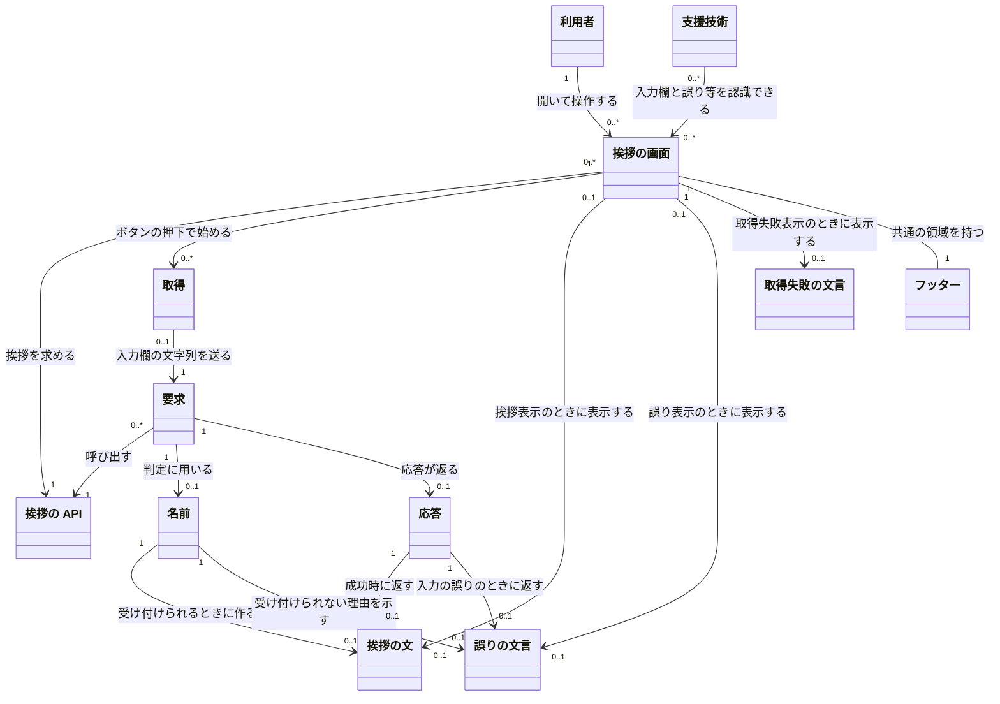

# 概念モデル: 名前を入力すると挨拶を表示する

## 1. 対象と読み方

[仕様書](specification.md) をもとに、名前から挨拶を作り、画面に表示するための概念、関係、制約を定める。用語は仕様書と、仕様書が参照する [要件定義書](requirements.md) の 3 章に従う。

「入力欄の文字列」は利用者が入力したままの値であり、「名前」はその前後の空白を除いた値である。名前には、判定の対象となる空の値や 21 文字以上の値も含める。「挨拶の文」「誤りの文言」「取得失敗の文言」は区別し、まとめて結果と呼ぶ場合も、この 3 つ以外の結果は設けない。

このモデルの「挨拶の画面」は、あるタブで開いている画面を指す。別のタブで開いた画面は別に扱う。要求ごとの名前や文言は、その要求・表示で用いる値を表し、同じ文字列でも要求をまたいで同一のものとして管理しない。関係の多重度は履歴の保存やサーバーの配備構成を意味しない。

## 2. 概念の一覧

| 名前 | 意味 | 主な属性 |
| --- | --- | --- |
| 利用者 | ブラウザーでアプリケーションを使い、名前を入力して挨拶を求める人。ログインは不要 | この機能で管理する固有の属性は無い |
| 挨拶の画面 | 入力した名前について、API から得た挨拶または誤りを表示する画面 | 経路: `/greeting`。名前の入力欄とその文字列。「挨拶する」ボタン。画面の状態: 初期、取得中、挨拶表示、誤り表示、取得失敗表示 |
| 取得 | 「挨拶する」ボタンを押してから、API の応答または接続の失敗を判定するまでの一連の動作 | 押した時点の入力欄の文字列。進行中かどうか。待ち時間の上限は定めない |
| 挨拶の API | サーバーで名前を確かめ、挨拶の文または誤りの文言を返す機能 | 操作: `POST /api/greeting`。自身では状態を持たない |
| 要求 | 挨拶の API に挨拶の作成を求めること。画面を通さない呼び出しも含む | 本文で渡す入力値 (`name`) と、その有無・文字列かどうか。本文が JSON のオブジェクトとして読めるかどうか |
| 名前 | 入力された文字列から、仕様で定めた前後の空白を除いた値。挨拶の作成と誤りの判定に用いる | 前後の空白を除いた文字列。文字数: Unicode のコードポイントの数 |
| 応答 | API が要求に対して返すもの。接続できない場合など、返らないこともある | 状態コード。本文: 挨拶の文 (`greeting`)、誤りの文言 (`error`)、または空 |
| 挨拶の文 | 受け付けられる名前を用いて API が作る文 | 文: `こんにちは、<名前> さん`。名前の後の空白は半角スペース 1 個 |
| 誤りの文言 | 名前を受け付けられない理由を API が返し、画面が表示する文言 | 理由: 名前が空、または 21 文字以上。文言: `名前を入力してください`、または `名前は 20 文字以内で入力してください` |
| 取得失敗の文言 | 接続や応答の問題で挨拶を取得できなかったことを、画面だけで伝える文言 | 文言: `挨拶を取得できませんでした` |
| 支援技術 | 入力欄の用途を認識し、誤りや取得失敗の表示を読み上げるための手段。スクリーンリーダーなど | この機能で管理する固有の属性は無い |
| フッター | 挨拶の画面にも表示される、すべての画面に共通の領域 | 表記などの決まりは、既存の [フッターの仕様書](../25-copyright-footer/specification.md) に従う |

入力欄、その文字列、ボタン、画面の状態は、画面の構成・属性・操作として扱う。空白は名前を求めるための規則、文字数は名前から求める値として扱い、独立した概念にはしない。サーバーは API を提供する役割として扱う。フッターの概念は既存の機能を参照し、この機能で決まりを追加しない。

## 3. 概念どうしの関係

### 3.1 全体図

図の英字は Mermaid の識別子であり、表示名が概念の名前である。`1` は必ず 1 個、`0..1` は 0 個または 1 個、`0..*` は 0 個以上を表す。

### 3.2 関係の意味と多重度

| 関係 | 多重度と意味 |
| --- | --- |
| 利用者 → 挨拶の画面 | 利用者は 0 個以上の画面を開ける。各画面は 1 人の利用者が 1 つのタブで開いたものとして扱う。利用者の識別や認証を要求する関係ではない |
| 挨拶の画面 → 挨拶の API | 各画面が使う API は 1 つ。1 つの API を 0 個以上の画面が使える |
| 挨拶の画面 → 取得 → 要求 | 各取得は 1 つの画面に属し、1 つの要求を行う。画面はボタンを押し直すたびに取得できるため、取得は 0 回以上。同時に進行する取得は各画面で最大 1 つ。直接の API 呼び出しには画面の取得が対応しないため、各要求に対応する取得は最大 1 つ |
| 要求 → 挨拶の API | 各要求は 1 つの API を呼び出す。API は 0 個以上の要求を扱い、要求どうしは影響しない |
| 要求 → 名前 | 各要求について、API が判定するときに 1 つの名前を求める。未到達・未処理の要求ではまだ名前を求めていないため、多重度は最大 1 つ。入力の形が誤っている場合も、判定時には空の名前として扱う。各名前は 1 つの要求で用いる値を表す |
| 要求 → 応答 | 各要求に返る応答は最大 1 つ。取得中や接続失敗では応答が無い場合がある。各応答は 1 つの要求に対応する |
| 名前 → 挨拶の文・誤りの文言 | 各名前から作る挨拶と誤りは、それぞれ最大 1 つ。正常に判定が完了すれば、受け付けられる名前には挨拶だけ、空または 21 文字以上の名前には誤りだけを作る。内部エラーではどちらも返さない。各挨拶・誤りは 1 つの要求の名前についてのもの |
| 応答 → 挨拶の文・誤りの文言 | 各応答に含む挨拶と誤りは、それぞれ最大 1 つで、両方は含まない。成功の応答は挨拶だけ、入力の誤りの応答は誤りだけ、内部エラーの応答はどちらも含まない。各挨拶・誤りは 1 つの応答で返す |
| 挨拶の画面 → 挨拶の文・誤りの文言 | 各画面が同時に表示する挨拶と誤りは、それぞれ最大 1 つで、今回の取得の応答に対応するものだけ。各挨拶・誤りを表示する画面も最大 1 つ。直接の API 呼び出しなど、画面で表示しない場合もある |
| 挨拶の画面 → 取得失敗の文言 | 各画面が同時に表示する取得失敗の文言は最大 1 つで、その画面の取得失敗を表す。API の応答の内容としては扱わない |
| 支援技術 → 挨拶の画面 | 1 つの支援技術は 0 個以上の画面を認識でき、1 つの画面は 0 個以上の支援技術から認識の対象となり得る。実際に使われていなくても、入力欄の用途の認識と、誤り・取得失敗の読み上げは可能にする |
| 挨拶の画面 → フッター | 表示されている各画面には、共通のフッターが 1 つある。各フッターは 1 つの画面に属する |

挨拶・誤り・取得失敗の表示数は、合わせて最大 1 つとする。取得の繰り返しを表す `0..*` は、過去の要求・名前・応答・表示を保存する意味ではない。

## 4. 制約

### 4.1 名前と挨拶の文

| 番号 | 常に満たす条件 | 仕様書の対応箇所 |
| --- | --- | --- |
| C-1 | 名前は、入力文字列の前後から、半角スペース (U+0020)、全角スペース (U+3000)、タブ (U+0009)、改行 (LF: U+000A、CR: U+000D) を連続する分だけすべて除いた値とする。これ以外の文字と、名前の間にある空白は除かない | 3.1、4.1、6、8 |
| C-2 | 文字数は C-1 の後の Unicode のコードポイントの数とする。UTF-16 の単位や、複数のコードポイントをまとめた見た目の文字では数えない。😀 は 1 文字、😀 が 20 個なら 20 文字として扱う | 3.1、6、8 |
| C-3 | 名前の文字数が 1 以上 20 以下なら受け付ける。0 なら `名前を入力してください`、21 以上なら `名前は 20 文字以内で入力してください` とし、挨拶を作らない。前後の空白の個数には上限を設けず、除いた後が 20 文字なら受け付ける | 3.1、4.1、4.2、6 |
| C-4 | 挨拶の文は `こんにちは、`、C-1 の名前、半角スペース 1 個、`さん` の順に並べたものだけとする。例: `山田 太郎` には `こんにちは、山田 太郎 さん`。時刻や言語によって切り替えない | 2、3.1、4.1、6 |

### 4.2 API・要求・応答

| 番号 | 常に満たす条件 | 仕様書の対応箇所 |
| --- | --- | --- |
| C-5 | 名前の前後の空白の除去、文字数の判定、挨拶の文の作成は API が行う。画面を通さない要求にも同じ規則を適用する。API は状態を持たず、繰り返しの要求は互いに影響せず、同じ名前からは同じ挨拶を作る | 4.1、4.2、5.2、7、8 |
| C-6 | 要求は `POST /api/greeting` とし、入力値は JSON のオブジェクトの `name` に文字列として入れ、URL には含めない。クエリ文字列と `name` 以外の項目は無視する。`name` が無い、文字列でない、本文が JSON のオブジェクトとして読めない場合は、空の名前と同じ誤りにし、別の文言は作らない | 3.2、4.1、4.2、8 |
| C-7 | API の成功の応答は状態コード 200 で、本文には文字列の `greeting` だけを含む。入力の誤りの応答は状態コード 400 で、本文には C-3 の文字列の `error` だけを含む。いずれも `Content-Type` は `application/json` とする | 4.1、4.2 |
| C-8 | 予期しない内部エラーの応答は状態コード 500 で本文を空にし、例外の内容や内部の情報を含めない。`POST` 以外のメソッドと `/api/greeting` 以外の経路には、この機能としての応答の決まりを追加しない | 4.2 |
| C-9 | 画面と API はログインや権限の有無によって利用を拒否せず、結果を切り替えない。名前も挨拶もサーバーとブラウザーに保存せず、履歴も持たない。この機能は起動時も含めて DB に接続せず、API は外部の依存先に接続して判定や作成を行わない | 2、4.1、4.2、5.1、5.3、9 |

### 4.3 画面・取得・表示

| 番号 | 常に満たす条件 | 仕様書の対応箇所 |
| --- | --- | --- |
| C-10 | `/greeting` を開くと、入力欄を空にし、結果を表示せず、API を呼ばない。既存の画面からの導線は作らない。別のタブで開く場合や閉じて開き直す場合も、入力値、前の結果、画面の状態を引き継がない | 3.2、5.1、5.3、7、8 |
| C-11 | 入力欄は「名前」という名前で、支援技術から用途を特定できるようにする。入力文字数に上限を設けず、空や 21 文字以上も入力でき、切り詰めない | 5.1、5.2、6、8、9 |
| C-12 | 取得の開始は、取得中でないときの「挨拶する」ボタンの押下だけとする。Enter キーでは取得しない。開始時に前の挨拶・誤り・取得失敗の表示をすべて消し、入力欄の文字列を変更も検証もせず要求の `name` に入れる | 5.2、5.4、7、8 |
| C-13 | 取得中はボタンを押せず、新しい取得を始めない。取得中であることを表す文言は出さない。応答または接続失敗を判定したらボタンを押せる状態に戻す。待ち時間の上限は定めず、応答が無ければブラウザーが接続失敗を返すまで待つ | 5.2、5.4、7、8 |
| C-14 | 状態コード 200 で、本文を JSON として読め、`greeting` が文字列なら、受け取った値をそのまま挨拶として表示する。名前に記号、絵文字、HTML の記号が含まれても、挨拶をテキストとして表示し、HTML として解釈しない | 5.2、5.4、8 |
| C-15 | 状態コード 400 で、本文を JSON として読め、`error` が文字列なら、その値をそのまま誤りとして表示する。API が返すべき文言は C-3 の 2 つだが、画面の判定条件には文言の一致を追加しない | 5.2、5.4、8 |
| C-16 | 接続できない場合と、C-14・C-15 に当てはまらない応答では、`挨拶を取得できませんでした` だけを表示する。500、JSON として読めない本文、200 で `greeting` が無いか文字列でない場合、400 で `error` が無いか文字列でない場合も含む。名前の誤りとは区別し、前の挨拶や誤りを残さない | 3.1、5.2、5.4、8 |
| C-17 | 取得が完了したときに表示する結果は、挨拶、誤り、取得失敗のいずれか 1 つだけとする。入力欄の値は、どの結果でも消さない。取得失敗の後も含め、押し直したときは新しい結果で置き換える。別のタブの取得や表示には影響しない | 5.2、5.4、7 |
| C-18 | 画面の状態は、初期、取得中、挨拶表示、誤り表示、取得失敗表示の 5 つとし、API の状態としては扱わない。結果の表示と状態は下表に対応させる | 5.1 ～ 5.4、7 |
| C-19 | 誤りと取得失敗の表示は、支援技術から読み上げられるようにする。挨拶の画面にも既存の共通フッターを表示する。読み上げやボタンを押せなくする具体的な方法は、アーキテクチャ設計に引き継ぐ | 1、5.1、8、9 |

### 4.4 画面の状態と結果の対応

| 状態 | 表示する結果 | 入力欄・取得・ボタンの条件 |
| --- | --- | --- |
| 初期 | 無し | 画面を開いた時点では入力欄が空。取得は行わず、ボタンは押せる |
| 取得中 | 無し | 押した時点の文字列を送って取得を進める。ボタンは押せない |
| 挨拶表示 | 今回受け取った挨拶の文 1 つ | 入力欄の値は消さず、ボタンは押せる |
| 誤り表示 | 今回受け取った誤りの文言 1 つ | 入力欄の値は消さず、ボタンは押せる |
| 取得失敗表示 | 取得失敗の文言 1 つ | 入力欄の値は消さず、ボタンは押せる |

画面を開くと初期になり、取得中以外でボタンを押すと取得中になる。取得中からは、応答を受け取るか接続が失敗したときだけ、C-14 ～ C-16 に従っていずれかの表示状態になる。画面を開き直すと初期に戻る。

仕様書 7 章の初期の定義は「入力欄が空で、結果は無い」だが、入力だけを行い、まだボタンを押していない時点の状態名は明記されていない。このモデルでは、そのための状態や遷移を新たに定めない。入力できること、開いた時点では空であること、ボタンを押すと取得中になることを、それぞれ仕様書 5.1、5.2、7 章から反映する。

## 5. 仕様との対応

| 仕様書の箇所 | 関わる概念 | この文書での対応 |
| --- | --- | --- |
| 1. 要件との対応 | 全概念 | 以下の各仕様項目を通じて FR-1 ～ FR-8、NFR-1 ～ NFR-4 と前提を反映する |
| 2. 範囲の判断 | 全概念 | 保存、ログイン、言語切り替え、既存の画面からの導線を追加しない。受け入れテストの対象外でも、仕様で定められた条件は制約に含める |
| 3.1 用語と値の決まり | 名前、挨拶の文、誤りの文言、取得失敗の文言 | 入力欄の文字列と名前の区別、C-1 ～ C-4、C-16 |
| 3.2 経路 | 挨拶の画面、挨拶の API、要求 | 各概念の属性、C-6、C-10 |
| 4.1 挨拶を作る | 要求、名前、挨拶の API、応答、挨拶の文、誤りの文言 | 要求・名前・応答・文言の関係、C-1 ～ C-7、C-9 |
| 4.2 異常系 (API) | 要求、名前、挨拶の API、応答、誤りの文言 | 空の名前にまとめる入力の形の誤り、余分な入力の無視、内部エラー、認証不要、要求の独立性、外部への接続不要。C-3、C-5 ～ C-9 |
| 5.1 画面を開く | 利用者、挨拶の画面、支援技術 | 入力欄とボタン、結果無し、取得無し、認証不要。C-9 ～ C-11、4.4 節 |
| 5.2 「挨拶する」ボタンを押す | 挨拶の画面、取得、要求、応答、各文言 | 入力の送信、前の結果の消去、応答の判定と表示、入力値の維持。C-11 ～ C-18、4.4 節 |
| 5.3 画面を開き直す | 挨拶の画面、名前、各文言 | 保存せず、入力欄と表示・状態を初期化する。C-9、C-10、4.4 節 |
| 5.4 異常系 (画面) | 挨拶の画面、取得、応答、各文言 | 入力の誤りと取得失敗の区別、テキスト表示、取得の重複防止、タブごとの独立性、待ち時間、再取得。C-13 ～ C-17 |
| 6. 境界値 | 名前、挨拶の画面、挨拶の文、誤りの文言 | 0・1・20・21 文字の境界、前後と途中の空白、コードポイント、入力欄の上限無し。C-1 ～ C-4、C-11 |
| 7. 状態の遷移 | 挨拶の画面、取得、各文言 | C-12、C-13、C-17、C-18、4.4 節。状態は画面だけに持たせ、入力だけを行った時点の状態は追加しない |
| 8. 仕様で定めた判断 | 挨拶の画面、取得、挨拶の API、要求、応答、名前、各文言 | 経路、項目名、空白、文字数、API での確認、応答の判定、取得中の扱い、Enter キー、待ち時間、文字数上限、欠落・型の誤り、テキスト表示を反映する。C-1 ～ C-3、C-5、C-6、C-10 ～ C-16 |
| 9. 後の段階への引き継ぎ | 挨拶の画面、挨拶の API、名前、応答、支援技術、フッター | 仕様で決まった契約の内容、共通フッター、読み上げ、取得中の操作制限、空白と文字数の定義、起動時を含む DB 接続不要を維持する。C-1、C-2、C-6 ～ C-9、C-13、C-19。技術や具体的な構成方法は追加しない |
