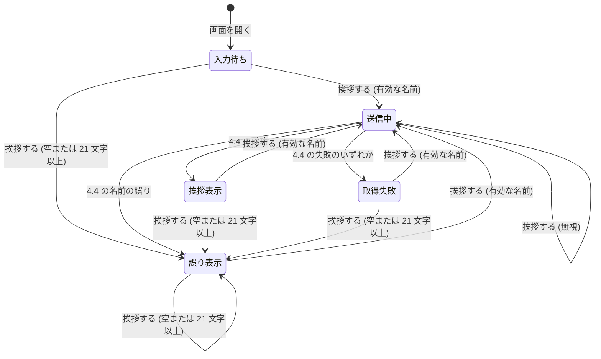

# 仕様書: 名前を入力すると挨拶を表示する

この文書は、要件定義書 (`requirements.md`) をもとに、挨拶の API と挨拶の画面が外から見てどう振る舞うかを定める。画面の見た目、技術の選択、データの持ち方は後の段階で決めるため、ここには書かない。用語は要件定義書の 3 章に従う。

## 1. 要件との対応

| 要件 | 要約 | 仕様の該当箇所 |
| --- | --- | --- |
| FR-1 | 名前の入力欄と「挨拶する」ボタンを表示する | 2.4、4.1 |
| FR-2 | ボタンを押すと、挨拶を画面に表示する | 4.2、4.4 |
| FR-3 | 挨拶の文は API が作り、画面は API の結果をそのまま表示する | 3.1、4.4 |
| FR-4 | 前後の空白を除いてから扱い、挨拶にも空白を除いた名前を使う | 2.2、2.3、3.1、4.2 |
| FR-5 | 空のときは「名前を入力してください」と表示し、挨拶は表示しない | 2.2、2.4、4.2、5 |
| FR-6 | 21 文字以上のときは「名前は 20 文字以内で入力してください」と表示し、挨拶は表示しない。20 文字は受け付ける | 2.2、2.4、4.2、5 |
| FR-7 | API も同じ決まりで名前を確かめ、誤りのときは挨拶を作らず、誤りの文言を返す | 2.2、3.1、3.2、4.4 |
| FR-8 | もう一度押したときは、前の挨拶や誤りを新しい結果で置き換える | 4.2、4.6 |
| NFR-1 | 名前や挨拶を、サーバーにもブラウザーにも保存しない | 3.1、4.1、4.5 |
| NFR-2 | 入力欄に「名前」のラベルを付け、誤りの表示を支援技術から読み上げられるようにする | 2.4、4.1、4.5 |
| NFR-3 | サーバーに接続できないときは「挨拶を取得できませんでした」と表示する | 4.4、4.5 |
| NFR-4 | DB を使わない。API は DB に接続せず、アプリの起動時にも接続しない | 3.1、3.2 |
| 前提 | 利用者はブラウザーで使い、ログインは不要 | 3.3、4.1 |

## 2. 共通の決まり

### 2.1 経路

- 挨拶の API は `POST /api/greeting` とする。名前を URL に含めず、要求の本文 (JSON) で渡す
- 挨拶の画面は `/greeting` とする。要件定義書 2.2 のとおり、既存の画面からの導線は作らない。利用者は URL を直接開いて使う
- 画面は、同じサーバーの `/api/greeting` を呼び出す

### 2.2 名前の扱い

- 空白とは、Unicode の `White_Space` プロパティを持つ文字とする。半角スペース (U+0020)、全角スペース (U+3000)、タブ、改行、ノーブレークスペース (U+00A0) などが含まれる
- 空白でない文字は、空白として除かない。ゼロ幅スペース (U+200B) や BOM (U+FEFF) がこれにあたる
- 名前は、前後の空白を除く。途中の空白は、そのまま残す (例: `山 田` は、そのまま `山 田` として扱う)
- 文字数は、前後の空白を除いたあとの Unicode のコードポイントの数で数える。UTF-16 の長さでは数えない (例: 絵文字の `😀` は 1 文字)。結合文字は、コードポイントごとに 1 文字と数える (例: `か` と結合用の濁点 U+3099 の組は 2 文字)。Unicode の正規化はしない
- 名前の判定は、次の表のとおりに行う。判定は空を先に行う。空は 0 文字なので、両方に当てはまることはない

| 前後の空白を除いたあとの文字数 | 判定 | 誤りの文言 |
| --- | --- | --- |
| 0 文字 | 空 | `名前を入力してください` |
| 1 文字以上 20 文字以下 | 有効 | なし |
| 21 文字以上 | 長すぎる | `名前は 20 文字以内で入力してください` |

- 名前の文字の種類 (記号、英字、数字、絵文字、HTML の記号など) による制限は無い。要件に無いため
- 画面と API は、この決まりで同じ判定をする

### 2.3 挨拶の文

- 挨拶の文は、`こんにちは、<名前> さん` の形にする。「、」は全角の読点とし、「さん」の前の空白は半角のスペース 1 つ (U+0020) とする
- `<名前>` には、2.2 で前後の空白を除いた名前を、そのまま使う。文字は変換せず、エスケープもしない
- 例: 名前が `山田` なら `こんにちは、山田 さん` になる
- 挨拶の文は 1 行の文字列とし、見出しや接頭語は付けない

### 2.4 画面と API で使う文言

| 場面 | 文言 |
| --- | --- |
| 入力欄のラベル | `名前` |
| ボタン | `挨拶する` |
| 空の名前の誤り | `名前を入力してください` |
| 21 文字以上の名前の誤り | `名前は 20 文字以内で入力してください` |
| 挨拶を取得できなかったとき | `挨拶を取得できませんでした` |
| API の形式の誤り (画面には表示しない。3.2 を参照) | `リクエストの形式が正しくありません` |

- 文言は、この表のとおりにする。文言を言語や設定によって変えない

## 3. 挨拶の API

### 3.1 挨拶を作る

- 入力: `POST /api/greeting`。`Content-Type` は `application/json` とする。本文は、次の形式の JSON とする。認証は不要

```json
{"name": "山田"}
```

- 事前の条件: サーバーが要求を受けて、応答を返せること。データベースに接続できるかどうかは、結果に関係しない (NFR-4)
- 処理 (次の順に行う):
  1. 本文を JSON として読み、`name` の値を取り出す。3.2 の形式の誤りに当たるときは、ここで終える
  2. `name` を 2.2 のとおりに判定する
  3. 判定が空または長すぎるなら、3.2 の名前の誤りとして応答する。挨拶は作らない (FR-7)
  4. 判定が有効なら、2.3 のとおりに挨拶の文を作る
  5. 状態は変えない。名前も挨拶も保存せず、アプリケーションが名前を記録する処理は持たない (NFR-1)。データには接続しない (NFR-4)
- 出力 (成功): 状態コード 200、`Content-Type` は `application/json`。本文は次の JSON とし、項目は `greeting` の 1 つだけにする

```json
{"greeting": "こんにちは、山田 さん"}
```

- 出力 (名前の誤り): 状態コード 400、`Content-Type` は `application/json`。本文は `{"error": "<文言>"}` の JSON とし、`greeting` は含めない。文言は 2.4 の空の誤り、または 21 文字以上の誤りのどちらか

```json
{"error": "名前を入力してください"}
```

### 3.2 異常系 (API)

| 事象 | 振る舞い |
| --- | --- |
| 本文が空、または JSON として読めない | 状態コード 400。本文は `{"error": "リクエストの形式が正しくありません"}`。挨拶は作らない |
| `Content-Type` の媒体型が `application/json` でない (文字コードの指定の有無は問わない) | 状態コード 400。本文は上の形式の誤りと同じ |
| JSON だが、`name` が無い、`null`、または文字列でない (数値、配列、真偽値など) | 状態コード 400。本文は上の形式の誤りと同じ |
| `name` が空、または空白だけ | 状態コード 400。本文は `{"error": "名前を入力してください"}` |
| 前後の空白を除いて 21 文字以上 | 状態コード 400。本文は `{"error": "名前は 20 文字以内で入力してください"}` |
| 本文に `name` 以外の項目がある | 項目は使わず無視し、3.1 の処理を行う (有効なら 200) |
| `POST` 以外のメソッド (`GET`、`PUT`、`DELETE` など) | 状態コード 405。`Allow: POST` のヘッダーを付け、本文は空にする |
| `/api/greeting` 以外のパス | この仕様の対象外とする |
| データベースなどの依存するものの障害 | API はデータに接続しないため、結果は変わらず 200 を返す (NFR-4) |
| 予期しない内部エラー | 状態コード 500。本文は空にし、例外の内容や内部の情報を含めない |
| サーバーが停止している、または要求が届かない | 応答は返らない。呼び出した側では接続の失敗になる |
| 名前に HTML の記号などが含まれる | 文字をそのまま使う。エスケープや削除はしない。例: `<b>太郎</b>` は、`こんにちは、<b>太郎</b> さん` になる |

### 3.3 権限

- 認証は無く、権限によって拒否する操作は無い
- 呼び出し元が、ブラウザーか、ほかのプログラムかに関係なく、同じ結果を返す
- 401 や 403 は返さない

### 3.4 同時の要求

- API は状態を持たないため、要求どうしは影響しない
- 同じ名前の要求が同時に来ても、要求ごとに独立して 3.1 の応答を返す。結果は同じ挨拶になる
- 要求の数に上限は設けない

## 4. 挨拶の画面

### 4.1 画面を開く

- 入力: ブラウザーで `/greeting` を開く
- 事前の条件: 利用者が、ブラウザーでアプリケーションを開けること。ログインは不要
- 処理: 画面の状態を「入力待ち」にする (4.6)。入力欄は空にする
- 出力: 次を表示し、挨拶も誤りも取得失敗の文言も表示しない
  - 「名前」というラベルの付いた入力欄 (空)。入力欄には、プレースホルダー (入力のヒントの文字) を表示しない
  - 「挨拶する」ボタン
- 状態の変化: 入力待ち。前の表示は残さない

### 4.2 名前を入力して「挨拶する」を押す

- 入力: 入力欄に名前を入力し、「挨拶する」を押す。入力欄で Enter キーを押した場合も、ボタンを押したときと同じに扱う
- 事前の条件: 画面が開いていること。状態が「送信中」でないこと (4.3)
- 入力欄は、文字数で入力を止めない。21 文字以上の名前も入力でき、誤りとして表示する
- 処理:
  1. 前回の挨拶や誤りの表示を、すべて消す (FR-8)
  2. 入力された名前を 2.2 のとおりに判定する
  3. 判定が空または長すぎるなら、2.4 の誤りの文言を表示する。API は呼び出さない。状態は「誤り表示」になる
  4. 判定が有効なら、前後の空白を除いた名前を、`POST /api/greeting` の `name` に入れて呼び出す。状態は「送信中」になる
  5. 応答を受けたら、4.4 のとおりに表示する
- 出力: 4.4 の表示のどれか 1 つ
- 入力欄の値は変えない。前後の空白も除かず、入力したままの値を残す
- 状態の変化: 4.6 のとおり

### 4.3 送信中の操作

- 入力: 状態が「送信中」の間に、「挨拶する」を押す、または入力欄で Enter キーを押す
- 処理: 何もしない。新しい呼び出しは行わず、進行中の応答を待つ
- 出力: 表示は変わらない。進行中の応答の結果が、そのまま表示される
- 入力欄の編集: 送信中に入力欄の値を変えても、進行中の応答には影響しない。応答の表示は、送信した名前による
- 送信中の画面には、挨拶も誤りも取得失敗の文言も表示しない。待ちを示す文言は、2.4 に無いため表示しない
- 状態の変化: 送信中のまま

### 4.4 API の応答を受けたとき

| 受け取ったもの | 表示 | 状態 |
| --- | --- | --- |
| 2xx で、本文が JSON で、`greeting` が文字列 | `greeting` の値を、そのまま 1 行で表示する | 挨拶表示 |
| 400 で、`error` が 2.4 の空の誤り、または 21 文字以上の誤りの文言と一致する | その `error` の文言を表示する。挨拶は表示しない | 誤り表示 |
| 400 で、上記以外 (形式の誤りなど) | `挨拶を取得できませんでした` | 取得失敗 |
| 2xx だが、本文が JSON でない、`greeting` が無い、または文字列でない | `挨拶を取得できませんでした` | 取得失敗 |
| 2xx 以外で、400 以外 (405、404、500 など) | `挨拶を取得できませんでした` | 取得失敗 |
| 接続できない、または通信の途中で切断された | `挨拶を取得できませんでした` | 取得失敗 |
| 送信から 5 秒を経過しても応答が完了しない | 取得を中断し、`挨拶を取得できませんでした` を表示する。後から届いた応答は表示しない | 取得失敗 |

- 表示は、挨拶表示、誤り表示、取得失敗のどれか 1 つだけにする。ほかの文言は残さない
- 状態の変化: 4.6 のとおり

### 4.5 異常系 (画面)

| 事象 | 画面の振る舞い |
| --- | --- |
| 空、または空白だけを入力して「挨拶する」を押す | `名前を入力してください` を表示する。挨拶は表示しない。API は呼ばない (FR-5) |
| 前後の空白を含めて 26 文字で、空白を除くと 20 文字 | 有効として扱い、挨拶を表示する (FR-4、2.2) |
| 21 文字以上の名前で「挨拶する」を押す | `名前は 20 文字以内で入力してください` を表示する。挨拶は表示しない。API は呼ばない (FR-6) |
| 名前に HTML の記号などが含まれる | 名前の文字を、そのまま文字として表示する。タグとしては解釈せず、太字などの書式も付けない |
| 同じ名前で続けて「挨拶する」を押す | 押すたびに API を呼び出し、同じ挨拶を表示する |
| 挨拶や誤りを表示したあと、ブラウザーで再読み込みする | 入力欄は空になり、挨拶も誤りも表示されない (NFR-1、4.1) |
| サーバーに接続できない | `挨拶を取得できませんでした` を表示する (NFR-3) |
| 誤りや取得失敗の文言が表示される | 支援技術から読み上げられる。入力欄は、ラベル「名前」によって何を入力する欄か分かる (NFR-2) |
| 同じ画面を別のタブで開いて、それぞれで操作する | 各タブは独立して動き、互いの表示に影響しない |

### 4.6 状態の遷移

画面の状態は、次の 5 つとする。

- 入力待ち: 画面を開いた直後、または再読み込みした直後。挨拶も誤りも表示していない
- 送信中: API を呼び出し、応答を待っている
- 挨拶表示: 挨拶の文を表示している
- 誤り表示: 名前の誤りの文言を表示している
- 取得失敗: 「挨拶を取得できませんでした」を表示している



| 遷移元 | 遷移先 | 条件 |
| --- | --- | --- |
| (開始) | 入力待ち | 画面を開く (ブラウザーの再読み込みを含む) |
| 入力待ち、挨拶表示、誤り表示、取得失敗 | 送信中 | 「挨拶する」を押し、名前が有効 (前回の表示は消す) |
| 入力待ち、挨拶表示、誤り表示、取得失敗 | 誤り表示 | 「挨拶する」を押し、名前が空または 21 文字以上 (前回の表示は消す) |
| 送信中 | 挨拶表示 | 4.4 の成功 |
| 送信中 | 誤り表示 | 4.4 の、400 で名前の誤りの文言を返した場合 |
| 送信中 | 取得失敗 | 4.4 の、そのほかの失敗 (接続の失敗、5 秒の経過、2xx 以外、形式の合わない応答) |
| 送信中 | 送信中 | 「挨拶する」を押す (無視する。4.3) |

- 状態は画面だけが持つ。API は状態を持たない (3.4)
- 挨拶表示、誤り表示、取得失敗は、同時に 2 つ以上を表示しない

## 5. 境界値

| 項目 | 下限と上限 | 振る舞い |
| --- | --- | --- |
| 名前の文字数 (前後の空白を除いたあと) | 0 文字 | 空の誤り (`名前を入力してください`)。挨拶は作らない |
| 〃 | 1 文字 | 有効。挨拶を作る (例: `山` は `こんにちは、山 さん`) |
| 〃 | 20 文字 | 有効。挨拶を作る |
| 〃 | 21 文字 | 長すぎる誤り (`名前は 20 文字以内で入力してください`)。挨拶は作らない |
| 前後の空白の数 | 0 個以上 | 数に関係なく、除いたあとの文字数で判定する。前後に空白を付けても、除いたあとが 20 文字なら有効 |
| 途中の空白 | 0 個以上 | 除かず、文字数に含める。例: `山 田` は 3 文字 |
| 空白とみなさない文字 (U+200B など) | 1 文字 | 空白として除かない。`​` だけの名前は 1 文字の有効な名前として扱う |
| 絵文字 | 1 個 = 1 文字 (コードポイント) | 20 個の絵文字は有効。21 個は長すぎる誤り |
| 送信の待ち時間 | 5 秒 | 5 秒を経過する前に完了した応答は、その結果で判定する。5 秒を経過した時点で完了していなければ中断し、取得失敗にする |
| 「挨拶する」の押下 (送信中) | 0 回 (受け付けない) | 送信中の押下は無視する |
| 「挨拶する」の押下 (送信の完了後) | 回数の上限なし | 押すたびに 4.2 の処理を行う |
| API の要求の数 | 上限なし | 要求ごとに独立して応答する |
| 本文の大きさ | 上限は設けない | 名前が 21 文字以上なら 400 を返す。大きさによる拒否は、この仕様では定めない |

## 6. 仕様で定めた判断

要件定義書に無かったため、この仕様で定めた点を次に挙げる。後の段階は、これらを前提にする。

- API の経路は `POST /api/greeting`、画面の経路は `/greeting` とする (2.1)。名前を URL に含めないため、本文で渡す
- 名前の空白は、Unicode の `White_Space` プロパティを持つ文字とする。要件は「空白」とだけ書いているため (2.2)
- 文字数は、前後の空白を除いたあとの Unicode のコードポイントの数で数える。要件の「コードポイントの数」に従い、正規化はしない (2.2)
- 途中の空白は、名前の一部としてそのまま残す。除くのは前後だけとする (2.2)
- 挨拶の文の「さん」の前の空白は、半角のスペース 1 つとする。要件の例 `こんにちは、山田 さん` に従う (2.3)
- API の成功の応答は `greeting`、名前の誤りの応答は `error` の項目で返す。名前の誤りは 400 とする (3.1)
- 形式の誤り (JSON として読めない、`name` が無い、文字列でないなど) は 400 とし、`リクエストの形式が正しくありません` を返す。この文言は画面に表示しない。画面は必ず形式の合う要求を送るため (3.2、4.4)
- 画面も、API と同じ判定を先に行い、空または長すぎるなら API を呼ばない。API の状態に関係なく、FR-5 と FR-6 の誤りを表示するため (4.2)
- 画面が API に送る名前は、前後の空白を除いたものとする。API も同じ判定をする。FR-7 で API を直接呼ぶ場合にも同じ決まりを守るため (3.1、4.2)
- 送信中の「挨拶する」の押下は無視する。応答の順序が入れ替わって、古い結果で新しい結果が上書きされるのを防ぐため (4.3)
- 送信中は、待ちを示す文言を表示しない。要件に文言が無いため (4.3)
- 応答の待ち時間の上限は 5 秒とする。要件に上限が無いため、稼働状況の確認 (`docs/features/1-health-check/specification.md`) と同じ値にする (5)
- 2xx 以外の応答、形式の合わない 2xx の応答、400 以外の 4xx や 5xx は、NFR-3 の「挨拶を取得できない」として扱い、取得失敗の文言を表示する。要件は接続できないときだけを定めているため (4.4)
- 400 で名前の誤りの文言を返したときは、その文言を表示する。画面の判定と API の判定が食い違った場合に備える (4.4)
- 入力欄は文字数で入力を止めない。21 文字以上でも入力させ、FR-6 の誤りを表示する (4.2)
- 入力欄の値は、挨拶の表示のあとも残す。再読み込みすると空に戻る。名前は保存しない (4.2、4.5)
- 入力欄のラベルは「名前」とし、プレースホルダーは表示しない (4.1)
- 名前の文字の種類は制限しない。要件に無いため (2.2)
- 挨拶の文は、画面では文字として表示し、HTML として解釈しない (4.5)
- 入力欄で Enter キーを押したときも、ボタンを押したときと同じに扱う。入力欄の標準の動きに合わせるため (4.2)
- 同じ画面を別のタブで開いた場合は、タブごとに独立させる (4.5)
- 挨拶は、利用者の時刻や言語によって変えない。要件の対象外のため (2.2 の文言)

## 7. 後の段階への引き継ぎ

- アーキテクチャ設計では、3.1 と 3.2 の API の経路、項目、応答を、API の契約 (`docs/api/openapi.yaml`) に書く。この仕様にない経路や項目を足さない
- 画面は `/greeting` に置く。この画面にも、フッターの仕様 (`docs/features/25-copyright-footer/specification.md`) に従い、フッターを表示する
- DB は使わない。PostgreSQL と jOOQ は、この機能の依存に加えない。アプリの起動時にも DB に接続しない (NFR-4)
- 画面と API の判定は、2.2 の決まりを同じ形で守る。文字数の数え方を、画面と API で別々にしない
- 表示する文言は 2.4 のとおりにする。文言を言い換えない
- 受け入れテストは、この仕様の 3 章、4 章、5 章の各項目を確かめる。予期しない内部エラー (500) は、外から再現できないため、受け入れ基準に含めない
