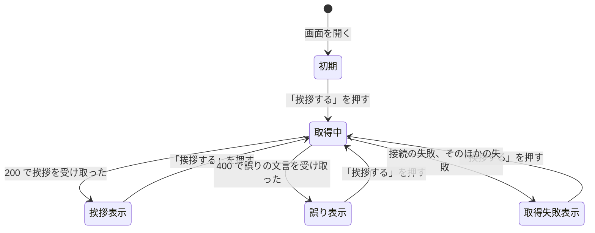

# 仕様書: 名前を入力すると挨拶を表示する

この文書は、要件定義書 (`requirements.md`) をもとに、挨拶の API と挨拶の画面が外から見てどう振る舞うかを定める。画面の見た目、技術の選択、データの持ち方は後の段階で決めるため、ここには書かない。用語は要件定義書の 3 章に従う。

## 1. 要件との対応

| 要件 | 要約 | 仕様の該当箇所 |
| --- | --- | --- |
| FR-1 | 名前の入力欄と「挨拶する」ボタンを表示する | 5.1 |
| FR-2 | ボタンを押すと、挨拶を画面に表示する | 5.2 |
| FR-3 | 挨拶の文は API が作り、画面は API の結果をそのまま表示する | 4.1、5.2 |
| FR-4 | 前後の空白を除いてから扱い、挨拶にも除いた名前を使う | 3.1、4.1、6 |
| FR-5 | 空の名前は「名前を入力してください」と表示し、挨拶は表示しない | 4.1、4.2、5.2、6 |
| FR-6 | 21 文字以上は「名前は 20 文字以内で入力してください」と表示し、20 文字ちょうどは受け付ける | 3.1、4.1、4.2、5.2、6 |
| FR-7 | API も FR-4 から FR-6 と同じ決まりで名前を確かめ、誤りのときは誤りの文言を返す | 4.1、4.2 |
| FR-8 | もう一度押したときは、前の挨拶や誤りを新しい結果で置き換える | 5.2、7 |
| NFR-1 | 名前も挨拶も、サーバーにもブラウザーにも保存しない | 4.1、5.3 |
| NFR-2 | 入力欄は「名前」という名前で特定でき、誤りの表示は支援技術から読み上げられる | 5.1、5.4 |
| NFR-3 | サーバーに接続できないとき、「挨拶を取得できませんでした」と表示する | 5.4 |
| NFR-4 | DB に接続せず、起動時にも DB へ接続しない | 4.2、9 |
| 前提 | 利用者は、ブラウザーでアプリケーションを使う。ログインは不要 | 5.1 |

## 2. 範囲の判断

「スコープの決め方」に従い、次のとおり判断した。判断の材料は次の 2 つとする。

- プロジェクトの背景: 方針は C > D > Q で、品質の水準は「試作」とする。要件を満たしたことの確認に要る振る舞いだけを受け入れテストで確かめ、入力のバリエーションの網羅や、要件に書かれていない状況への備えは行わない
- 機能の事情: 仕組みの動作確認のための小さな機能 (要件定義書 6 章)。要件定義書 2.2 で扱わないと決めた項目 (保存、ログイン、言語による切り替え、既存の画面からの導線) は、この仕様にも含めない

### 2.1 受け入れテストで確かめること

- 挨拶の表示の正常系 (FR-1、FR-2、FR-3)
- 前後の空白を除くこと、空白の種類、文字数の数え方。要件で明記された定義のため、それぞれを 1 ケースずつ確かめる (FR-4、FR-6)
- 空の名前と 21 文字以上の名前の誤り、20 文字ちょうどの受け付け (FR-5、FR-6)
- 押し直しによって、前の結果が新しい結果に置き換わること (FR-8)
- サーバーに接続できないときの表示 (NFR-3)
- 入力欄が「名前」という名前で特定できること、誤りの文言が画面に表示されること (NFR-2 のうち、確かめられる部分)
- 画面を開き直したときに、前の挨拶や誤りが残らないこと (NFR-1 のうち、ブラウザーに保存しないこと)

### 2.2 受け入れテストで確かめないこと

仕様では決めるが、受け入れテストの基準にはしない。

- 入力のバリエーション (記号、HTML の記号、空白の組み合わせ、長さの組み合わせなど)。規則の正しさは単体テストに任せる
- API の入力の形の誤り (`name` の欠落、文字列でない値、JSON として読めない本文)、`POST` 以外のメソッド、内部エラー (500)
- 接続はできたが想定と違う応答を受けたときの画面の表示 (5.4)
- 連続して押すこと、別のタブで同時に操作すること、Enter キーでの取得
- 支援技術での読み上げそのもの。読み上げの確認は、後の段階に任せる
- サーバーが名前や挨拶を保存しないこと (NFR-1)。外から確かめられないため、ブラウザーに保存しないことで代える
- DB に接続しないこと (NFR-4)。アーキテクチャ設計と実装で、DB に依存しない構成にすることで満たす

### 2.3 この判断の理由

- 方針の「試作」と「C > D > Q」により、確かめる範囲を要件の確認に絞る。入力の網羅は費用が大きく、この機能の目的 (仕組みの動作確認) に寄与しない
- 要件が明記した定義 (前後の空白、コードポイント、境界の 20 と 21) は、実装で誤りやすい。そのため、最小限のケースで確かめる
- 機能の事情 (要件定義書 6 章の前提) により、要件に無い状況 (認証、同時操作、外部の障害の細部) には備えない

## 3. 共通の決まり

### 3.1 用語と値の決まり

- 名前: 利用者が入力欄に入力した文字列から、前後の空白を除いたもの。以降の判定と挨拶の文には、この値を使う
- 空白: 半角スペース (U+0020)、全角スペース (U+3000)、タブ (U+0009)、改行 (LF の U+000A と CR の U+000D) の 4 種類とする。これ以外の文字は、空白として扱わない
- 名前の間の空白: 前後以外にある空白は除かず、そのまま残す (例: `山田 太郎` は `山田 太郎` のまま)
- 文字数: 名前の Unicode のコードポイントの数。1 つの絵文字 (例: 😀) は 1 文字として数え、UTF-16 の単位では数えない。文字の組み合わせを 1 つにまとめて数えず、コードポイントを 1 つずつ数える
- 挨拶の文: `こんにちは、` の後に名前を続け、名前の後に半角スペースと `さん` を続けたもの。名前が `山田` なら `こんにちは、山田 さん` になる
- 誤りの文言: 画面と API の両方で使う
  - 名前が空: `名前を入力してください`
  - 名前が 21 文字以上: `名前は 20 文字以内で入力してください`
- 取得失敗の文言 (画面だけで使う): `挨拶を取得できませんでした`

### 3.2 経路

- 挨拶の API: `POST /api/greeting`。経路は `/api` から始まる (`docs/api/openapi.yaml` の決まり)
- 挨拶の画面: `/greeting`

## 4. 操作ごとの振る舞い: API

### 4.1 挨拶を作る

- 入力: `POST /api/greeting`。本文は JSON のオブジェクトとし、項目 `name` に文字列を入れる (例: `{"name": "山田"}`)。名前は本文で受け取り、URL には含めない。認証は不要。クエリ文字列は無視する
- 事前の条件: サーバーが要求を受けて、応答を返せること。DB には接続しない (NFR-4)
- 処理:
  1. 名前を、3.1 のとおり前後の空白を除いた値にする
  2. 名前が空のときは、空の誤りを返す
  3. 名前の文字数が 21 以上のときは、長すぎる誤りを返す
  4. それ以外は、挨拶の文を作って返す
  5. 名前も挨拶も保存しない (NFR-1)
- 出力 (成功): 状態コード 200、`Content-Type` は `application/json`。本文は次の形式とする

```json
{"greeting": "こんにちは、山田 さん"}
```

- 出力 (誤り): 状態コード 400、`Content-Type` は `application/json`。本文は次の形式とし、`error` には 3.1 の誤りの文言を入れる

```json
{"error": "名前を入力してください"}
```

- 項目は、成功のときは `greeting` だけ、誤りのときは `error` だけにする
- 例: 本文 `{"name": "  山田  "}` (前後に半角スペース) は、200 と `{"greeting": "こんにちは、山田 さん"}` を返す
- 状態の変化: なし

### 4.2 異常系 (API)

| 事象 | 振る舞い |
| --- | --- |
| 入力の誤り: 名前が空、または空白だけ | 400 と `{"error": "名前を入力してください"}` を返す (FR-5、FR-7) |
| 入力の誤り: 前後の空白を除いた名前が 21 文字以上 | 400 と `{"error": "名前は 20 文字以内で入力してください"}` を返す (FR-6、FR-7) |
| 入力の誤り: 項目 `name` が無い、文字列でない、または本文が JSON のオブジェクトとして読めない | 名前が空だったものとして扱い、400 と `{"error": "名前を入力してください"}` を返す。この場合のための別の文言は作らない |
| 入力の誤り: `name` 以外の項目がある | 無視して、4.1 の処理をする |
| 権限の不足 | 認証は無く、権限で拒否する操作も無い。ログインの有無に関係なく、同じ応答を返す |
| 競合: 同じ名前で繰り返し要求する | API は状態を持たないため、要求どうしは影響しない。同じ名前には、毎回同じ挨拶を返す |
| 外部の失敗: DB などの依存するものが障害 | API は依存するものに接続しないため、影響を受けず、結果は変わらない (NFR-4) |
| 予期しない内部エラー | 状態コード 500 を返す。本文は空にし、例外の内容や内部の情報を含めない |
| `POST` 以外のメソッド、`/api/greeting` 以外の経路 | この機能の対象外とする。フレームワークの既定の応答に任せ、この仕様では定めない |

## 5. 操作ごとの振る舞い: 画面

### 5.1 画面を開く

- 入力: ブラウザーで `/greeting` を開く。ほかの画面からの導線は作らない (要件定義書 2.2)
- 事前の条件: 利用者がブラウザーでアプリケーションを開けること。ログインは不要
- 処理: 画面を初期の状態で表示する。API は呼ばない
- 出力:
  - 「名前」という名前が付いた入力欄。入力欄は空で表示する。支援技術から、何を入力する欄かが分かるようにする (NFR-2)
  - 「挨拶する」というボタン
  - 挨拶も誤りの文言も表示しない
- 状態の変化: 画面の状態は「初期」になる (7 章)

### 5.2 「挨拶する」ボタンを押す

- 入力: 入力欄の文字列を、空でも、21 文字以上でも入力できる。文字数に上限は設けず、切り詰めない。「挨拶する」ボタンを押す。Enter キーでは取得しない
- 事前の条件: 画面が表示されていること。取得中でないこと (取得中はボタンを押せない。5.4 の競合を参照)
- 処理:
  1. 押した時点で、前の結果 (挨拶、誤り、取得失敗の表示) を消す
  2. ボタンを押せない状態にし、取得中にする
  3. 入力欄の値を、そのまま `POST /api/greeting` の `name` に入れて送る。前後の空白の除去と名前の確かめは API が行う (FR-4、FR-7)。画面では確かめない
  4. 応答を受け取ったら、次のとおり判定する
     - 状態コード 200 のとき: 本文の `greeting` の値を、挨拶として表示する
     - 状態コード 400 で、本文の `error` に文字列があるとき: その文字列を、誤りとして表示する
     - それ以外のとき (接続できない、状態コード 500、想定と違う応答など): 「挨拶を取得できませんでした」を表示する (5.4)
  5. ボタンを押せる状態に戻す
- 出力: 挨拶、誤り、取得失敗のいずれか 1 つを表示する。挨拶と誤りを同時に表示しない。挨拶は、テキストとして表示する
- 状態の変化: 画面の状態は、挨拶表示、誤り表示、取得失敗表示のいずれかになる (7 章)。入力欄の値は、どの結果でも消さない

### 5.3 画面を開き直す

- 入力: 同じブラウザーで `/greeting` を新しく開く (新しいタブで開く、または、ページを閉じてから開き直す)
- 事前の条件: 前に挨拶や誤りが表示されていたこと
- 処理: 画面の状態を、前の表示から引き継がない。名前も挨拶も、ブラウザーに保存しない (NFR-1)
- 出力: 5.1 と同じ初期の表示。前の挨拶や誤りは表示せず、入力欄は空にする
- 状態の変化: 画面の状態は「初期」になる (7 章)

### 5.4 異常系 (画面)

| 事象 | 振る舞い |
| --- | --- |
| 入力の誤り: 空白だけ、または空 | API の 400 の文言 `名前を入力してください` を表示する (5.2) |
| 入力の誤り: 前後の空白を除いて 21 文字以上 | API の 400 の文言 `名前は 20 文字以内で入力してください` を表示する (5.2) |
| 入力の誤り: 記号、絵文字、HTML の記号を含む | 3.1 の規則のとおりに扱い、挨拶はテキストとして表示する。HTML として解釈しない |
| 権限の不足 | 起きない (認証が無い) |
| 競合: 取得中にボタンを押す | ボタンを押せないため、新しい取得は始まらない。取得が終わると、ボタンを押せるようになる |
| 競合: 同じ画面を別のタブで開く | 各タブは独立し、互いの結果に影響しない |
| 外部の失敗: API に接続できない (サーバーが停止しているなど) | 「挨拶を取得できませんでした」を表示する。挨拶と誤りは表示しない (NFR-3) |
| 外部の失敗: 状態コード 500、400 だが `error` が無い、200 だが `greeting` が無いか文字列でない、本文が JSON として読めない | 「挨拶を取得できませんでした」を表示する。挨拶と誤りは表示しない |
| 外部の失敗: 応答が返らない | 待つ時間の上限は、この仕様では定めない。ブラウザーが接続の失敗を返した時点で、「挨拶を取得できませんでした」を表示する |
| 取得失敗のあとに、もう一度押す | 通常どおり取得し、結果で置き換える (FR-8) |

## 6. 境界値

| 項目 | 境界 | 振る舞い |
| --- | --- | --- |
| 名前の文字数 (前後の空白を除いた後) | 0 文字 | 誤り: `名前を入力してください` |
| 名前の文字数 | 1 文字 | 挨拶を表示する |
| 名前の文字数 | 20 文字 | 挨拶を表示する (FR-6。ちょうど 20 文字は受け付ける) |
| 名前の文字数 | 21 文字 | 誤り: `名前は 20 文字以内で入力してください` |
| 前後の空白の数 | 0 個から、数の上限なし | 空白を除いた後の文字数で判定する。前後に空白が付いていても、除いて 20 文字なら受け付ける |
| 絵文字を含む名前 | 絵文字 20 個 (コードポイントで 20 文字、UTF-16 では 40 単位) | 受け付ける。UTF-16 の単位では数えない |
| 入力欄の文字数 | 上限なし | 切り詰めない。21 文字以上も入力でき、5.2 の判定で誤りを表示する |
| 空白の種類 | 半角スペース、全角スペース、タブ、改行 (LF、CR) | 前後から除く。これ以外の文字は除かない |
| 名前の間の空白 | 前後以外 | 除かず、そのまま残す (例: `山田 太郎` は `こんにちは、山田 太郎 さん`) |

## 7. 状態の遷移

画面が持つ状態は、次の 5 つとする。

- 初期: 入力欄が空で、結果は無い
- 取得中: 「挨拶する」を押してから、応答を受け取るか接続が失敗するまで。ボタンは押せない
- 挨拶表示: 挨拶を表示している
- 誤り表示: 誤りの文言を表示している
- 取得失敗表示: 「挨拶を取得できませんでした」を表示している



- 遷移の条件は、5.2 の判定に従う
- 「取得中」から出るのは、応答を受け取ったときと、接続が失敗したときの 2 つだけとする
- 状態は画面だけが持つ。API は状態を持たない
- 画面を開き直すと、状態は「初期」に戻る (5.3)

## 8. 仕様で定めた判断

要件定義書に無かったため、この仕様で定めた点を次に挙げる。後の段階は、これらを前提にする。

- 経路: 画面は `/greeting`、API は `POST /api/greeting` とする (3.2)。画面を `/` にしないのは、`/` が既存のアプリケーションの画面のためである。API を `POST` にして名前を URL に含めないのは、URL は記録に残りやすく、NFR-1 の趣旨に合わないためである
- 導線: 要件定義書 2.2 のとおり、既存の画面からの導線は作らない。利用者は URL を直接開く (5.1)
- 項目名: 名前は `name`、挨拶は `greeting`、誤りは `error` とする (4.1)
- 空白: 空白の種類は 4 種類に限る (3.1)。全角スペースを含めるのは、日本語の入力で使われるためである
- 文字数: コードポイントの数で数える (3.1)。要件の定義に従う
- 入力の確かめ: 画面は入力を確かめずに API へ送る。空の名前や長い名前も送り、API の誤りの文言を表示する (5.2)。確かめを API の 1 か所にまとめるためである
- 誤りの判定: 状態コード 400 で `error` に文字列があるときを誤りとし、それ以外の失敗はすべて「挨拶を取得できませんでした」にまとめる (5.2、5.4)。要件 NFR-3 は接続の失敗だけを定めているため、ほかの失敗も同じ文言で扱う
- 取得中の操作: 取得中はボタンを押せないようにし、取得中であることを表す文言は出さない (5.2)。連続して押す場合の扱いを単純にするためである
- Enter キー: 取得しない (5.2)。要件の「ボタンを押すと」に従う
- 応答の待ち時間: 上限は定めない (5.4)。要件に無いため
- 入力欄の文字数: 上限を設けない (5.1、6 章)。21 文字以上の誤りを API の判定で表示するためである
- 名前の欠落や型の誤り: 空の名前として扱う (4.2)
- 挨拶の文の表示: テキストとして表示する (5.2)。名前に記号が含まれても、そのまま文字として表示する

## 9. 後の段階への引き継ぎ

- アーキテクチャ設計では、次を決める
  - API の契約 (`docs/api/openapi.yaml`) に、4.1 の経路、本文、応答 (200、400、500) を書き足す。項目名は `name`、`greeting`、`error` のとおりにする
  - 画面は `/greeting` の経路として追加する。`docs/features/25-copyright-footer` の 2.1 では、すべての画面に共通のフッターを表示すると定めているため、この画面にもフッターが表示されることを確かめる
  - 入力欄の名前 (5.1)、誤りの表示、取得失敗の表示を、支援技術から読み上げられる形にする。要素の作り方は、この段階で決める
  - 取得中にボタンを押せないようにする方法 (5.2)
- 実装では、次を確かめる
  - 空白は、3.1 の 4 種類を明示して除く。言語の標準の関数 (Java の `strip`、JavaScript の `trim` など) は、除く空白の種類が異なるため、そのまま使わない
  - 文字数は、コードポイントの数で数える (Java の `codePointCount`、JavaScript の `[...s].length` など)。UTF-16 の長さ (`length`) では数えない
  - この機能は DB に接続しない。アプリケーションの起動時にも接続しない (NFR-4)
- 受け入れテストは、2.1 に挙げた振る舞いを確かめる。2.2 に挙げた事項は、単体テストや後の機能に任せる
