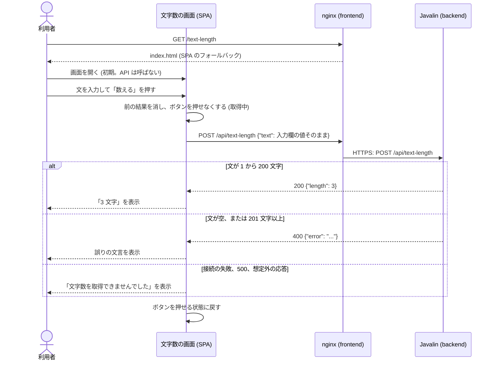

# アーキテクチャ: 入力した文の文字数を表示する

[要件定義書](requirements.md)、[仕様書](specification.md)、[概念モデル](domain-model.md) をもとに、この機能の設計を定める。全体の構成は [`docs/architecture.md`](../../architecture.md)、API の契約は [`docs/api/openapi.yaml`](../../api/openapi.yaml) にある。構成は greeting ([architecture.md](../42-greeting/architecture.md)) と同じ形で、違いは「前後の空白を除かない」「文字数を返す」「200 文字の上限」の 3 点である。

## 1. 全体の構成との関係

- 関わるモジュールは、フロントエンド (`app/frontend`、`features/text-length`、`routes`) とバックエンド (`app/backend`、`com.example.app.textlength`、`Application`) の 2 つ。greeting と同じ、API と画面の組の機能である
- 全体の構成 (`docs/architecture.md`) の変更点は、次の 3 つだけ。モジュールの追加や、依存の向きの変更は無い
  1. 4.2 に、`com.example.app.textlength..` が DB に関わるものへ依存しないルールを足す (NFR-4 を機械的に守る)
  2. 4.2 に、ハイフンを含む機能名の Java のパッケージ名の付け方 (`text-length` → `textlength`) を足す
  3. 6 章の機能の一覧に行を足す
- 技術スタックは変えない。Jackson は greeting で導入済みのため、新しい依存は無い
- 既存の API のパス (`/api/health`、`/api/greeting`) は変えない。`routes/router.tsx` に `/text-length` の子の経路を足すだけで、共通のフッターは既存の仕組み (`RootLayout`) で付く
- データの保存先 (PostgreSQL) と jOOQ は使わず、導入もしない (NFR-4)
- nginx の設定は変えない。`/api/text-length` は既存の `/api/` の中継に乗る

## 2. 構成要素とやり取り

| 構成要素 | 置き場所 | 役割 |
| --- | --- | --- |
| 文字数の画面 | `app/frontend/src/features/text-length/` | `/text-length` の画面。入力欄、ボタン、取得の実行、結果の判定と表示 |
| 経路の定義 | `app/frontend/src/routes/router.tsx` | `/text-length` を文字数の画面に結びつける。`RootLayout` の子とする |
| フロントエンドのサーバー | `app/frontend` の Docker イメージ (nginx) | 静的ファイルの配信、SPA のフォールバック、`/api/` の中継。変更なし |
| 文字数の API | `app/backend/src/main/java/com/example/app/textlength/` | `POST /api/text-length` に応答する。文字数の計算と長さの確かめ |
| 起動と組み立て | `app/backend/.../Application.java` | `TextLengthHandler` の組み立てと、`POST /api/text-length` の登録 |

データの保存先は無い。文も文字数も、API の処理の間だけメモリー上にあり、画面は React の状態にだけ持つ。

### 2.1 フロントエンドの内部

`features/text-length/` には次のファイルを置く。

| ファイル | 内容 |
| --- | --- |
| `TextLengthPage.tsx` | 画面。入力欄、ボタン、結果の表示を組み立てる。状態は `useTextLength` から受け取る |
| `useTextLength.ts` | 画面が持つ状態と、入力欄の値、「数える」の処理を提供するフック。状態は `idle`、`loading`、`length`、`error`、`failed` の 5 つ (仕様書 7 章の初期、取得中、文字数表示、誤り表示、取得失敗表示に対応)。`loading` の間は取得を始めない |
| `requestTextLength.ts` | `fetch('/api/text-length', { method: 'POST', headers: { 'Content-Type': 'application/json' }, body: JSON.stringify({ text }) })` を呼ぶ。結果を `{ kind: 'length', length }`、`{ kind: 'error', text }`、`{ kind: 'failed' }` のいずれかで返す。例外は投げない。待ち時間の上限は設けない |
| `parseTextLengthResponse.ts` | 状態コードと本文の文字列から結果を決める、純粋な関数。判定は仕様書 5.2 の 4 のとおり: 200 で本文が JSON のオブジェクトで `length` が数なら `length`。400 で `error` が文字列なら `error`。それ以外はすべて `failed` |

- 入力欄の値は React の状態として持ち、どの結果でも消さない。画面では、空かどうかや長さの確かめも、文字数の計算もしない。入力欄に `maxLength` も付けない (仕様書 5.2、6 章)。表示する文字数は API が返した `length` をそのまま使い、`[...s].length` などで数え直さない (FR-3)
- 「数える」ボタンは `<button type="button">` とし、Enter での取得は起きないよう `<form>` で囲まない。`shared` のボタンの部品があればそれを使い、無ければ標準の `<button>` を Tailwind CSS で整える (新しい Radix UI の Primitives は足さない)。ラベルは `<label>` と `htmlFor`/`id` で入力欄に結びつける
- 入力欄は `<input type="text">` とする。1 行の入力欄のため、キーボードからは改行を入力できない (貼り付けた改行は、ブラウザーが取り除く)。仕様書 9 章が後の段階に任せた「入力欄が改行を入力できるか」は、「入力できない」と決める。改行を数える規則は API が持ち、直接 API を呼ぶ場合に効く (仕様書 3.1)。この機能の受け入れテストは改行を扱わない (仕様書 2.2)
- 取得中にボタンを押せなくする方法: `disabled` 属性を付ける。フックの中でも `loading` なら取得を始めない (二重の安全)
- 結果の表示は、React の通常のテキストの描画だけで行い、`dangerouslySetInnerHTML` は使わない
- 押した時点で、前の結果を消してから取得を始める。画面を離れた後の応答で状態を更新しない (アンマウント後は無視する)
- 状態は `useState` だけで持つ。`localStorage`、`sessionStorage`、URL のクエリ、Cookie には書かない。別のタブとも共有しない (NFR-1、仕様書 5.3)
- 固定の文言と要素 (仕様書 5.1、NFR-2):

| 要素 | 内容 |
| --- | --- |
| 見出し | 「文字数」 (`<h1>`) |
| 入力欄 | `<label>` の文言は「文」、`<input type="text">`。アクセシブルな名前が「文」になること |
| ボタン | 「数える」 |
| 文字数の表示 | `role="status"` の要素 (`
`)。`<length> 文字` (数字と `文字` の間は半角スペース 1 個) |
| 誤りの表示 | `role="alert"` の要素 (`
`)。誤りの文言 (API が返した文字列をそのまま) |
| 取得失敗の表示 | `role="alert"` の要素 (`
`)。「文字数を取得できませんでした」 |

- `role="status"` と `role="alert"` の要素は、結果が無いときは描画しない。表示するのは 1 つだけ。読み上げの確認そのものは受け入れテストの範囲外 (仕様書 2.2) だが、要素の作り方はこのとおりにする
- 見出しの「文字数」と入力欄の「文」は別の要素である。受け入れテストが `getByLabel('文')` を完全一致で使えるよう、`<label>` の文言は「文」だけにする

### 2.2 バックエンドの内部

`com.example.app.textlength` には次のクラスを置く。

| クラス | 内容 |
| --- | --- |
| `TextLengthResult` | `sealed interface`。`record Counted(int length)` と `record Rejected(String error)` の 2 つだけを許す。Jackson にも Javalin にも依存しない |
| `TextLengthService` | `TextLengthResult count(String text)` を持つ。処理は 1 `codePointCount(0, text.length())` で文字数を求める、2 0 なら `Rejected("文を入力してください")`、3 201 以上なら `Rejected("文は 200 文字以内で入力してください")`、4 それ以外は `Counted(文字数)`。文は変換しない (`strip`、`trim`、正規化をしない)。状態を持たず、Javalin にも Jackson にも DB にも依存しない |
| `TextLengthHandler` | Javalin の `Handler`。境界。本文を読み、`TextLengthService` を呼び、結果を JSON で返す |

- `TextLengthHandler` の本文の読み取り (Jackson の `ObjectMapper.readTree` を使う): 本文を UTF-8 の文字列として読み、JSON として読めない、空、オブジェクトでない、`text` が無い、`text` が文字列のノードでない場合は、`text` を空文字列にして `TextLengthService` を呼ぶ。読み取りの例外は、ここで受けて空の文にする (500 にしない)。`Content-Type` は見ない。クエリ文字列は読まない。`text` 以外の項目は読まない
- 応答: `Counted` なら 200、`Rejected` なら 400。どちらも `Content-Type: application/json` で、本文は `{"length": ...}` または `{"error": ...}` の 1 項目だけ。JSON の組み立ては `ObjectMapper` で行う
- `Application` が `TextLengthHandler` を組み立て、`.post("/api/text-length", textLength)` を登録する。500 は、既存の `Exception` ハンドラー (`respondInternalError`) が、本文を空にして返す。`POST` 以外のメソッドや他の経路のための処理は足さない (仕様書 4.2)
- ログには、既存と同じく要求の行 (メソッド、パス、状態コード) だけを書く。文も文字数もログに書かない (NFR-1)

## 3. 概念モデルとの対応

| 概念 | 対応するもの |
| --- | --- |
| 利用者 | ブラウザー。`app/frontend` の画面を使う。固有のデータは持たない |
| 文字数の画面 | `TextLengthPage` と、経路 `/text-length` (`routes/router.tsx`) |
| 画面の状態 (初期、取得中、文字数表示、誤り表示、取得失敗表示) | `useTextLength` の状態 `idle`、`loading`、`length`、`error`、`failed`。`useState` で画面だけが持ち、タブごとに独立する。入力の編集だけでは状態を変えない (概念モデル 4.4) |
| 取得 | `useTextLength` の「数える」の処理と `requestTextLength`。同時に進行するのは 1 つまで。待ち時間の上限は無い |
| 文字数の API | `TextLengthHandler`、`TextLengthService`。状態を持たない |
| 要求 | `POST /api/text-length` の HTTP の要求。本文 `text` は `TextLengthHandler` が読み取る |
| 文 | 画面では入力欄の値 (`useTextLength` の `text`)。バックエンドでは `TextLengthService.count` の引数。変換せず、保存しない |
| 文字数 | `Counted.length` (`codePointCount`)。画面は `parseTextLengthResponse` が返す `length` を `<length> 文字` の形で表示する |
| 応答 | HTTP の応答。200 は `Counted`、400 は `Rejected`、500 は本文が空 |
| 誤りの文言 | `Rejected.error`。画面は API が返した文字列をそのまま表示する。文言の定義はバックエンドだけに置く |
| 取得失敗の文言 | フロントエンドの定数 (`TextLengthPage` の固定文言)。API は返さない |
| 支援技術 | `<label>`、`role="status"`、`role="alert"` の要素 (2.1) |
| フッター | 既存の `routes/RootLayout.tsx` の `CopyrightFooter`。この機能は変更しない |
| サーバー | バックエンドの Javalin のプロセス (Cloud Run のサービス)。役割としてのみ扱う |

## 4. API

契約は [`docs/api/openapi.yaml`](../../api/openapi.yaml) の `/api/text-length` に書いた。

| メソッド | パス | リクエスト | 応答 |
| --- | --- | --- | --- |
| `POST` | `/api/text-length` | JSON `{"text": "<文字列>"}` | 200 `{"length": <1 から 200 の整数>}`、`Content-Type: application/json` |
| `POST` | `/api/text-length` | 同上 (文が空、または 201 文字以上。`text` の欠落、文字列でない値、JSON として読めない本文を含む) | 400 `{"error": "文を入力してください"}` または `{"error": "文は 200 文字以内で入力してください"}` |
| (内部エラー) | `/api/text-length` | | 500、本文なし |

- 認証は無く、401 と 403 は返さない
- 画面の経路 `/text-length` は API の契約に含めない
- `POST` 以外のメソッドの応答は、契約に書かない (仕様書 4.2)
- 既存のパス (`/api/health`、`/api/greeting`) は変えない。既存の機能への影響は無い

## 5. データの持ち方

- 保存するデータは無い。データベース、ファイル、ブラウザーの保存先を使わない (NFR-1、NFR-4)
- リクエストとレスポンスの構造は、次のとおり。

| 名前 | 項目 | 型 | 内容 |
| --- | --- | --- | --- |
| 要求の本文 | `text` | 文字列 | 利用者が入力したままの値。前後の空白を含んでよい。長さの上限は無い |
| 成功の応答の本文 | `length` | 整数 | 文のコードポイントの数 (1 から 200)。この項目だけを持つ |
| 誤りの応答の本文 | `error` | 文字列 | 2 つの誤りの文言のどちらか。この項目だけを持つ |

- 画面の状態は、次の構造を React の状態として持つ。保存先には書かない。

| 項目 | 型 | 内容 |
| --- | --- | --- |
| `text` | 文字列 | 入力欄の値。初期は空文字列 |
| `state` | `idle` / `loading` / `length` / `error` / `failed` | 画面の状態 |
| `length` | 数 | `length` のときの文字数。それ以外は無い |
| `message` | 文字列 | `error` のときの誤りの文言。それ以外は無い |

## 6. 非機能要件への対応

| 要件 | 満たす仕組み |
| --- | --- |
| NFR-1: 文や文字数を保存しない | バックエンドは、状態を持つフィールド、ファイル、DB を使わず、文も文字数もログに書かない。文は URL に含めず、本文で送る。フロントエンドは `useState` だけで持ち、`localStorage`、`sessionStorage`、Cookie、URL のクエリには書かない。画面を開き直すと初期に戻る。ブラウザーに保存しないことは受け入れテストで確かめる。サーバーが保存しないことは外から確かめられないため、構造 (`TextLengthService` が状態を持たないこと、DB に依存しないこと) で満たす |
| NFR-2: 支援技術から分かる | 入力欄に `<label>` (「文」) を結びつける。文字数は `role="status"`、誤りと取得失敗は `role="alert"` の要素に表示する (2.1)。読み上げ自体の確認は、仕様書 2.2 のとおり扱わない |
| NFR-3: 接続できないときの表示 | `requestTextLength` が、接続の失敗 (`fetch` の例外) を含め、200 で `length` が数のもの、400 で `error` が文字列のもの以外のすべてを `failed` にまとめ、固定の文言「文字数を取得できませんでした」を表示する。nginx の中継が失敗したとき (502、504 など) も同様になる |
| NFR-4: DB を使わない | `TextLengthService` と `TextLengthHandler` は DB に接続しない。PostgreSQL と jOOQ を依存に加えず、バックエンドは起動時にも接続しない。`com.example.app.textlength..` が `java.sql..`、`javax.sql..`、`org.jooq..`、`org.postgresql..` に依存しないことを ArchUnit で確かめる (全体の構成 4.2) |
| セキュリティ (前提: 利用者 0 人、認証なし) | 認証は入れない。結果は React のテキストとして描画し、HTML として解釈しない。API が返す本文は JSON で、`ObjectMapper` で組み立てる。バックエンドの Cloud Run サービスは、全体の構成 5 章のとおり認証なしの呼び出しを許可する。入力の長さの制限、レート制限などには備えない (7 章) |
| 性能・可用性・運用 | 要件定義書に数値の要件は無い。処理は文字数を数えるだけで、外部への接続が無い。画面側に待ち時間の上限は設けない。nginx の中継の待ち時間は既存の設定のままで、超えれば 504 となり、画面は取得失敗を表示する。ログは既存の方針 (要求の行だけ) に従う。それ以上の備えはしない (7 章) |

## 7. 範囲の判断

「スコープの決め方」に従い、次のとおり判断した。

### 7.1 この設計で扱うこと

- 要件 FR-1 から FR-7、NFR-1 から NFR-4 を満たす構成: 画面とバックエンドの責務の分け方、API の契約、状態の持ち方
- 仕様書 9 章が引き継いだこと: 契約への書き足し、`/text-length` の経路とフッター、支援技術向けの要素、取得中の無効化の方法、入力欄が改行を入力できるか (2.1 で決定)
- NFR-4 を機械的に守る ArchUnit のルール (既存の `greeting` と同じ仕組みで、費用がほとんど掛からない)

### 7.2 この設計で扱わないこと

- 入力の長さの上限、要求の大きさの制限、レート制限、CORS、CSRF の対策。Javalin の既定の上限を超える本文の扱いも決めない
- 画面側の待ち時間の上限、再試行、取得中の表示の文言 (仕様書 5.4)
- `POST` 以外のメソッドの 405 の整備 (仕様書 4.2)
- 孤立したサロゲートを含む文字列の扱い (仕様書 4.2)
- 監視、アラート、負荷への備え
- 国際化。データ取得、状態管理のライブラリーの導入
- 単体テストの細かいケースの列挙 (後の段階の担当者が、7.3 の方針で決める)

### 7.3 理由

- プロジェクトの背景の方針は C > D > Q で、品質の水準は「試作」、利用者は 0 人である。このため、要件の確認に要る振る舞いを満たす構成に絞り、要件に無い状況への備えは行わない
- 機能の親 Issue が「仕組みの動作確認のための、DB を使わない小さな機能」としている。このため、greeting と同じ形を流用して設計の費用を抑え、新しい依存や仕組みは足さない

### 7.4 テストの方針

後の段階で、これをもとにテストを書く。受け入れテスト (Playwright、`acceptance/`) の範囲は、仕様書 2.1 と受け入れ基準 (`acceptance-criteria.json`) で決まっており、この設計では広げない。

| 対象 | 種類 | 内容 |
| --- | --- | --- |
| `TextLengthService` | JUnit | 0 文字、1 文字、200 文字、201 文字の境界、前後の空白が除かれないこと、空白だけの文の文字数、絵文字 200 個が 200 文字で受け付けられること、改行が 1 文字ずつ数えられること |
| `TextLengthHandler` を通した API | JUnit (Javalin のテストツール) | 200 と本文、400 の 2 種類、`text` の欠落、文字列でない値、JSON として読めない本文が空の文の 400 になること、`text` 以外の項目の無視、`Content-Type: application/json`、本文の項目が 1 つだけ |
| 構造 | ArchUnit | 全体の構成 4.2 のルール。`textlength` が DB に関わるものと Jackson (機能の処理のクラス) に依存しないこと |
| `parseTextLengthResponse` | Vitest | 200 と `length`、400 と `error`、200 だが `length` が無いか数でない、400 だが `error` が無い、500、JSON でない本文 |
| `useTextLength`、`TextLengthPage` | Vitest (Testing Library) | 初期、取得中のボタンの無効化、結果の置き換え、入力欄の値が残ること、`requestTextLength` が例外を投げずに `failed` を返すこと、ラベルと `role` |
| 構造 | dependency-cruiser | 全体の構成 4.1 のルール |
| 画面と API | Playwright (`acceptance/`) | 仕様書 2.1 のとおり。この設計では追加しない |

## 8. 判断の理由

| 判断 | 理由 | 採らなかった選択肢 |
| --- | --- | --- |
| 文の長さの確かめと文字数の計算を、バックエンドの `TextLengthService` 1 か所にまとめる | FR-3、FR-6 と、仕様書 8 章の「確かめを API の 1 か所にまとめる」に従う。規則を 2 か所に書くと食い違うため | 画面でも数える・確かめる: 規則が二重になり、画面が誤りの文言を持つ必要が出る |
| `TextLengthService` を Javalin と Jackson から分ける | 規則 (コードポイント、境界) を、HTTP なしで JUnit で確かめるため。greeting と同じ方針 | `Handler` の中に直接書く: 規則の確認に HTTP が要る |
| `TextLengthResult` を `sealed interface` にして、成功と誤りを型で分ける | 呼び出し側が両方を扱うことをコンパイラーが確かめられるため。greeting と同じ | 誤りを例外で表す: 想定内の入力の誤りに例外を使うことになり、500 の処理と混ざる |
| 読み取りも書き出しも、導入済みの Jackson の `ObjectMapper` で行う | 仕様書 4.2 は、`text` の欠落、型の誤り、JSON として読めない本文を、すべて空の文の 400 にすると定めている。この寛容な読み取りを木で行うのが単純。greeting で導入済みのため、依存は増えない | 自前で JSON を読む: 誤りやすい。`ctx.bodyAsClass` で型に束縛する: 型の誤りが例外になる |
| 文字数を `codePointCount` で数え、`strip`、`trim` を使わない | 仕様書 3.1 と 9 章。UTF-16 の長さでは絵文字が 2 になり、前後の空白を除くと FR-4 の「入力したとおり」に反するため | `String.length()`: 絵文字 200 個が 400 になる。grapheme (見た目の文字) で数える: 仕様書 3.1 が「コードポイントを 1 つずつ数える」と定めている |
| `POST` + 本文で文を送る | 仕様書 8 章のとおり。URL は記録に残りやすく、NFR-1 の趣旨に合わないため | `GET /api/text-length?text=`: 文がアクセスログや履歴に残る |
| 画面を `useState` と標準の `fetch` だけで書く | 状態が 5 つで、画面は 1 つ。greeting の `useGreeting` と同じ形にそろえる | データ取得や状態管理のライブラリー: この規模には過剰で、依存が増える |
| 画面側にタイムアウトを設けない | 仕様書 5.4 が上限を定めないと決めたため。実際には nginx の中継の打ち切りで、画面は取得失敗になる | `AbortController` で打ち切る: 仕様に無く、試作の方針に合わない |
| `<form>` を使わず、`type="button"` のボタンにする | 仕様書 5.2 が Enter での取得をしないと定めているため | `<form onSubmit>` で `preventDefault`: Enter で取得が始まってしまう |
| 取得中のボタンに `disabled` を付ける | 仕様書 5.2 が「押せない」と定めているため | `aria-disabled` と無視: 押せる見た目と挙動が分かれる |
| 入力欄を 1 行の `<input type="text">` にする (改行を入力できない) | 仕様書 9 章が後の段階に任せた点。要件に改行の入力が無く、受け入れテストでも扱わないため、最も単純な部品にする。改行の規則は API が持つ | `<textarea>`: 改行を入力できるが、要件に無い振る舞いが増え、確かめる範囲も広がる |
| 文字数に `role="status"`、誤りと取得失敗に `role="alert"` | NFR-2。greeting と同じ | 全てを `aria-live` の 1 つの領域にまとめる: 読み上げの強さを分けられない |
| 誤りの文言をバックエンドだけに定義し、画面は API の文字列をそのまま表示する | FR-3、FR-6 と、文言の定義を 1 か所にするため | 画面が `error` の種類に応じた文言を持つ: 文言が 2 か所になる |
| 画面を `features/text-length/` に置き、`RootLayout` の子の経路にする | 全体の構成 3 章、4.1 のとおり。フッターが自動で付く | 画面の中でフッターを描画する: 二重になる |
| Java のパッケージ名を `textlength` にする | Java のパッケージ名にハイフンは使えないため。全体の構成 4.2 に規則として足した | `text_length`: Java の慣例に合わない |
| DB を導入しない | NFR-4。データが無い | 先に PostgreSQL と jOOQ を入れる: 使わない依存が増える |
