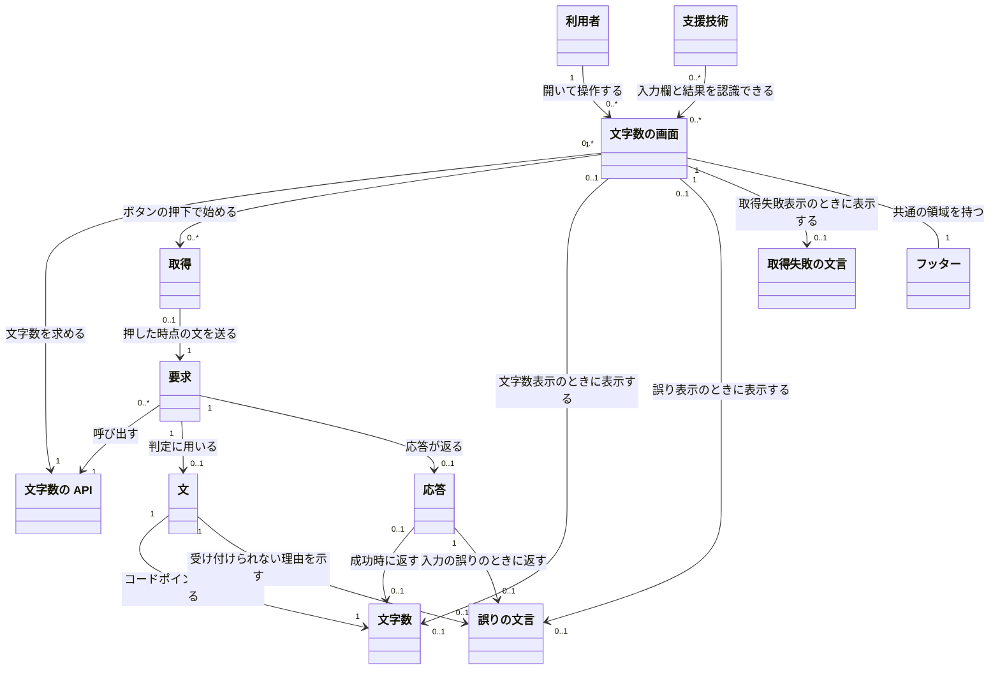

# 概念モデル: 入力した文の文字数を表示する

## 1. 対象と読み方

[仕様書](specification.md) をもとに、文の文字数を数え、画面に表示するための概念、関係、制約を定める。用語は仕様書と、仕様書が参照する [要件定義書](requirements.md) の 3 章に従う。

「文」は入力されたままの文字列であり、空の文や 201 文字以上の文も含む。「文字数」は文から求める値であり、受け付けられない文にも文字数は定まる。ただし、API が文字数を返すのは、1 文字以上 200 文字以下の文を受け付けたときだけである。「文字数」「誤りの文言」「取得失敗の文言」は区別する。

このモデルの「文字数の画面」は、あるタブで開いている画面を指す。別のタブの画面は別に扱う。要求に用いる文は、ボタンを押した時点の入力欄の値である。図の文や文字数は、それぞれの要求で用いる値を表し、同じ値を要求間で共有して管理する意味ではない。関係の多重度は履歴の保存やサーバーの配備構成を意味しない。

## 2. 概念の一覧

| 名前 | 意味 | 主な属性 |
| --- | --- | --- |
| 利用者 | ブラウザーでアプリケーションを使い、文を入力して文字数を求める人。ログインは不要 | この機能で管理する固有の属性は無い |
| 文字数の画面 | 文を入力し、API から得た文字数または誤りを表示する画面 | 経路: `/text-length`。名前が「文」の入力欄とその値。「数える」ボタン。状態: 初期、取得中、文字数表示、誤り表示、取得失敗表示 |
| 取得 | 「数える」ボタンを押してから、API の応答または接続の失敗を判定するまでの一連の動作 | 押した時点の入力欄の値。進行中かどうか。待ち時間の上限は定めない |
| 文字数の API | サーバーで文の文字数を数え、受け付けられる長さかを確かめる機能 | 操作: `POST /api/text-length`。自身では状態を持たない |
| 要求 | 文字数の API に、文の文字数を数えるよう求めること。画面を通さない呼び出しも含む | 本文の入力値 (`text`) と、その有無・文字列かどうか。本文が JSON のオブジェクトとして読めるかどうか |
| 文 | 利用者が入力した文字列。前後の空白を含め、入力されたとおりに数える対象 | 文字列。入力の形が誤っている場合は、判定上、空の文として扱う |
| 文字数 | 文に含まれる Unicode のコードポイントの数 | 0 以上の整数。文から求める値。画面の表示形式は `<文字数> 文字` |
| 応答 | API が要求に対して返すもの。接続できない場合など、返らないこともある | 状態コード。本文: 文字数 (`length`)、誤りの文言 (`error`)、または空 |
| 誤りの文言 | 文を受け付けられない理由を API が返し、画面が表示する文言 | 理由: 文が空、または 201 文字以上。文言: `文を入力してください`、または `文は 200 文字以内で入力してください` |
| 取得失敗の文言 | 接続や応答の問題で文字数を取得できなかったことを、画面だけで伝える文言 | 文言: `文字数を取得できませんでした` |
| 支援技術 | 入力欄の用途を認識し、結果の表示を読み上げるための手段。スクリーンリーダーなど | この機能で管理する固有の属性は無い |
| フッター | 文字数の画面にも表示される、すべての画面に共通の領域 | 表記や配置などの決まりは、既存の [フッターの仕様書](../25-copyright-footer/specification.md) に従う |

入力欄、ボタン、画面の状態は、画面の構成・属性・操作として扱う。空白、改行、絵文字、記号は文を構成する文字として、コードポイントは文字数を求める単位として扱う。サーバーは API を提供する役割として扱う。これらのために独立した概念を追加しない。フッターの決まりも、この機能では追加しない。

## 3. 概念どうしの関係

### 3.1 全体図

図の英字は Mermaid の識別子であり、表示名が概念の名前である。`1` は必ず 1 個、`0..1` は 0 個または 1 個、`0..*` は 0 個以上を表す。

### 3.2 関係の意味と多重度

| 関係 | 多重度と意味 |
| --- | --- |
| 利用者 → 文字数の画面 | 利用者は 0 個以上の画面を開ける。各画面は 1 人の利用者が 1 つのタブで開いたものとして扱う。利用者の識別や認証を要求する関係ではない |
| 文字数の画面 → 文字数の API | 各画面が使う API は 1 つ。1 つの API を 0 個以上の画面が使える |
| 文字数の画面 → 取得 → 要求 | 各取得は 1 つの画面に属し、1 つの要求を行う。画面は繰り返し取得できるため、取得は 0 回以上。ただし、各画面で同時に進行する取得は最大 1 つ。直接の API 呼び出しには画面の取得が対応しないため、各要求に対応する取得は最大 1 つ |
| 要求 → 文字数の API | 各要求は 1 つの API を呼び出す。API は 0 個以上の要求を扱い、要求どうしは影響しない |
| 要求 → 文 | 各要求について、API が判定するときに 1 つの文を用いる。未到達・未処理の要求ではまだ文を扱っていないため、多重度は最大 1 つ。入力の形が誤っている場合も、判定上は空の文として扱う。各文は 1 つの要求で用いる値を表す |
| 文 → 文字数 | 各文の文字数は必ず 1 つに定まる。各文字数は、その要求の 1 つの文から求める値である。空の文の 0 や、長すぎる文の 201 以上も、この関係には含む |
| 文 → 誤りの文言 | 各文に対応する誤りの文言は最大 1 つ。正常に判定が完了した場合、空または 201 文字以上の文だけに誤りの文言が対応する。各誤りは 1 つの要求の文についてのもの |
| 要求 → 応答 | 各要求に返る応答は最大 1 つ。取得中や接続失敗では応答が無い場合がある。各応答は 1 つの要求に対応する |
| 応答 → 文字数・誤りの文言 | 各応答に含む文字数と誤りの文言は、それぞれ最大 1 つで、両方は含まない。成功なら文字数だけ、入力の誤りなら誤りの文言だけ、内部エラーならどちらも含まない。各文字数を返す応答は最大 1 つであり、受け付けられない文の文字数は返さない。各誤りの文言は 1 つの応答で返す |
| 文字数の画面 → 文字数・誤りの文言 | 各画面が同時に表示する文字数と誤りの文言は、それぞれ最大 1 つで、今回の取得の応答に対応するものだけ。各文字数・誤りを表示する画面も最大 1 つ。直接の API 呼び出しなど、画面で表示しない場合もある |
| 文字数の画面 → 取得失敗の文言 | 各画面が同時に表示する取得失敗の文言は最大 1 つで、その画面の取得失敗を表す。API の応答の内容としては扱わない |
| 支援技術 → 文字数の画面 | 1 つの支援技術は 0 個以上の画面を認識でき、1 つの画面は 0 個以上の支援技術から認識の対象となり得る。実際に使われていなくても、入力欄の用途の認識と、文字数・誤り・取得失敗の読み上げは可能にする |
| 文字数の画面 → フッター | 表示されている各画面には、共通のフッターが 1 つある。各フッターは 1 つの画面に属する |

文字数・誤り・取得失敗の表示数は、合わせて最大 1 つとする。取得の繰り返しを表す `0..*` は、過去の要求・文・文字数・応答・表示を保存する意味ではない。

## 4. 制約

### 4.1 文・文字数・誤りの文言

| 番号 | 常に満たす条件 | 仕様書の対応箇所 |
| --- | --- | --- |
| C-1 | 文は入力されたとおりに扱い、前後の空白の除去、切り詰め、文字の組み合わせをまとめる変換を行わない。空白だけの文も、0 文字でなければ空とはみなさない | 3.1、4.1、5.2、5.4、6、8 |
| C-2 | 文字数は文の Unicode のコードポイントの数である。UTF-16 の単位や、複数のコードポイントをまとめた見た目の文字では数えない。`あいう` は 3、`😀` は 1、`😀` が 200 個なら 200 とする。組み合わせのある絵文字も、コードポイントごとに数える | 3.1、6、8 |
| C-3 | 半角スペース、全角スペース、タブ、改行も、ほかの文字と同じく 1 コードポイントずつ数える。LF と CR が続く場合は合計 2 文字。半角スペース 3 個は 3 文字、前後に半角スペース 1 個ずつを含む ` あ ` は 3 文字とする | 3.1、4.1、5.4、6、8 |
| C-4 | 文の文字数が 1 以上 200 以下なら受け付ける。0 なら `文を入力してください`、201 以上なら `文は 200 文字以内で入力してください` を返し、文字数を返さない。1 文字と 200 文字ちょうどは受け付ける | 3.1、4.1、4.2、6 |

### 4.2 API・要求・応答

| 番号 | 常に満たす条件 | 仕様書の対応箇所 |
| --- | --- | --- |
| C-5 | 文字数の計算と文の長さの確認は API が行う。画面を通さない要求にも同じ規則を適用する。API は状態を持たず、要求どうしは影響しない。正常に判定できる場合、同じ文には毎回同じ応答を返す | 4.1、4.2、5.2、7、8 |
| C-6 | 要求は `POST /api/text-length` とし、文は JSON のオブジェクトの `text` に文字列として入れ、URL には含めない。クエリ文字列と `text` 以外の項目は無視する。`text` が無い、文字列でない、本文が JSON のオブジェクトとして読めない場合は、空の文と同じ誤りにし、別の文言は作らない | 3.2、4.1、4.2、8 |
| C-7 | 成功の応答は状態コード 200 で、本文には C-2 の文字数を表す数の `length` だけを含む。入力の誤りの応答は状態コード 400 で、本文には C-4 の文字列の `error` だけを含む。いずれも `Content-Type` は `application/json` とする | 4.1、4.2 |
| C-8 | 予期しない内部エラーの応答は状態コード 500 で本文を空にし、例外の内容や内部の情報を含めない。`POST` 以外のメソッドと `/api/text-length` 以外の経路の応答は、この機能では定めない。要求本文の大きさの上限や、孤立したサロゲートを含む文字列の扱いも、このモデルでは追加しない | 4.2 |
| C-9 | 画面と API はログインや権限の有無によって利用を拒否せず、結果を切り替えない。文も文字数もサーバーとブラウザーに保存せず、履歴を持たない。この機能は起動時も含めて DB に接続せず、API は外部の依存先に接続せずに文の確認と計算を行う | 2、4.1、4.2、5.1、5.3、9 |

### 4.3 画面・取得・表示

| 番号 | 常に満たす条件 | 仕様書の対応箇所 |
| --- | --- | --- |
| C-10 | `/text-length` を開くと入力欄を空にし、結果を表示せず、API を呼ばない。既存の画面からの導線は作らない。新しいタブで開く場合や、閉じてから開き直す場合も、前の入力・結果・状態を引き継がない | 3.2、5.1、5.3、7、8 |
| C-11 | 入力欄は「文」という名前で、支援技術から用途を特定できるようにする。入力文字数に上限を設けず、空や 201 文字以上も入力でき、切り詰めない | 5.1、5.2、6、8、9 |
| C-12 | 取得の開始は、取得中でないときの「数える」ボタンの押下だけとする。Enter キーでは取得しない。開始時に前の文字数・誤り・取得失敗の表示をすべて消し、押した時点の入力欄の値を変更も検証もせず要求の `text` に入れる | 5.2、5.4、7、8 |
| C-13 | 取得中はボタンを押せず、新しい取得を始めない。取得中であることを表す文言は出さない。応答または接続失敗を判定したらボタンを押せる状態に戻す。待ち時間の上限は定めず、応答が無ければブラウザーが接続失敗を返すまで待つ | 5.2、5.4、7、8 |
| C-14 | 状態コード 200 で、本文を JSON として読め、`length` が数なら、その値をそのまま表示する。半角の数字、半角スペース 1 個、`文字` の順に並べ、区切りの記号を付けない。例: `3 文字`。画面で文字数を計算し直したり、値の範囲を確かめたりする条件は追加しない。記号、絵文字、HTML の記号を含む文も C-2 に従って数え、結果は HTML として解釈せずテキストとして表示する | 3.1、5.2、5.4、8 |
| C-15 | 状態コード 400 で、本文を JSON として読め、`error` が文字列なら、その値をそのまま誤りとして表示する。API が返すべき文言は C-4 の 2 つだが、画面の判定条件には文言の一致を追加しない | 5.2、5.4、8 |
| C-16 | 接続できない場合と、C-14・C-15 に当てはまらない応答では、`文字数を取得できませんでした` だけを表示する。500、JSON として読めない本文、200 で `length` が無いか数でない場合、400 で `error` が無いか文字列でない場合も含む。文の長さの誤りとは区別し、文字数や誤りの文言は表示しない | 3.1、5.2、5.4、8 |
| C-17 | 取得が完了したときに表示する結果は、文字数、誤り、取得失敗のいずれか 1 つだけとする。どの結果でも入力欄の値を消さない。取得失敗の後も含め、押し直したときは新しい結果で置き換える。別のタブの入力・取得・表示には影響しない | 5.2、5.4、7 |
| C-18 | 状態は画面だけが持ち、初期、取得中、文字数表示、誤り表示、取得失敗表示の 5 つとする。表示と状態は 4.4 節のとおり対応させる | 5.1 ～ 5.4、7 |
| C-19 | 文字数・誤り・取得失敗の表示は、支援技術から読み上げられるようにする。文字数の画面にも既存の共通フッターを表示し、表示や配置はフッターの仕様に従う。取得や結果の変化でフッターの表示や年を変えない | 5.1、8、9、フッターの仕様書 2、3.3、3.5 |

### 4.4 画面の状態と結果の対応

| 状態 | 表示する結果 | 入力欄・取得・ボタンの条件 |
| --- | --- | --- |
| 初期 | 無し | 画面を開いた時点では入力欄が空。取得は行わず、ボタンは押せる |
| 取得中 | 無し | 押した時点の文で取得を進める。ボタンは押せない |
| 文字数表示 | 今回受け取った文字数 1 つ | 入力欄の値は消さず、ボタンは押せる |
| 誤り表示 | 今回受け取った誤りの文言 1 つ | 入力欄の値は消さず、ボタンは押せる |
| 取得失敗表示 | 取得失敗の文言 1 つ | 入力欄の値は消さず、ボタンは押せる |

画面を開くと初期になり、取得中以外でボタンを押すと取得中になる。取得中からは、応答を受け取るか接続が失敗したときだけ、C-14 ～ C-16 に従っていずれかの表示状態になる。画面を開き直すと初期に戻る。

仕様書 7 章の初期の定義は「入力欄が空で、結果は無い」だが、入力だけを行い、まだボタンを押していない時点の状態名は明記されていない。入力欄の編集だけで起きる状態遷移も定められていないため、このモデルでは新たな状態や遷移を追加しない。入力できること、開いた時点では空であること、押した時点の文で取得することを、それぞれ仕様書 5.1、5.2、7 章から反映する。

## 5. 仕様との対応

| 仕様書の箇所 | 関わる概念 | この文書での対応 |
| --- | --- | --- |
| 1. 要件との対応 | 全概念 | 以下の各仕様項目を通じて FR-1 ～ FR-7、NFR-1 ～ NFR-4 と前提を反映する |
| 2. 範囲の判断 | 全概念 | 保存、ログイン、ほかの数え方、既存の画面からの導線を追加しない。受け入れテストの対象外でも、仕様で定められた条件は制約に含める |
| 3.1 用語と値の決まり | 文、文字数、誤りの文言、取得失敗の文言 | C-1 ～ C-4、C-14、C-16。コードポイント、空白・改行、文字数の範囲、文言、表示形式 |
| 3.2 経路 | 文字数の画面、文字数の API、要求 | 各概念の属性、C-6、C-10 |
| 4.1 文字数を数える | 要求、文、文字数、文字数の API、応答、誤りの文言 | 要求・文・文字数・応答の関係、C-1 ～ C-7、C-9 |
| 4.2 異常系 (API) | 要求、文、文字数の API、応答、誤りの文言 | 入力の形の誤り、余分な入力の無視、内部エラー、認証不要、要求の独立性、外部への接続不要。未定義の事項を含め、C-4 ～ C-9 に対応する |
| 5.1 画面を開く | 利用者、文字数の画面、支援技術、フッター | 入力欄とボタン、結果無し、取得無し、認証不要、共通フッター。C-9 ～ C-11、C-19、4.4 節 |
| 5.2 「数える」ボタンを押す | 文字数の画面、取得、要求、文、応答、文字数、各文言 | 入力の送信、前の結果の消去、応答の判定と表示、入力値の維持。C-11 ～ C-18、4.4 節 |
| 5.3 画面を開き直す | 文字数の画面、文、文字数、各文言 | 保存せず、入力欄と表示・状態を初期化する。C-9、C-10、4.4 節 |
| 5.4 異常系 (画面) | 文字数の画面、取得、文、文字数、応答、各文言 | 空白・記号の扱い、誤りと取得失敗の区別、取得の重複防止、タブごとの独立性、待ち時間、再取得。C-1 ～ C-4、C-13 ～ C-17 |
| 6. 境界値 | 文、文字数、文字数の画面、誤りの文言 | 0・1・200・201 文字、空白だけの文、前後の空白、200 個の絵文字、入力欄の上限無し。C-1 ～ C-4、C-11 |
| 7. 状態の遷移 | 文字数の画面、取得、文字数、各文言 | C-12、C-13、C-17、C-18、4.4 節。状態は画面だけに持たせ、入力の編集だけで起きる遷移を追加しない |
| 8. 仕様で定めた判断 | 文字数の画面、取得、文字数の API、要求、応答、文、文字数、各文言、フッター | 経路、項目名、空白・改行、コードポイント、表示形式、API での確認、応答の判定、取得中の扱い、Enter キー、待ち時間、入力欄の上限、共通フッター。C-1 ～ C-19 |
| 9. 後の段階への引き継ぎ | 文字数の画面、文字数の API、文、文字数、応答、支援技術、フッター | 仕様で決まった契約、共通フッター、読み上げ、取得中の操作制限、コードポイントと空白の扱い、起動時を含む DB 接続不要を維持する。入力欄が改行を入力できるか、読み上げや操作制限の具体的な方法は、アーキテクチャ設計で決める |
